# Lila

**Lila** is a personal fork of the [XiaoZhi AI Chatbot](https://github.com/78/xiaozhi-esp32),
the open-source ESP32 voice assistant created by [78](https://github.com/78) and the
XiaoZhi community. My daughter **Sophie** chose the name, so this little assistant is
called Lila from here on.

The credit for everything that makes this firmware work belongs to the upstream
project: the audio pipeline, the ESP-SR wake-word engines, the 138 board ports, the
WebSocket and MQTT/UDP protocols, the MCP server, the documentation and years of
careful engineering. Thank you, 78, and thank you to everyone who contributed there.
Lila only adds a few personal touches on top, and it inherits the upstream MIT license.

If you are looking for the canonical project, its documentation, its release matrix or
community support, please start at
[78/xiaozhi-esp32](https://github.com/78/xiaozhi-esp32). Everything from the
*An MCP-based Chatbot* heading below is the upstream README, kept intact so Lila users
can still follow it.

## What Lila adds over upstream

Every change is additive: without a `.env` file and without API credentials, a Lila
build behaves exactly like upstream.

- **Configured builds from `.env`** — `scripts/build_lila.py` reads board, variant,
  language, wake word, display panel, API credentials, extra sdkconfig and zip options
  from `.env` (see `.env.example`) and forwards them to `scripts/build.py`.
  `--dry-run` prints the exact command.
- **Custom MultiNet wake words from the CLI** — `scripts/build.py --wake-word
  custom:<word>` turns any word into a MultiNet custom command, which
  `scripts/build_default_assets.py` packs into the assets partition. No source or
  sdkconfig edits are needed, and the Lila profile wakes on `custom:lila`.
- **Raw sdkconfig overrides** — a repeatable `--sdkconfig KEY=VALUE` flag applied after
  every derived option, which is how API keys and the LCD panel choice are injected
  without touching the tree.
- **`web.search` MCP tool** — Tavily-backed web search, registered only when
  `XIAOZHI_TAVILY_API_KEY` is non-empty. It returns the search answer plus numbered
  results and permits a single in-flight search.
- **`self.telegram.send` MCP tool** — sends a Telegram message, registered only when
  both `XIAOZHI_TELEGRAM_BOT_TOKEN` and `XIAOZHI_TELEGRAM_CHAT_ID` are set. Delivery
  runs on a one-shot worker task so the main event loop never blocks on the network.
- **Lila hardware profile** — Spanish (`es-ES`) defaults, the `lila` wake word and an
  ST7789 240x240 panel (`LCD_ST7789_240X240_7PIN`, or `LCD_ST7789_240X240` when the
  module has a CS line), all selectable from `.env` and matching the 7-pin ST7789
  wiring this build targets on the `wk-esp32s3-dev` board.
- **Documented board changes** — `main/boards/wk-esp32s3-dev/README.md` documents the
  wrapper, both display variants and the two optional tools.

## Quick start (Lila)

Source your ESP-IDF `release/v6.1` environment first (see
[Development Environment](#development-environment)), then:

```bash
cp .env.example .env                      # edit language, wake word, panel and keys
python scripts/build_lila.py --dry-run    # print the command
python scripts/build_lila.py              # build
```

Both tools can also be enabled for any board in `idf.py menuconfig`
(`Xiaozhi Assistant` → `Tavily API key`, `Telegram bot token`, `Telegram chat ID`).

---

## An MCP-based Chatbot

(English | [中文](README_zh.md) | [日本語](README_ja.md))

The sections below are the upstream XiaoZhi documentation, unmodified.

## Introduction

👉 [Human: Give AI a camera vs AI: Instantly finds out the owner hasn't washed hair for three days【bilibili】](https://www.bilibili.com/video/BV1bpjgzKEhd/)

👉 [Handcraft your AI girlfriend, beginner's guide【bilibili】](https://www.bilibili.com/video/BV1XnmFYLEJN/)

As a voice interaction entry, the XiaoZhi AI chatbot leverages the AI capabilities of large models like Qwen / DeepSeek, and achieves multi-terminal control via the MCP protocol.


## Recent Updates

- The project now requires ESP-IDF v6.0.1 or later. [ESP-IDF `release/v6.1`](https://github.com/espressif/esp-idf/tree/release/v6.1) is the recommended SDK branch. ESP-IDF 5.x is no longer supported. The current matrix contains 171 variants; ESP32-S31 builds require IDF 6.1 or later.
- MQTT and BluFi cryptographic code has migrated to PSA Crypto. IDF 6 component splits and third-party dependency compatibility have also been addressed.
- Audio pipeline concurrency, MQTT/UDP packet validation, and release-matrix selection have been hardened.
- ESP32-P4 Rev1 and Rev3 are both supported on IDF 6 with ESP-SR 2.4.7.

### Features Implemented

- Wi-Fi, wired Ethernet, USB RNDIS, and ML307/EC801E or NT26 Cat.1 4G networking; supported boards can switch between Wi-Fi and 4G
- Offline voice wake-up with [ESP-SR](https://github.com/espressif/esp-sr), including customizable wake words
- Two communication transports: [WebSocket](docs/websocket.md) and [MQTT + UDP](docs/mqtt-udp.md)
- Opus audio streaming with conventional streaming ASR + LLM + TTS pipelines and Realtime end-to-end voice models; AEC-capable hardware supports realtime full-duplex interaction
- Speaker recognition, identifies the current speaker [3D Speaker](https://github.com/modelscope/3D-Speaker)
- OLED / LCD displays with emoji and rich expression support, plus camera vision input on supported boards
- Battery display and power management
- 39 interface languages, with localized voice prompts where available and English fallback
- ESP32, ESP32-C3, ESP32-C5, ESP32-C6, ESP32-S3, and ESP32-P4 chip platforms
- Wi-Fi provisioning through hotspot or BluFi
- Device-side MCP for device control (Speaker, LED, Servo, GPIO, etc.)
- Cloud-side MCP to extend large model capabilities (smart home control, PC desktop operation, knowledge search, email, etc.)
- Customizable wake words, fonts, emojis, and chat backgrounds with online web-based editing ([Custom Assets Generator](https://github.com/78/xiaozhi-assets-generator))

## Hardware

### Breadboard DIY Practice

See the Feishu document tutorial:

👉 ["XiaoZhi AI Chatbot Encyclopedia"](https://ccnphfhqs21z.feishu.cn/wiki/F5krwD16viZoF0kKkvDcrZNYnhb?from=from_copylink)

Breadboard demo:

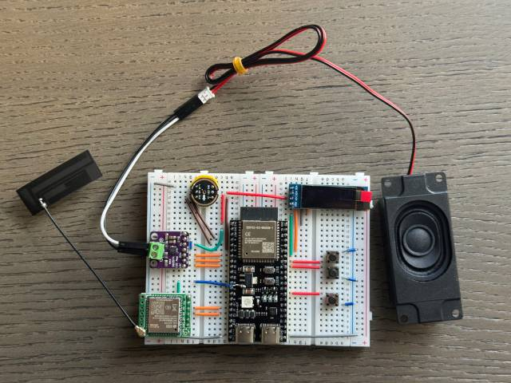

### Supports 138 Board Directories and 171 Release Variants (Partial List)

- <a href="https://oshwhub.com/li-chuang-kai-fa-ban/li-chuang-shi-zhan-pai-esp32-s3-kai-fa-ban" target="_blank" title="LiChuang ESP32-S3 Development Board">LiChuang ESP32-S3 Development Board</a>
- <a href="https://github.com/espressif/esp-box" target="_blank" title="Espressif ESP32-S3-BOX-3">Espressif ESP32-S3-BOX-3</a>
- <a href="https://docs.m5stack.com/zh_CN/core/CoreS3" target="_blank" title="M5Stack CoreS3">M5Stack CoreS3</a>
- <a href="https://docs.m5stack.com/en/atom/Atomic%20Echo%20Base" target="_blank" title="AtomS3R + Echo Base">M5Stack AtomS3R + Echo Base</a>
- <a href="https://gf.bilibili.com/item/detail/1108782064" target="_blank" title="Magic Button 2.4">Magic Button 2.4</a>
- <a href="https://www.waveshare.net/shop/ESP32-S3-Touch-AMOLED-1.8.htm" target="_blank" title="Waveshare ESP32-S3-Touch-AMOLED-1.8">Waveshare ESP32-S3-Touch-AMOLED-1.8</a>
- <a href="https://github.com/Xinyuan-LilyGO/T-Circle-S3" target="_blank" title="LILYGO T-Circle-S3">LILYGO T-Circle-S3</a>
- <a href="https://oshwhub.com/tenclass01/xmini_c3" target="_blank" title="XiaGe Mini C3">XiaGe Mini C3</a>
- <a href="https://oshwhub.com/movecall/cuican-ai-pendant-lights-up-y" target="_blank" title="Movecall CuiCan ESP32S3">CuiCan AI Pendant</a>
- <a href="https://github.com/WMnologo/xingzhi-ai" target="_blank" title="WMnologo-Xingzhi-1.54">WMnologo-Xingzhi-1.54TFT</a>
- <a href="https://www.seeedstudio.com/SenseCAP-Watcher-W1-A-p-5979.html" target="_blank" title="SenseCAP Watcher">SenseCAP Watcher</a>
- <a href="https://www.bilibili.com/video/BV1BHJtz6E2S/" target="_blank" title="ESP-HI Low Cost Robot Dog">ESP-HI Low Cost Robot Dog</a>

<div style="display: flex; justify-content: space-between;">
  <a href="docs/v1/lichuang-s3.jpg" target="_blank" title="LiChuang ESP32-S3 Development Board">
    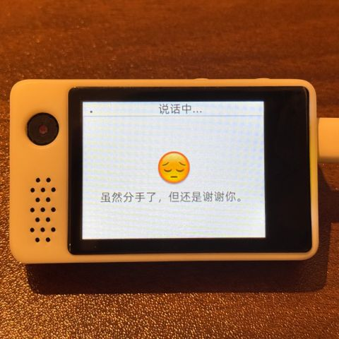
  </a>
  <a href="docs/v1/espbox3.jpg" target="_blank" title="Espressif ESP32-S3-BOX3">
    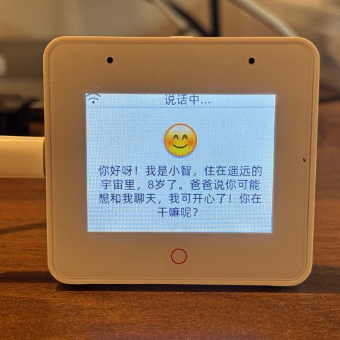
  </a>
  <a href="docs/v1/m5cores3.jpg" target="_blank" title="M5Stack CoreS3">
    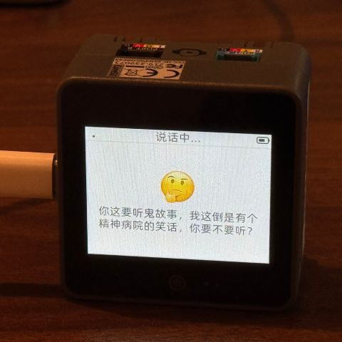
  </a>
  <a href="docs/v1/atoms3r.jpg" target="_blank" title="AtomS3R + Echo Base">
    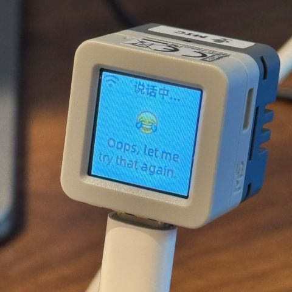
  </a>
  <a href="docs/v1/magiclick.jpg" target="_blank" title="Magic Button 2.4">
    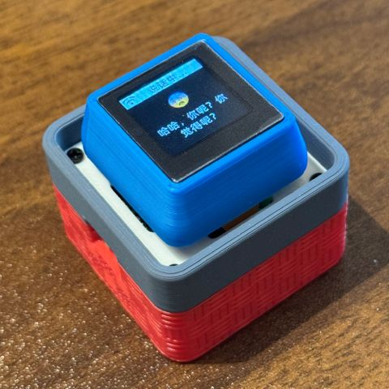
  </a>
  <a href="docs/v1/waveshare.jpg" target="_blank" title="Waveshare ESP32-S3-Touch-AMOLED-1.8">
    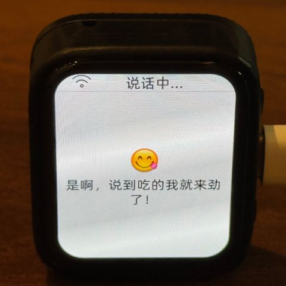
  </a>
  <a href="docs/v1/lilygo-t-circle-s3.jpg" target="_blank" title="LILYGO T-Circle-S3">
    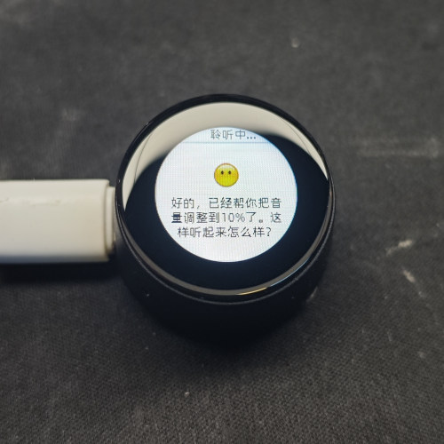
  </a>
  <a href="docs/v1/xmini-c3.jpg" target="_blank" title="XiaGe Mini C3">
    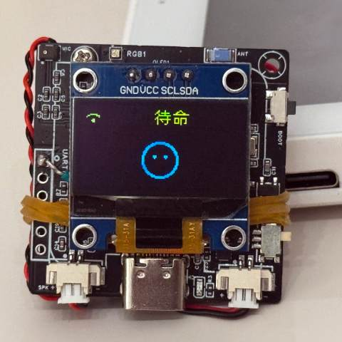
  </a>
  <a href="docs/v1/movecall-cuican-esp32s3.jpg" target="_blank" title="CuiCan">
    
  </a>
  <a href="docs/v1/wmnologo_xingzhi_1.54.jpg" target="_blank" title="WMnologo-Xingzhi-1.54">
    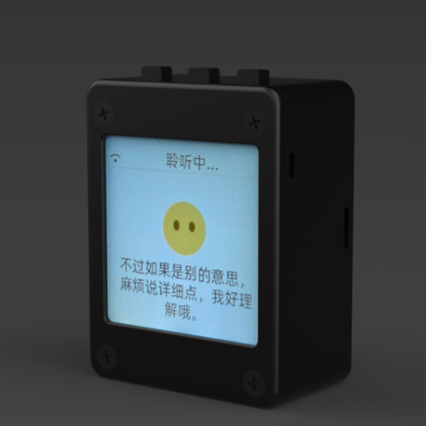
  </a>
  <a href="docs/v1/sensecap_watcher.jpg" target="_blank" title="SenseCAP Watcher">
    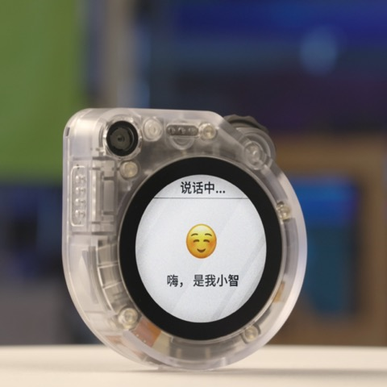
  </a>
  <a href="docs/v1/esp-hi.jpg" target="_blank" title="ESP-HI Low Cost Robot Dog">
    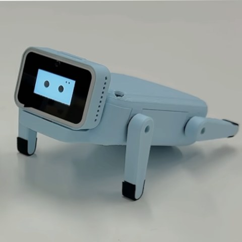
  </a>
</div>

## Software

### Firmware Flashing

For beginners, it is recommended to use the firmware that can be flashed without setting up a development environment.

The firmware connects to the official [xiaozhi.me](https://xiaozhi.me) server by default. Personal users can register an account to use the Qwen real-time model for free.

👉 [Beginner's Firmware Flashing Guide](https://ccnphfhqs21z.feishu.cn/wiki/Zpz4wXBtdimBrLk25WdcXzxcnNS)

### Development Environment

- Cursor or VSCode
- Install the ESP-IDF plugin. The minimum SDK is [ESP-IDF v6.0.1](https://github.com/espressif/esp-idf/releases/tag/v6.0.1); [ESP-IDF `release/v6.1`](https://github.com/espressif/esp-idf/tree/release/v6.1) is recommended. ESP-IDF 5.x is not supported.
- Linux is better than Windows for faster compilation and fewer driver issues
- This project uses Google C++ code style, please ensure compliance when submitting code

Use the `release/v6.1` branch rather than the `v6.1` release tag: an ESP32-C3 Wi-Fi initialization failure with that tag is reported in [#2344](https://github.com/78/xiaozhi-esp32/issues/2344). After switching SDK revisions, run `git submodule update --init --recursive` in the ESP-IDF directory, source its `export.sh`, and run `idf.py fullclean` in this project before rebuilding.

### Developer Documentation

- [Custom Board Guide](docs/custom-board.md) - Learn how to create custom boards for XiaoZhi AI
- [MCP Protocol IoT Control Usage](docs/mcp-usage.md) - Learn how to control IoT devices via MCP protocol
- [MCP Protocol Interaction Flow](docs/mcp-protocol.md) - Device-side MCP protocol implementation
- [MQTT + UDP Hybrid Communication Protocol Document](docs/mqtt-udp.md)
- [A detailed WebSocket communication protocol document](docs/websocket.md)

## Large Model Configuration

If you already have a XiaoZhi AI chatbot device and have connected to the official server, you can log in to the [xiaozhi.me](https://xiaozhi.me) console for configuration.

👉 [Backend Operation Video Tutorial (Old Interface)](https://www.bilibili.com/video/BV1jUCUY2EKM/)

## Related Open Source Projects

For server deployment on personal computers, refer to the following open-source projects:

- [xinnan-tech/xiaozhi-esp32-server](https://github.com/xinnan-tech/xiaozhi-esp32-server) Python server
- [joey-zhou/xiaozhi-esp32-server-java](https://github.com/joey-zhou/xiaozhi-esp32-server-java) Java server
- [AnimeAIChat/xiaozhi-server-go](https://github.com/AnimeAIChat/xiaozhi-server-go) Golang server
- [hackers365/xiaozhi-esp32-server-golang](https://github.com/hackers365/xiaozhi-esp32-server-golang) Golang server

Other client projects using the XiaoZhi communication protocol:

- [huangjunsen0406/py-xiaozhi](https://github.com/huangjunsen0406/py-xiaozhi) Python client
- [TOM88812/xiaozhi-android-client](https://github.com/TOM88812/xiaozhi-android-client) Android client
- [100askTeam/xiaozhi-linux](http://github.com/100askTeam/xiaozhi-linux) Linux client by 100ask
- [78/xiaozhi-sf32](https://github.com/78/xiaozhi-sf32) Bluetooth chip firmware by Sichuan
- [QuecPython/solution-xiaozhiAI](https://github.com/QuecPython/solution-xiaozhiAI) QuecPython firmware by Quectel

Custom Assets Tools:

- [78/xiaozhi-assets-generator](https://github.com/78/xiaozhi-assets-generator) Custom Assets Generator (Wake words, fonts, emojis, backgrounds)

## About the Project

This is an open-source ESP32 project, released under the MIT license, allowing anyone to use it for free, including for commercial purposes.

We hope this project helps everyone understand AI hardware development and apply rapidly evolving large language models to real hardware devices.

Lila keeps that spirit: it is a small personal fork made for a family assistant,
named by my daughter Sophie, and it would not exist without the upstream authors and
contributors thanked at the top of this README.

If you have any ideas or suggestions, please feel free to raise Issues or join our [Discord](https://discord.gg/C759fGMBcZ) or QQ group: 1095994019

## Star History

<a href="https://star-history.com/#78/xiaozhi-esp32&Date">
 <picture>
   <source media="(prefers-color-scheme: dark)" srcset="https://api.star-history.com/svg?repos=78/xiaozhi-esp32&type=Date&theme=dark" />
   <source media="(prefers-color-scheme: light)" srcset="https://api.star-history.com/svg?repos=78/xiaozhi-esp32&type=Date" />
   
 </picture>
</a>
