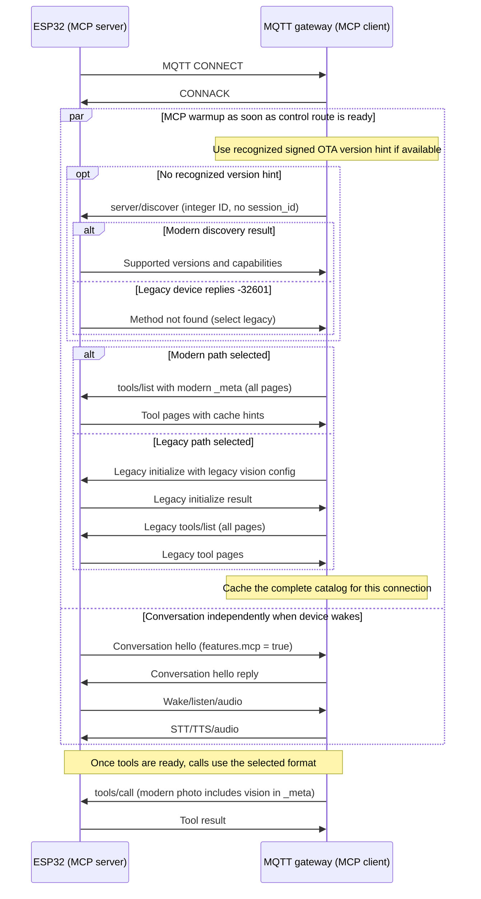

# MCP over WebSocket and MQTT

[简体中文](mcp-protocol_zh.md) | [Tool registration guide](mcp-usage.md)

**Device status:** legacy `2024-11-05` and modern `2026-07-28` tools requests are implemented.
Gateway discovery/prefetch changes and optional early-version hints require coordinated server work.
End-to-end hardware acceptance remains separate from host tests and firmware builds.

This guide describes both wire formats. No additional device task is introduced.

## 1. Scope and compatibility

The device supports the modern MCP tools flow to both XiaoZhi transports while retaining the existing
`2024-11-05` behavior. The ESP32 is the **MCP server**; the backend or a gateway making requests is
the **MCP client**, regardless of which side opened the network connection.

The `2026-07-28` wire protocol is a **breaking update**. A modern-only peer does not automatically
interoperate with a legacy-only peer. Backward compatibility requires a dual-era implementation,
which accepts legacy initialization and modern self-contained requests separately. Official SDK
compatibility does not upgrade XiaoZhi's handwritten dispatcher or gateway automatically.
See the [official compatibility matrix](https://modelcontextprotocol.io/specification/2026-07-28/basic/versioning).

The legacy handler answers `initialize` with `2024-11-05` and keeps its initialization-based
vision settings. The modern handler validates request metadata, implements discovery and modern
responses, and owns vision settings per call. Neither path waits for an extra device-side task.

The XiaoZhi behavior is:

- Keep `features.mcp: true`. Select the version at MQTT connection time, before conversation hello.
- Carry vision configuration with each relevant call inside `params._meta`.
- Preserve the existing outer MCP envelope and transport authentication.
- Keep `tools/list`. It discovers schemas; it was not removed by the new revision.
- Implement the required base behavior and the tools capability. Resources, prompts, sampling,
  elicitation, subscriptions, and tasks are not added or advertised by this implementation.

The official change list compares against `2025-11-25`, while this firmware's legacy handler
reports `2024-11-05`. Supporting the two versions in this implementation does not claim support for
every intervening revision. The required work is broader than removing a handshake:

| Area | XiaoZhi action |
|---|---|
| Initialization and protocol session | Retain the old handler; use self-contained modern requests. The outer XiaoZhi conversation ID stays. |
| Version and client capabilities | Validate the required per-request `_meta`; implement modern version/capability errors. |
| Endpoint discovery | Implement `server/discover`; without a recognized signed version hint, the MQTT gateway probes at connection time before warming the tool cache. |
| Results | Emit modern `resultType`; read older results without it as complete when intentionally using legacy. |
| Catalog caching | Include mandatory `ttlMs`/`cacheScope` and preserve pagination/filter semantics. |
| Vision | Define a namespaced project extension and pass its settings per call, not through shared initialization state. |
| Gateway/backend | Upgrade request generation, forwarding, intercepted responses, and caches on the complete route. |
| HTTP-only and unused optional features | Apply only to endpoints/capabilities actually exposed; do not add them to the device tools flow. |

String request IDs are an existing JSON-RPC requirement. The dispatcher now preserves both string
and safe integral numeric IDs through scheduling and responses.

## 2. Transport hello and version discovery timing

Keep `features.mcp: true` as the existing boolean support declaration. Version selection does not
depend on a hello feature. The device reports `mcp_20260728` in its shared capability map,
but MQTT initialization and tool prefetch must not wait for conversation hello.
OTA and both hello builders use the same capability source; a gateway still selects the request
version from discovery or a trusted early hint. `mcp_versions` is not added.

The optional [OTA protocol-capability report](ota.md#10-protocol-capability-reporting)
can supply information for an early gateway version choice. Conveying that choice to the gateway
is a deployment integration agreement described in section 2.1, not an OTA username schema.
A recognized modern hint permits direct modern catalog warmup; a recognized legacy hint permits
direct legacy initialization/warmup. With no recognized hint, use connection-time discovery/fallback.
This optional path requires coordinated implementation and is not a prerequisite for baseline support.

A WebSocket device hello, followed by the backend hello:

```json
{
  "type": "hello",
  "version": 1,
  "transport": "websocket",
  "features": {
    "mcp": true,
    "mcp_20260728": true,
    "udp_probe": false,
    "aec": false,
    "glyph_push": false
  },
  "audio_params": {
    "format": "opus",
    "sample_rate": 16000,
    "channels": 1,
    "frame_duration": 60
  }
}
```

```json
{
  "type": "hello",
  "transport": "websocket",
  "session_id": "session-001",
  "audio_params": {
    "format": "opus",
    "sample_rate": 24000,
    "channels": 1,
    "frame_duration": 60
  }
}
```

For MQTT/UDP, keep transport version `3`. MCP travels over MQTT, not UDP. These messages open a
conversation; the gateway may already have discovered MCP and cached the tools before they arrive:

```json
{
  "type": "hello",
  "version": 3,
  "transport": "udp",
  "features": {
    "mcp": true,
    "mcp_20260728": true,
    "udp_probe": false,
    "aec": false,
    "glyph_push": false
  },
  "audio_params": {
    "format": "opus",
    "sample_rate": 16000,
    "channels": 1,
    "frame_duration": 60
  }
}
```

```json
{
  "type": "hello",
  "transport": "udp",
  "session_id": "session-001",
  "audio_params": {
    "format": "opus",
    "sample_rate": 24000,
    "channels": 1,
    "frame_duration": 60
  },
  "udp": {
    "server": "udp.example.com",
    "port": 8888,
    "encryption": "aes-128-ctr",
    "key": "00112233445566778899aabbccddeeff",
    "nonce": "01000000010203040000000000000000"
  }
}
```

Other capabilities, including AEC, glyph push, and UDP probes, remain independent.
The example audio parameters and UDP credentials are illustrative.

Selection and timing rules:

1. After an authenticated MQTT connection is ready and device-control messages can be exchanged,
   the gateway first uses a recognized version hint from the authenticated username, if available.
   Otherwise it sends `server/discover` immediately with an integer ID and no conversation
   `session_id`. It does not wait for hello or make an extra OTA request on MQTT connection.
2. A valid discovery response selects a mutually supported version. For `2026-07-28`, prefetch
   `tools/list` with modern metadata and cache all pages, preserving connection-time warmup.
3. A `-32601` response to this discovery probe identifies the current legacy firmware: run
   `initialize`, then prefetch and cache the legacy tool list. Section 4 defines other outcomes.
4. Later conversation hello messages reuse this connection's discovery outcome and valid catalog.
   Do not restart discovery, initialization, or full catalog loading for every wake/hello.
5. Direct WebSocket backends use the same discovery/fallback logic once the existing control
   channel/transport hello is ready. They need only the existing `mcp` capability, not a version
   flag in hello. Do not move the MQTT warmup to this later WebSocket-specific timing.
6. Discovery selects how the gateway generates its requests; it does not establish a required
   MCP session on the device. Firmware still dispatches each request from its own metadata,
   and accepts legacy requests from older clients.

An unexpected hello version flag must not override a completed discovery result. New requests still
declare their actual MCP version in `_meta`. The baseline needs no OTA or credential change;
the optional trusted hint is a gateway integration optimization described in section 2.1.

### 2.1 Optional gateway version hint

An OTA service can use the device's protocol-capability report when issuing MQTT credentials.
For a deployment whose issuer and gateway explicitly agree on it, those credentials may carry
a protected `mcp_version` hint. Its encoding, authentication and extraction are gateway-specific;
not every MQTT username is decodable, and the OTA interface defines no internal username fields.
The firmware always uses the returned credential strings unchanged.

| Trusted hint interpreted by the configured gateway | Connection-time warmup |
|---|---|
| `2026-07-28` | Direct modern tool-list prefetch/cache; no discovery or initialization. |
| `2024-11-05` | Legacy initialization and tool-list prefetch/cache; no discovery. |
| Missing or unrecognized version | `server/discover` and the explicit legacy fallback. |

The issuer must apply its existing credential-authentication rules after incorporating the hint.
Do not assume an arbitrary username string is JSON or Base64, or trust an unverified field.
The public OTA guide describes only the capability report and opaque credential delivery;
this optional hint is an agreement of the particular issuer/gateway integration.

Hints describe the running firmware, not an image about to be downloaded. Cached credentials can
survive failed OTA requests, upgrades and rollbacks. Refresh the hint when capabilities change;
resolve concrete read-only warmup mismatches through discovery, without replaying tool calls.
The actual modern request still declares its version in `_meta`.

## 3. Envelope, metadata, IDs, and dispatch

All MCP examples below are complete application JSON messages with `type: "mcp"` and an inner
JSON-RPC `payload`. WebSocket sends them as text; MQTT sends them on the existing control topics.
The outer `session_id` belongs to XiaoZhi's conversation/routing layer, not an MCP protocol session.
Keep it where the existing transport requires it. Connection-time MQTT discovery, initialization,
and tool prefetch use the established device-control route without a conversation `session_id`;
the examples of those exchanges deliberately omit it.

Every modern request uses `payload.params._meta`, including discovery and every pagination request:

| Field inside `_meta` | Requirement |
|---|---|
| `io.modelcontextprotocol/protocolVersion` | Required string, `"2026-07-28"` for this modern implementation. |
| `io.modelcontextprotocol/clientCapabilities` | Required object; use `{}` when the call needs no client capabilities. |
| `io.modelcontextprotocol/clientInfo` | Recommended identity object; all examples include it. |
| `io.modelcontextprotocol/logLevel` | Optional. Do not produce MCP log notifications without an explicit request. |

Ordinary modern success results carry `resultType: "complete"`. This implementation also includes
`result._meta["io.modelcontextprotocol/serverInfo"]` in every modern success result. Error responses
use `error` instead of `result` and do not need a `resultType`.
These are the [official base-protocol fields](https://modelcontextprotocol.io/specification/2026-07-28/basic/index#_meta).

Requests may use string or safe integral numeric IDs. Preserve the ID's value and JSON type through
scheduling, gateway mapping, and responses; do not convert strings to `int`. Reject fractional,
null, boolean, object, and array request IDs. Invalid/unrecoverable IDs must not be replaced with
a valid outstanding request's ID. A valid notification has no ID and receives no response.

Dual-era dispatch is per request, before any tool side effect:

- An `initialize` request without modern protocol fields uses the legacy handler.
- A request carrying the modern version key is validated as modern. Missing required companions,
  wrong types, or invalid vision data are errors; never retry it through the legacy handler.
- `server/discover` or other modern-specific metadata without the required version/capabilities
  is malformed modern input.
- An ordinary `tools/list` or `tools/call` without modern protocol metadata keeps the existing
  legacy behavior. The device cannot distinguish a completely untagged new request from an old
  request; the backend is responsible for always attaching modern metadata.
- Unsupported versions return `-32022` with supported versions. Selecting `2024-11-05` means using
  the legacy `initialize` flow, not tagging a stateless request with that old version.
- Unknown metadata unrelated to required fields is ignored. Unknown methods return `-32601`.
  Legacy `notifications/initialized` remains tolerated without a reply.

## 4. Connection-time discovery and legacy fallback

The MCP specification makes `server/discover` optional for callers and mandatory for modern
servers. Without a recognized signed OTA version hint, this XiaoZhi MQTT design uses it as the
first request of each authenticated connection, before conversation hello, to select the warmup
path. A recognized hint skips this probe, as described in section 2. This is our MQTT binding policy,
not a claim that the MCP specification defines MQTT transport.
See [official discovery](https://modelcontextprotocol.io/specification/2026-07-28/server/discover).

The gateway sends the first packet below; a modern camera-capable device returns the second.
There is no conversation `session_id` yet. The initial probe uses integer ID `10000` because the
current legacy dispatcher rejects string IDs; later requests may use either supported ID type.

```json
{
  "type": "mcp",
  "payload": {
    "jsonrpc": "2.0",
    "id": 10000,
    "method": "server/discover",
    "params": {
      "_meta": {
        "io.modelcontextprotocol/protocolVersion": "2026-07-28",
        "io.modelcontextprotocol/clientInfo": {
          "name": "xiaozhi-backend",
          "version": "example-backend"
        },
        "io.modelcontextprotocol/clientCapabilities": {}
      }
    }
  }
}
```

```json
{
  "type": "mcp",
  "payload": {
    "jsonrpc": "2.0",
    "id": 10000,
    "result": {
      "resultType": "complete",
      "supportedVersions": [
        "2026-07-28",
        "2024-11-05"
      ],
      "capabilities": {
        "tools": {},
        "extensions": {
          "me.xiaozhi/vision": {}
        }
      },
      "ttlMs": 60000,
      "cacheScope": "private",
      "_meta": {
        "io.modelcontextprotocol/serverInfo": {
          "name": "example-board",
          "version": "example-firmware"
        }
      }
    }
  }
}
```

`supportedVersions` spans both eras; using `2024-11-05` still requires legacy initialization.
A device without the camera tool omits the vision extension. Do not advertise `listChanged` or
other features until their behavior exists. Discovery contains no vision URL or token and does
not replace `tools/list` or install per-call configuration.

An existing legacy device replies to that exact same probe with an unknown-method error:

```json
{
  "type": "mcp",
  "payload": {
    "jsonrpc": "2.0",
    "id": 10000,
    "error": {
      "code": -32601,
      "message": "Method not implemented: server/discover"
    }
  }
}
```

The gateway then sends the legacy `initialize` exchange in section 9, including its legacy vision
configuration, followed by paginated legacy `tools/list`. It caches the completed catalog at MQTT
connection time, just as today. It must not wait for a later hello to do this.

| Discovery outcome | Gateway action before catalog prefetch |
|---|---|
| Valid complete result supporting `2026-07-28` | Select modern requests; query/cache modern tool pages. |
| Probe returns `-32601` | Run legacy `initialize`, then query/cache legacy tool pages. |
| Complete result or `-32022` explicitly offers only our supported legacy version | Select legacy initialization, then load its catalog. |
| `-32022` offers another mutually implemented modern version | Retry discovery using that supported version; this implementation implements only the named modern revision. |
| No mutually implemented version | Report incompatibility; do not mark a catalog ready. |
| Timeout, disconnect, malformed result, ID mismatch, or other error | Fail this warmup attempt; do not infer legacy support or retry a tool call. |

Use the existing bounded MCP request timeout and gateway initialization concurrency control.
Keep at most one warmup workflow per connection; do not start duplicate probes from repeated hello.
A failed attempt must release its pending requests and remain distinguishable from a valid empty
catalog. Report tool unavailability while voice can continue. Another bounded attempt can be started
by explicit management action or a new connection; this implementation adds no polling loop.

Retain the selected era for generating requests on this connection. A reconnect clears that
selection and selects again from current credentials or discovery. The optional OTA hint must
be refreshed when running capabilities change; resolve a concrete read-only warmup mismatch through
discovery, since cached credentials can survive a firmware upgrade/rollback or failed OTA request. Catalog TTL
refreshes use the already selected request format rather than rediscovering the era on every refresh.
A per-connection gateway choice does not change the device's stateless per-request semantics.

On the no-hint baseline, a new device uses one discovery round trip in place of the previous initialization round trip.
An old device incurs one additional failed probe before its original initialization. Both happen
during connection warmup, not as a fixed extra step for each wake or conversation hello.

## 5. Tool discovery, pagination, and cache

After discovery selects modern mode, the MQTT gateway immediately queries `tools/list` without
initialization and caches every page, before any conversation hello is needed. These prefetch
examples omit `session_id`. A later backend with a valid catalog can call tools directly; if a
catalog becomes stale, refresh it in the selected format. This illustrative catalog contains two
tools; actual boards expose their own inventory.
[Tool discovery remains part of the new specification](https://modelcontextprotocol.io/specification/2026-07-28/server/tools).

Backend to device:

```json
{
  "type": "mcp",
  "payload": {
    "jsonrpc": "2.0",
    "id": "list-1",
    "method": "tools/list",
    "params": {
      "withUserTools": false,
      "_meta": {
        "io.modelcontextprotocol/protocolVersion": "2026-07-28",
        "io.modelcontextprotocol/clientInfo": {
          "name": "xiaozhi-backend",
          "version": "example-backend"
        },
        "io.modelcontextprotocol/clientCapabilities": {}
      }
    }
  }
}
```

```json
{
  "type": "mcp",
  "payload": {
    "jsonrpc": "2.0",
    "id": "list-1",
    "result": {
      "resultType": "complete",
      "tools": [
        {
          "name": "self.audio_speaker.set_volume",
          "description": "Set the audio speaker volume.",
          "inputSchema": {
            "type": "object",
            "properties": {
              "volume": {
                "type": "integer",
                "minimum": 0,
                "maximum": 100
              }
            },
            "required": [
              "volume"
            ]
          }
        },
        {
          "name": "self.camera.take_photo",
          "description": "Take a photo and answer the question about it.",
          "inputSchema": {
            "type": "object",
            "properties": {
              "question": {
                "type": "string"
              }
            },
            "required": [
              "question"
            ]
          }
        }
      ],
      "ttlMs": 60000,
      "cacheScope": "private",
      "_meta": {
        "io.modelcontextprotocol/serverInfo": {
          "name": "example-board",
          "version": "example-firmware"
        }
      }
    }
  }
}
```

If a page has `nextCursor`, send another `tools/list` with that exact opaque string as
`params.cursor`, the same `withUserTools` value, and fresh required request metadata. Continue until
`nextCursor` is absent or empty. Keep stable tool order and do not expose a partial catalog as complete.
Unknown/invalid cursors return `-32602`; the backend can restart discovery with no cursor.

Preserve the XiaoZhi `withUserTools` extension: omitted/false lists regular tools; true includes
regular and user-only tools. It is a visibility selector, not authentication or authorization.
Separate cache entries for each selector and authorization context.

Modern discovery/list results include `ttlMs` and `cacheScope`, as required by the
[official caching rules](https://modelcontextprotocol.io/specification/2026-07-28/server/utilities/caching).
The initial policy here is `60000` ms and `"private"`, not a new protocol constant. Cache on the backend
or gateway; no extra catalog cache is needed on ESP32. A valid cached catalog permits a direct call.
TTL expiry is checked on use, not by a new polling task.

Include device identity, firmware/tool configuration, protocol era, authorization context, and all
result-affecting parameters (including cursor and `withUserTools`) in the cache identity. Invalidate
on reconnect/identity or firmware change, relevant configuration change, stale TTL, or evidence of
a changed catalog. A gateway must not reset the freshness clock when returning a cached page: report
the remaining TTL, and preserve the private scope. Never cache tool execution results or credentials.
This implementation does not add a tool-inventory hash or change notifications.

## 6. Ordinary tool call

This call needs no vision capability and can be sent as the first MCP request when the backend
already knows the valid tool schema. Backend to device:

```json
{
  "session_id": "session-001",
  "type": "mcp",
  "payload": {
    "jsonrpc": "2.0",
    "id": "volume-1",
    "method": "tools/call",
    "params": {
      "name": "self.audio_speaker.set_volume",
      "arguments": {
        "volume": 50
      },
      "_meta": {
        "io.modelcontextprotocol/protocolVersion": "2026-07-28",
        "io.modelcontextprotocol/clientInfo": {
          "name": "xiaozhi-backend",
          "version": "example-backend"
        },
        "io.modelcontextprotocol/clientCapabilities": {}
      }
    }
  }
}
```

Device to backend:

```json
{
  "session_id": "session-001",
  "type": "mcp",
  "payload": {
    "jsonrpc": "2.0",
    "id": "volume-1",
    "result": {
      "resultType": "complete",
      "content": [
        {
          "type": "text",
          "text": "true"
        }
      ],
      "isError": false,
      "_meta": {
        "io.modelcontextprotocol/serverInfo": {
          "name": "example-board",
          "version": "example-firmware"
        }
      }
    }
  }
}
```

## 7. Vision configuration carried with the call

### 7.1 Exact field path and ownership

Define the XiaoZhi extension identifier `me.xiaozhi/vision` under the official capability extension map.
It is a project extension, not a built-in MCP vision field. Its reverse-DNS namespace corresponds
to `xiaozhi.me`. The one canonical location for modern vision configuration is:

`payload.params._meta["io.modelcontextprotocol/clientCapabilities"].extensions["me.xiaozhi/vision"]`

| Field | Requirement |
|---|---|
| `url` | Required nonempty HTTP/HTTPS URL to the image explanation endpoint, not a WebSocket URL. |
| `token` | Optional string; omitted or empty means no Authorization header. Otherwise use `Bearer <token>`. |

After discovery selects the modern device path, the backend or gateway injects this object
into every photo call after the model chooses the tool and arguments. Connection-time discovery
and cached tool lists do not install a reusable vision configuration. Never place the URL
or token in the model-facing `inputSchema`, ask the model to generate credentials, or echo them in
results, discovery, tool lists, or logs. For unrelated tool calls, `clientCapabilities: {}` is sufficient.
Each photo request provides its own extension object, even when the previous photo used the same values.

### 7.2 Complete photo call and response

Backend to device; the token below is a dummy example:

```json
{
  "session_id": "session-001",
  "type": "mcp",
  "payload": {
    "jsonrpc": "2.0",
    "id": "photo-1",
    "method": "tools/call",
    "params": {
      "name": "self.camera.take_photo",
      "arguments": {
        "question": "What is in front of me?"
      },
      "_meta": {
        "io.modelcontextprotocol/protocolVersion": "2026-07-28",
        "io.modelcontextprotocol/clientInfo": {
          "name": "xiaozhi-backend",
          "version": "example-backend"
        },
        "io.modelcontextprotocol/clientCapabilities": {
          "extensions": {
            "me.xiaozhi/vision": {
              "url": "https://vision.example.com/analyze",
              "token": "example-token-not-a-real-secret"
            }
          }
        }
      }
    }
  }
}
```

```json
{
  "session_id": "session-001",
  "type": "mcp",
  "payload": {
    "jsonrpc": "2.0",
    "id": "photo-1",
    "result": {
      "resultType": "complete",
      "content": [
        {
          "type": "text",
          "text": "There is a red cup on the table."
        }
      ],
      "isError": false,
      "_meta": {
        "io.modelcontextprotocol/serverInfo": {
          "name": "example-board",
          "version": "example-firmware"
        }
      }
    }
  }
}
```

### 7.3 Execution and lifetime

Validate before capturing or uploading:

- Missing vision capability for a photo call returns `MissingRequiredClientCapability` (`-32021`).
  A present but malformed extension, invalid URL, or non-string token returns `-32602`.
- Check URL scheme and header-safe token input. Follow existing transport limits and deployment
  endpoint policy. Do not log the raw request containing its token.
- Copy only the small execution context needed before scheduling the tool. Do not retain borrowed
  `cJSON` pointers after the incoming message is freed. The context owns the vision strings until
  execution finishes, fails, or is cancelled.
- Pass vision explicitly into this execution. Modern calls must not read or overwrite the shared
  settings installed by legacy `SetExplainUrl()`, including on error paths. Do not implement this
  by temporarily setting a global URL/token and restoring them later.
- An omitted token must not reuse a prior token. Missing vision must not fall back to a previous
  call, a prior `initialize`, another user, or another connection.
- Keep the existing serialized camera execution and frame ownership. Context must survive any
  deferred work, and responses remain bound to the original request/connection.

The implementation uses a small owned request context and an explicit
`Explain(question, url, token)` overload. The original `Explain(question)` delegates with the saved
legacy configuration. `Esp32Camera`, `EspVideo` and `SscmaCamera` reuse their existing capture,
encoding and upload bodies. Ordinary tool callbacks keep their existing registration interface.
No new task, timer, persistent token storage, or cross-call configuration cache is added.

Long-lived device settings can still come from OTA or existing configuration APIs. MQTT/UDP
addresses and audio keys remain in transport hello; they do not move into MCP metadata.

## 8. Errors and retry boundaries

Use JSON-RPC errors for invalid requests, unsupported versions/methods, unknown tools, and invalid
arguments. Use a modern `resultType: "complete", isError: true` tool result for a valid call whose
execution fails, such as camera capture or upload failure. Preserve existing legacy error behavior
in the legacy path. Legacy execution failures retain their `-32603` error behavior, while the
modern path emits a tool result with `isError: true`.

| Condition | Modern response |
|---|---|
| Malformed JSON / invalid JSON-RPC shape | `-32700` / `-32600`; no tool side effect. |
| Recognizable modern request missing required metadata, invalid types, malformed vision | `-32602`. |
| Unsupported requested version | `-32022` with `data.supported` and `data.requested`. |
| Photo call missing its vision capability | `-32021` with `data.requiredCapabilities` as an object. |
| Unknown method / unknown tool | `-32601` / `-32602`. |
| Valid tool execution failed | Modern tool result with `isError: true`. |

Version mismatch response (for a request declaring `2099-01-01`):

```json
{
  "session_id": "session-001",
  "type": "mcp",
  "payload": {
    "jsonrpc": "2.0",
    "id": "version-1",
    "error": {
      "code": -32022,
      "message": "Unsupported protocol version",
      "data": {
        "supported": [
          "2026-07-28",
          "2024-11-05"
        ],
        "requested": "2099-01-01"
      }
    }
  }
}
```

Missing vision capability:

```json
{
  "session_id": "session-001",
  "type": "mcp",
  "payload": {
    "jsonrpc": "2.0",
    "id": "photo-1",
    "error": {
      "code": -32021,
      "message": "Missing required client capability",
      "data": {
        "requiredCapabilities": {
          "extensions": {
            "me.xiaozhi/vision": {}
          }
        }
      }
    }
  }
}
```

Malformed supplied vision configuration:

```json
{
  "session_id": "session-001",
  "type": "mcp",
  "payload": {
    "jsonrpc": "2.0",
    "id": "photo-1",
    "error": {
      "code": -32602,
      "message": "Invalid vision configuration"
    }
  }
}
```

Valid photo call whose upload fails:

```json
{
  "session_id": "session-001",
  "type": "mcp",
  "payload": {
    "jsonrpc": "2.0",
    "id": "photo-1",
    "result": {
      "resultType": "complete",
      "content": [
        {
          "type": "text",
          "text": "Failed to upload photo"
        }
      ],
      "isError": true,
      "_meta": {
        "io.modelcontextprotocol/serverInfo": {
          "name": "example-board",
          "version": "example-firmware"
        }
      }
    }
  }
}
```

The error shapes follow the [official schema](https://github.com/modelcontextprotocol/modelcontextprotocol/blob/main/schema/2026-07-28/schema.ts).
Do not allocate application-specific meanings to the reserved modern error codes.

The backend may retry a read-only discovery/list request after an explicit version response, using
a compatible era. Do not silently downgrade for malformed metadata, missing vision, upload failure,
or timeout. The explicit `-32601` fallback is only for the initial discovery probe in section 4,
not for arbitrary unknown methods during tool execution. A tool call may already have executed
when its response is lost: a new JSON-RPC ID does
not make a retry idempotent. Do not automatically replay side-effecting calls across versions or
reconnections. This implementation adds no ACK or per-tool replay cache.

## 9. Legacy flow remains available

An old backend continues using `features.mcp` and the retained legacy path. After the discovery
probe returns `-32601`, or a recognized signed hint selects legacy, a new MQTT gateway sends
this legacy exchange before conversation
hello. These initialization packets omit `session_id`; their vision configuration belongs only
to the legacy context:

```json
{
  "type": "mcp",
  "payload": {
    "jsonrpc": "2.0",
    "id": 1,
    "method": "initialize",
    "params": {
      "protocolVersion": "2024-11-05",
      "capabilities": {
        "vision": {
          "url": "https://vision.example.com/analyze",
          "token": "example-token-not-a-real-secret"
        }
      },
      "clientInfo": {
        "name": "legacy-backend",
        "version": "example-backend"
      }
    }
  }
}
```

```json
{
  "type": "mcp",
  "payload": {
    "jsonrpc": "2.0",
    "id": 1,
    "result": {
      "protocolVersion": "2024-11-05",
      "capabilities": {
        "tools": {}
      },
      "serverInfo": {
        "name": "example-board",
        "version": "example-firmware"
      }
    }
  }
}
```

An optional legacy `notifications/initialized` needs no reply. Legacy `tools/list` remains
paginated and does not require modern metadata. A photo call after legacy initialization remains:

```json
{
  "session_id": "session-001",
  "type": "mcp",
  "payload": {
    "jsonrpc": "2.0",
    "id": 3,
    "method": "tools/call",
    "params": {
      "name": "self.camera.take_photo",
      "arguments": {
        "question": "What is in front of me?"
      }
    }
  }
}
```

```json
{
  "session_id": "session-001",
  "type": "mcp",
  "payload": {
    "jsonrpc": "2.0",
    "id": 3,
    "result": {
      "content": [
        {
          "type": "text",
          "text": "There is a red cup on the table."
        }
      ],
      "isError": false
    }
  }
}
```

Do not inject `resultType`, modern cache fields, or per-request vision requirements into the
legacy response contract. Keep the current no-initialization-gate behavior for ordinary legacy
list/call requests; a legacy photo still requires its legacy vision configuration to be usable.

| Backend/gateway toward device | Device | Outcome |
|---|---|---|
| Legacy | Legacy | Existing initialization, list, call. |
| Legacy | Dual-era | Same legacy flow; device retains its legacy handler. |
| Dual-era | Legacy | A recognized legacy hint or discovery `-32601` selects initialization and legacy catalog warmup. |
| Dual-era | Dual-era | Select the version and prefetch/cache on connection; modern calls carry their own metadata. |
| Modern-only | Legacy-only | Incompatible; explicit error rather than a claimed automatic upgrade. |

Rollback means selecting the retained legacy flow for subsequent operations, not uninstalling its
handlers or replaying an uncertain previous tool call.

## 10. Connection warmup, conversation timing, and gateway responsibilities



Preserve MQTT connection-time tool warmup and catalog caching. A first conversation will normally
reuse the prepared catalog. If hello arrives while discovery/prefetch is still running, do not
restart warmup or hold up listening/TTS; only an operation requiring the unfinished catalog waits
for its bounded preparation or receives an explicit unavailable error. Later hello messages must
not clear the selection/cache. TTL expiry may require a catalog refresh, not reinitialization.
Transport reconnect is the boundary for reselecting the era, using a hint or discovery;
a new voice conversation is not.

The `xz-mqtt` project already initializes device tools in `handleConnected()`, before conversation
hello, consumes some upstream MCP requests, and replies from caches. Preserve that timing while
upgrading those paths:

1. In the existing connection-time warmup, select directly from a recognized signed OTA hint
   when available; otherwise use the `server/discover` probe and section 4 fallback. Reuse initialization concurrency limits and
   pending-request cleanup. Hello must neither trigger a duplicate workflow nor decide the era.
2. Generate required metadata for gateway-originated modern requests. The existing
   `mcp_client.capabilities.vision` configuration can supply the values, but inject them into
   every modern photo call. On the legacy path, keep installing legacy vision through initialization.
3. Preserve metadata on forwarded calls. If upstream and gateway both provide vision settings,
   use one explicit trusted source policy; never combine a URL from one source with a token from
   another or accidentally replace the upstream pair.
4. Cached `server/discover` and `tools/list` responses must match request era, ID type, filters,
   authorization context, and remaining TTL. A cached legacy initialization result is not a
   modern discovery result. Keep valid empty catalogs distinct from failed/incomplete warmup.
5. Preserve the retained legacy upstream route. When serving legacy calls to a dual-era device,
   ensure legacy initialization really installs its vision configuration before acknowledging it;
   a cached modern discovery result alone cannot provide legacy vision state.
6. A device's discovery response describes the device leg, not automatically the gateway's
   upstream endpoint. Serve upstream discovery only for versions and methods the complete
   intercepted/forwarded route can handle. An older gateway can continue using a new device in
   legacy mode and gains no modern behavior automatically.
7. First rollout uses either an end-to-end modern route or an explicit legacy route. A general
   cross-era adapter is not assumed. A later adapter must translate metadata, vision ownership,
   results, and errors; removing `_meta` from a photo call is not a valid translation.
8. Isolate in-flight requests across device reconnects and replaced upstream bridges.
   A delayed result must not be delivered to a new connection with a reused ID.

## 11. Implementation ownership and resource constraints

Device-side rows below are implemented here. Gateway/backend rows describe the coordinated work
needed for end-to-end deployment:

| Owner | Required work |
|---|---|
| `main/protocols/protocol.*` and transport integration | Retain `features.mcp`; deliver MQTT MCP control messages before conversation hello; no hello version gating or audio version change. |
| `main/mcp_server.*` | Per-request era/metadata validation, string and integer IDs, discovery, modern results/cache hints/errors, and owned request context through existing scheduling. |
| `main/boards/common/camera.h` and applicable camera implementations | Explicit per-call vision context while retaining the legacy interface/behavior. |
| `xz-mqtt/src/gateway.ts` | Connection-time discovery/fallback and catalog warmup; metadata injection/forwarding, era-aware interception/caches, request identity and reconnect handling. |
| Backend MCP client | Discovery-based version selection, request metadata, cached catalog use, request-local vision injection, error and compatibility handling. |

Do not add a dedicated MCP task, per-request task stack, polling timer, unbounded queue, or device-side
tool catalog copy. Reuse current application scheduling and bounded message/tool execution paths;
the protocol migration must not introduce more blocking work on main/audio tasks. Only photo calls
need owned URL/token strings. Camera capability remains optional, including builds without LVGL/camera.

Keep the existing approximately 8000-byte list-result budget; recompute serialized sizes including
modern result fields before appending each tool, and also respect the transport envelope limit.
Do not allocate a second large JSON buffer just to add `resultType`. Reject oversize input using
existing transport limits. Do not assume PSRAM or enough free SRAM for a full SDK.

HTTP MCP requirements (`Mcp-Method`/`Mcp-Name` headers, removal of `Mcp-Session-Id`, OAuth changes)
apply to a separate Streamable HTTP endpoint if one is exposed. They are not fields to add to
XiaoZhi MQTT/WebSocket messages. Likewise, removal of MCP's `ping` RPC does not remove UDP probe,
MQTT keepalive, or WebSocket transport ping. See the [official change list](https://modelcontextprotocol.io/specification/2026-07-28/changelog).

Do not add advertised sampling/elicitation or task capabilities merely to adopt this tools flow.
If a future tool needs multi round-trip input, implement that exchange before exposing it.
Existing unsolicited XiaoZhi state messages are not automatically modern MCP subscription events.

## 12. Rollout and acceptance plan

1. Review the bilingual contract and validate the implemented device behavior.
2. Complete representative device checks for dual-era parsing/results, discovery, and request-local
   vision before enabling a gateway modern route.
3. Upgrade gateway and backend paths while preserving connection-time warmup and complete catalog
   caching. Select the era from discovery, with an explicit legacy operational path for rollback.
4. Validate WebSocket and MQTT/UDP end to end, then enable the gateway discovery/modern route.
   The baseline requires no hello version feature, OTA change, or MCP-specific task.
   If the optional OTA hint is implemented later, skip discovery when it supplies a recognized version.
   Otherwise the one-time extra legacy probe is part of connection warmup, not every conversation.

Required validation before implementation is considered complete:

- Parse every documented JSON example; match request/response IDs and their JSON types.
- Test old/new device and backend combinations, including an older gateway in between.
- Without a recognized credential hint, verify MQTT discovery uses an integer ID without `session_id`, even when no
  conversation hello ever arrives. Verify `-32601` leads to initialize plus complete catalog caching;
  a modern result leads directly to modern catalog caching with no initialization.
- Verify at most one warmup workflow per connection, no restart/cache clear on repeated hello,
  rediscovery after reconnect/firmware rollback, and no legacy inference after timeout or malformed
  results. Hello arriving during warmup must not block voice or create duplicate work.
- For the optional OTA extension, verify recognized modern/legacy hints skip discovery and select
  the correct warmup path; missing/unknown hints still probe. Cover cached credentials, failed OTA,
  capability changes, upgrade/rollback and read-only mismatch recovery without replaying tool calls.
- Test modern discovery/list/call as the first MCP request, legacy initialize/notification/list/call,
  and ordinary untagged legacy calls. Modern metadata must not be silently treated as legacy.
- Verify string IDs, safe integer IDs, malformed JSON, unknown methods/tools, invalid metadata,
  unsupported versions, and reserved error shapes, with no side effect for invalid requests.
- Test complete pagination, invalid cursors, a valid empty catalog, oversized single tools, and
  response budgets including modern fields. Verify cache filters, expiry, remaining TTL, and
  isolation by device/authorization/era.
- For camera A and B calls with different URL/token pairs, verify each upload uses its own pair;
  interleave legacy and modern calls, omit the next token, omit vision, fail a call, and reconnect.
  No previous values may leak into modern execution. Test both camera implementations where applicable.
- Verify context and response lifetime after input JSON destruction, scheduled execution, disconnect,
  and bridge replacement. No token may appear in routine request/result logs or model schemas.
- Build representative ESP32-C3, camera-capable, and no-camera targets with the supported ESP-IDF;
  measure free heap/stack and message allocation sizes. Check that no new task stack is introduced.
- On hardware, verify wake, capture/playback, TTS, interruption, tool execution, reconnect, and
  both network paths while catalog loading runs concurrently.

Host regression tests exercise the production dispatcher and shared capability builders.
The checklist also includes runtime and hardware acceptance that must be performed on the target;
passing documentation examples or a firmware build does not complete those checks.

## 13. References

- [OTA configuration and capability reporting](ota.md)
- [Device tool registration and usage](mcp-usage.md)
- [MCP 2026-07-28 compatibility and versioning](https://modelcontextprotocol.io/specification/2026-07-28/basic/versioning)
- [Official base protocol and metadata](https://modelcontextprotocol.io/specification/2026-07-28/basic/index)
- [Official discovery](https://modelcontextprotocol.io/specification/2026-07-28/server/discover)
- [Official tools](https://modelcontextprotocol.io/specification/2026-07-28/server/tools)
- [Official caching](https://modelcontextprotocol.io/specification/2026-07-28/server/utilities/caching)
- [Official changes from 2025-11-25](https://modelcontextprotocol.io/specification/2026-07-28/changelog)
- [Official schema](https://github.com/modelcontextprotocol/modelcontextprotocol/blob/main/schema/2026-07-28/schema.ts)


## 14. Joint testing with UDP probes

Keep the MCP implementation PR and the UDP-probe PR independent. The integration branch
`codex/test-mcp-udp-probe` merges both for a single test firmware; it is not the base of either PR.
Its merge resolution uses one shared capability map, with `udp_probe: true` for OTA and MQTT hello.
The standalone MCP branch reports `udp_probe: false` until the probe implementation is present.

To inspect and build the prepared integration branch in a separate checkout:

```sh
git fetch origin codex/test-mcp-udp-probe
git worktree add --detach ../xiaozhi-mcp-udp-test origin/codex/test-mcp-udp-probe
cd ../xiaozhi-mcp-udp-test
# Source a supported ESP-IDF environment first.
python3 -m unittest discover -s scripts/tests -v
python3 scripts/build.py kevin/c3 --name kevin-c3
# For a camera-capable S3 variant instead:
python3 scripts/build.py bread-compact-wifi-s3cam --name bread-compact-wifi-s3cam
```

A build selects one board and replaces the previous build output. Always flash the binary for the
actual board. Do not merge the integration branch into main in place of reviewing the independent PRs.

Joint acceptance should cover these combinations:

| Peer behavior | Expected device behavior |
|---|---|
| Legacy MCP and no probe feature | Legacy initialize/list/call; ordinary UDP behavior. |
| Modern MCP and no probe feature | Modern requests work; no probe timeout requirement. |
| Legacy MCP and negotiated probe | Legacy tools plus authenticated PING/PONG and RTT logging. |
| Modern MCP and negotiated probe | Both features work while wake/audio, tool calls and reconnect run. |

On a capable test peer, send discovery immediately after MQTT connection, before conversation hello;
verify list prefetch/caching and old-device fallback on the gateway. Then exercise ordinary and
photo calls with different per-call vision endpoints/tokens while UDP probes run. Verify blocked UDP,
lost/late PONG, repeated hello, reconnect, interruption, and C3 minimum free heap/stack.
Do not infer network RTT from a retransmitted PING as an unambiguous sample.

An unchanged old gateway exercises compatibility only. Real PONG and modern MCP prewarm require
the corresponding peer behavior, via a test peer or coordinated gateway update. This firmware PR
does not deploy or modify production services. Record hardware results separately from host/build
results, including the exact integration commit, board variant, and peer versions.
