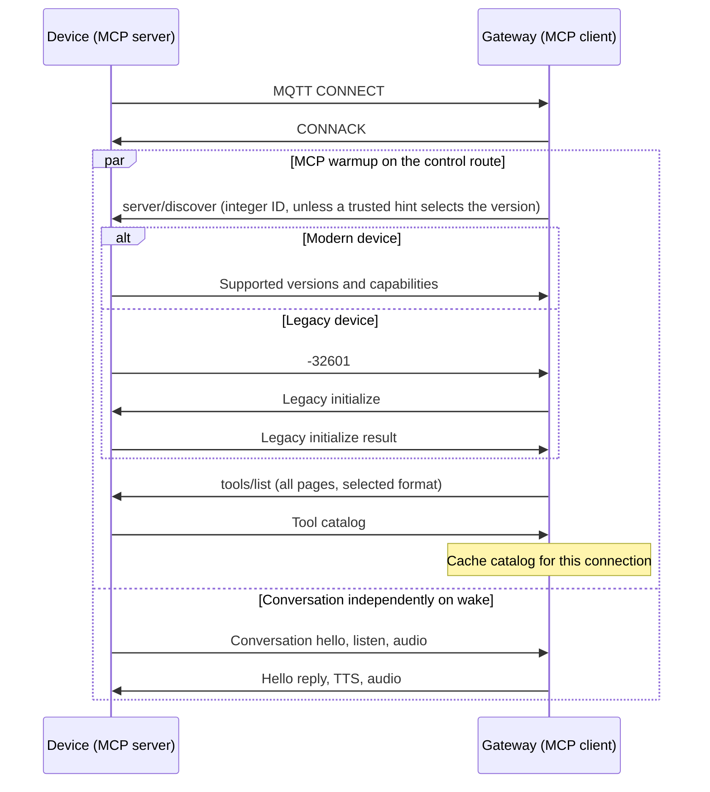

# MCP over WebSocket and MQTT

[简体中文](mcp-protocol_zh.md) | [Tool registration](mcp-usage.md)

The device is the **MCP server**; the backend/gateway calling tools is the **MCP client**.
Firmware supports legacy `2024-11-05` and modern `2026-07-28` requests on both transports.
Gateway discovery, prefetch and optional credential hints require server-side integration.

## 1. Versions and compatibility

The modern revision is a [breaking wire-protocol update](https://modelcontextprotocol.io/specification/2026-07-28/basic/versioning).
The modern flow removes initialization, not `tools/list`. Firmware keeps both request formats;
it does not claim support for every intervening revision.

| Backend/gateway | Device | Flow |
|---|---|---|
| Legacy | Legacy or dual-version | `initialize` → `tools/list` → `tools/call`. |
| Dual-version | Legacy | Discovery `-32601` → legacy initialization and catalog warmup. |
| Dual-version | Dual-version | Modern discovery and catalog warmup; each call carries metadata. |
| Modern-only | Legacy-only | Incompatible without a legacy fallback. |

Version selection does not depend on conversation hello. `features.mcp` remains true;
`mcp_20260728` reports modern support. OTA `protocol.features` and both hello builders share
one capability source; see [OTA capability reporting](ota.md#23-protocol-capabilities).

## 2. Transport and connection warmup

MCP uses JSON text on WebSocket or the existing MQTT control topics, never the UDP audio channel.
Each packet below is a complete XiaoZhi message: `type: "mcp"` wraps a JSON-RPC `payload`.
The outer `session_id` is a conversation/routing field. Connection-time MQTT warmup has no
conversation ID; later calls keep it as required by the existing route. Transport hello/audio
formats remain in [WebSocket](websocket.md) and [MQTT/UDP](mqtt-udp.md).

After authenticated MQTT connection and control-route readiness, the gateway sends discovery,
selects a format, fetches **all** tool pages and caches the catalog before conversation hello.
Use an integer ID for the initial probe: existing legacy firmware may ignore string IDs.
A direct WebSocket backend starts this flow after its existing transport hello.



Keep one bounded warmup per connection. Repeated wake/hello reuses its selected version and valid
catalog; reconnect selects again. Warmup failure leaves tools unavailable without blocking voice.
An old device adds one failed discovery round trip at connection time; this is not a per-wake step.

### 2.1 Optional gateway version hint

An OTA service may use reported capabilities to convey a trusted `mcp_version` hint through its
credential agreement with the gateway. Encoding and authentication belong to that integration;
firmware uses the returned MQTT credential strings unchanged.

| Recognized trusted hint | Warmup |
|---|---|
| `2026-07-28` | Direct modern `tools/list`; no initialization. |
| `2024-11-05` | Legacy `initialize`, then `tools/list`. |
| Missing/unrecognized | Discovery and fallback below. |

Hints describe the running firmware. Cached credentials may outlive upgrades/rollbacks;
a read-only warmup version mismatch should trigger discovery, not a replayed tool call.

## 3. Modern request and response rules

Every modern request, including discovery and each list page, carries `payload.params._meta`:

| Key | Value |
|---|---|
| `io.modelcontextprotocol/protocolVersion` | Required string: `"2026-07-28"`. |
| `io.modelcontextprotocol/clientCapabilities` | Required object; `{}` for ordinary calls. |
| `io.modelcontextprotocol/clientInfo` | Optional identity with string `name` and `version`; recommended. |

A modern success result has `resultType: "complete"` and this firmware includes
`result._meta["io.modelcontextprotocol/serverInfo"]`. Errors use `error` instead of `result`.
See the [official base protocol](https://modelcontextprotocol.io/specification/2026-07-28/basic/index).

- Preserve string IDs or integral numeric IDs in the safe range ±(2^53−1), including JSON type.
  Reject null, fractional, boolean, object and array IDs. Notifications have no ID and receive no reply.
- Select the handler per request. Modern metadata or `server/discover` requires valid modern fields;
  malformed modern input never falls through to legacy. Untagged list/call requests retain legacy behavior.
- Unsupported versions return `-32022`. Using `2024-11-05` means the legacy flow, not modern
  metadata tagged with that version. Unknown unrelated metadata is ignored.
- Only tools and the available vision extension are advertised; resources, prompts and other
  optional MCP features are not implemented by this device flow.

## 4. Discovery

The gateway sends this packet before MQTT conversation hello:

```json
{
  "type": "mcp",
  "payload": {
    "jsonrpc": "2.0",
    "id": 10000,
    "method": "server/discover",
    "params": {
      "_meta": {
        "io.modelcontextprotocol/protocolVersion": "2026-07-28",
        "io.modelcontextprotocol/clientInfo": {
          "name": "xiaozhi-backend",
          "version": "example-backend"
        },
        "io.modelcontextprotocol/clientCapabilities": {}
      }
    }
  }
}
```

A camera-capable device replies:

```json
{
  "type": "mcp",
  "payload": {
    "jsonrpc": "2.0",
    "id": 10000,
    "result": {
      "resultType": "complete",
      "supportedVersions": [
        "2026-07-28",
        "2024-11-05"
      ],
      "capabilities": {
        "tools": {},
        "extensions": {
          "me.xiaozhi/vision": {}
        }
      },
      "ttlMs": 60000,
      "cacheScope": "private",
      "_meta": {
        "io.modelcontextprotocol/serverInfo": {
          "name": "example-board",
          "version": "example-firmware"
        }
      }
    }
  }
}
```

A device without the camera tool omits `me.xiaozhi/vision`.
Discovery neither replaces `tools/list` nor installs vision settings.

| Discovery outcome | Gateway action |
|---|---|
| Valid result supporting `2026-07-28` | Prefetch/cache modern tool pages. |
| Initial probe returns `-32601`, or explicitly offers only supported legacy mode | Legacy initialization, then catalog prefetch. |
| Unsupported version | Use an explicitly supported common version; otherwise report incompatibility. |
| Timeout, disconnect, malformed response, ID mismatch or another error | Fail this bounded warmup; do not infer legacy support. |

Discovery is mandatory for modern servers but optional for callers that already know the peer;
see [official discovery](https://modelcontextprotocol.io/specification/2026-07-28/server/discover).

## 5. Tool list, pagination and caching

The gateway requests tools immediately after version selection:

```json
{
  "type": "mcp",
  "payload": {
    "jsonrpc": "2.0",
    "id": "list-1",
    "method": "tools/list",
    "params": {
      "withUserTools": false,
      "_meta": {
        "io.modelcontextprotocol/protocolVersion": "2026-07-28",
        "io.modelcontextprotocol/clientInfo": {
          "name": "xiaozhi-backend",
          "version": "example-backend"
        },
        "io.modelcontextprotocol/clientCapabilities": {}
      }
    }
  }
}
```

Example response:

```json
{
  "type": "mcp",
  "payload": {
    "jsonrpc": "2.0",
    "id": "list-1",
    "result": {
      "resultType": "complete",
      "tools": [
        {
          "name": "self.audio_speaker.set_volume",
          "description": "Set the audio speaker volume.",
          "inputSchema": {
            "type": "object",
            "properties": {
              "volume": {
                "type": "integer",
                "minimum": 0,
                "maximum": 100
              }
            },
            "required": [
              "volume"
            ]
          }
        },
        {
          "name": "self.camera.take_photo",
          "description": "Take a photo and answer the question about it.",
          "inputSchema": {
            "type": "object",
            "properties": {
              "question": {
                "type": "string"
              }
            },
            "required": [
              "question"
            ]
          }
        }
      ],
      "ttlMs": 60000,
      "cacheScope": "private",
      "_meta": {
        "io.modelcontextprotocol/serverInfo": {
          "name": "example-board",
          "version": "example-firmware"
        }
      }
    }
  }
}
```

`withUserTools` omitted/false excludes user-only tools; true includes them. It is a visibility
filter, not authorization. If `nextCursor` is present, pass it unchanged as `params.cursor` on the
next request with the same filter and required metadata. Finish all pages before declaring the
catalog ready. An invalid cursor returns `-32602`; restart from the first page. An empty list is valid.
Firmware bounds each list JSON-RPC reply, including modern metadata, to 8000 bytes; an oversized
single tool fails.

Discovery/list replies use `ttlMs: 60000` and `cacheScope: "private"` under the
[official caching rules](https://modelcontextprotocol.io/specification/2026-07-28/server/utilities/caching).
The gateway/backend owns the cache. Key it by device, firmware/tool configuration, protocol version,
authorization context, cursor and filter. Invalidate on reconnect, relevant configuration changes
or TTL expiry; refresh in the selected format. Cached replies keep the remaining TTL and private
scope, but use the current request's ID and wire format. Do not cache tool execution results or credentials.

## 6. Tool call

A backend with a known valid tool schema may call directly without initialization:

```json
{
  "session_id": "session-001",
  "type": "mcp",
  "payload": {
    "jsonrpc": "2.0",
    "id": "volume-1",
    "method": "tools/call",
    "params": {
      "name": "self.audio_speaker.set_volume",
      "arguments": {
        "volume": 50
      },
      "_meta": {
        "io.modelcontextprotocol/protocolVersion": "2026-07-28",
        "io.modelcontextprotocol/clientInfo": {
          "name": "xiaozhi-backend",
          "version": "example-backend"
        },
        "io.modelcontextprotocol/clientCapabilities": {}
      }
    }
  }
}
```

```json
{
  "session_id": "session-001",
  "type": "mcp",
  "payload": {
    "jsonrpc": "2.0",
    "id": "volume-1",
    "result": {
      "resultType": "complete",
      "content": [
        {
          "type": "text",
          "text": "true"
        }
      ],
      "isError": false,
      "_meta": {
        "io.modelcontextprotocol/serverInfo": {
          "name": "example-board",
          "version": "example-firmware"
        }
      }
    }
  }
}
```

A valid execution failure uses the same result shape with `isError: true` and error text in
`content`. Modern image content uses `type`, `mimeType` and `data` directly; the legacy image
string wrapper remains unchanged.

## 7. Per-call vision

The project extension has one canonical location:

`payload.params._meta["io.modelcontextprotocol/clientCapabilities"].extensions["me.xiaozhi/vision"]`

| Field | Meaning |
|---|---|
| `url` | Required nonempty HTTP/HTTPS image-explanation endpoint. |
| `token` | Optional string. Missing/empty sends no Authorization header; otherwise `Bearer <token>`. |

The backend/gateway supplies this configuration on **every** modern photo call. The model supplies
only tool arguments, such as `question`; URLs/tokens do not belong in the model's input schema,
discovery, catalog, results or logs.

```json
{
  "session_id": "session-001",
  "type": "mcp",
  "payload": {
    "jsonrpc": "2.0",
    "id": "photo-1",
    "method": "tools/call",
    "params": {
      "name": "self.camera.take_photo",
      "arguments": {
        "question": "What is in front of me?"
      },
      "_meta": {
        "io.modelcontextprotocol/protocolVersion": "2026-07-28",
        "io.modelcontextprotocol/clientInfo": {
          "name": "xiaozhi-backend",
          "version": "example-backend"
        },
        "io.modelcontextprotocol/clientCapabilities": {
          "extensions": {
            "me.xiaozhi/vision": {
              "url": "https://vision.example.com/analyze",
              "token": "example-token-not-a-real-secret"
            }
          }
        }
      }
    }
  }
}
```

```json
{
  "session_id": "session-001",
  "type": "mcp",
  "payload": {
    "jsonrpc": "2.0",
    "id": "photo-1",
    "result": {
      "resultType": "complete",
      "content": [
        {
          "type": "text",
          "text": "There is a red cup on the table."
        }
      ],
      "isError": false,
      "_meta": {
        "io.modelcontextprotocol/serverInfo": {
          "name": "example-board",
          "version": "example-firmware"
        }
      }
    }
  }
}
```

Firmware validates the extension before capture/upload and owns its strings through deferred
execution on `Application::Schedule()`. Modern calls neither read nor overwrite legacy settings;
a missing token never reuses an earlier one. `Explain(question, url, token)` reuses the existing
camera upload code; `Explain(question)` forwards with the saved legacy configuration. Ordinary
tool registration stays unchanged. No new task, timer or persistent vision cache is required.

## 8. Errors and retries

| Condition | Response |
|---|---|
| Malformed JSON / invalid JSON-RPC request | `-32700` / `-32600`. |
| Missing/invalid modern metadata, vision configuration or arguments | `-32602`, before tool execution. |
| Unsupported version | `-32022` with `data.supported` and `data.requested`. |
| Photo call lacks vision capability | `-32021` with `data.requiredCapabilities`. |
| Unknown method / tool | `-32601` / `-32602`. |
| Tool execution fails | Modern `result.isError: true`; legacy error `-32603`. |

Version mismatch example:

```json
{
  "session_id": "session-001",
  "type": "mcp",
  "payload": {
    "jsonrpc": "2.0",
    "id": "version-1",
    "error": {
      "code": -32022,
      "message": "Unsupported protocol version",
      "data": {
        "supported": [
          "2026-07-28",
          "2024-11-05"
        ],
        "requested": "2099-01-01"
      }
    }
  }
}
```

Missing vision capability example:

```json
{
  "session_id": "session-001",
  "type": "mcp",
  "payload": {
    "jsonrpc": "2.0",
    "id": "photo-1",
    "error": {
      "code": -32021,
      "message": "Missing required client capability",
      "data": {
        "requiredCapabilities": {
          "extensions": {
            "me.xiaozhi/vision": {}
          }
        }
      }
    }
  }
}
```

Only the initial discovery probe uses `-32601` to select legacy. Malformed requests, missing
vision, upload errors and timeouts are not downgrade signals. Read-only discovery/list requests
may be retried within bounded warmup. Do not automatically replay tool calls across versions or
connections: a lost response does not prove that the side effect did not occur.

## 9. Legacy flow

Legacy clients keep their existing initialization and stored vision settings:

```json
{
  "type": "mcp",
  "payload": {
    "jsonrpc": "2.0",
    "id": 1,
    "method": "initialize",
    "params": {
      "protocolVersion": "2024-11-05",
      "capabilities": {
        "vision": {
          "url": "https://vision.example.com/analyze",
          "token": "example-token-not-a-real-secret"
        }
      },
      "clientInfo": {
        "name": "legacy-backend",
        "version": "example-backend"
      }
    }
  }
}
```

```json
{
  "type": "mcp",
  "payload": {
    "jsonrpc": "2.0",
    "id": 1,
    "result": {
      "protocolVersion": "2024-11-05",
      "capabilities": {
        "tools": {}
      },
      "serverInfo": {
        "name": "example-board",
        "version": "example-firmware"
      }
    }
  }
}
```

Next fetch all legacy list pages, without modern metadata. `notifications/initialized` is tolerated
without a reply. A later photo call uses the configuration from initialization:

```json
{
  "session_id": "session-001",
  "type": "mcp",
  "payload": {
    "jsonrpc": "2.0",
    "id": 3,
    "method": "tools/call",
    "params": {
      "name": "self.camera.take_photo",
      "arguments": {
        "question": "What is in front of me?"
      }
    }
  }
}
```

```json
{
  "session_id": "session-001",
  "type": "mcp",
  "payload": {
    "jsonrpc": "2.0",
    "id": 3,
    "result": {
      "content": [
        {
          "type": "text",
          "text": "There is a red cup on the table."
        }
      ],
      "isError": false
    }
  }
}
```

Legacy replies keep their existing shape without `resultType`, modern cache fields or per-call
vision requirements. Ordinary untagged list/call requests gain no new initialization gate; legacy photos still need
a usable legacy vision configuration.

## 10. Testing with UDP probes

The firmware supports both MCP revisions and UDP probes. OTA and transport hello share one
capability builder and advertise `udp_probe: true`; MQTT probing still requires bilateral negotiation.

```sh
git fetch origin main
git worktree add --detach ../xiaozhi-mcp-udp-test origin/main
cd ../xiaozhi-mcp-udp-test
# Source ESP-IDF 6.0.1+ (release/v6.1 preferred), then select the actual board.
python3 -m unittest discover -s scripts/tests -v
python3 scripts/build.py kevin/c3 --name kevin-c3
# Or a camera-capable S3 variant; each build replaces the previous output.
python3 scripts/build.py bread-compact-wifi-s3cam --name bread-compact-wifi-s3cam
```

| Peer | Acceptance |
|---|---|
| Legacy MCP, no probe | Original initialize/list/call and UDP behavior. |
| Modern MCP, no probe | Modern calls without requiring UDP probe health. |
| Legacy MCP, negotiated probe | Legacy calls plus authenticated PING/PONG and RTT logs. |
| Modern MCP, negotiated probe | Both features during wake, audio, tool calls and reconnect. |

Verify connection-time prefetch before MQTT hello, old-device fallback, catalog refresh, per-call
vision isolation, blocked UDP, lost/late PONG, interruption and C3 free internal heap/task stack
high-water marks. Modern discovery requires a capable test peer. Legacy MCP with UDP probes,
including wake, voice and photo upload, passed S3 hardware integration. Packet-loss/firewall injection
and C3 heap/task-stack measurements remain separate hardware acceptance work.
