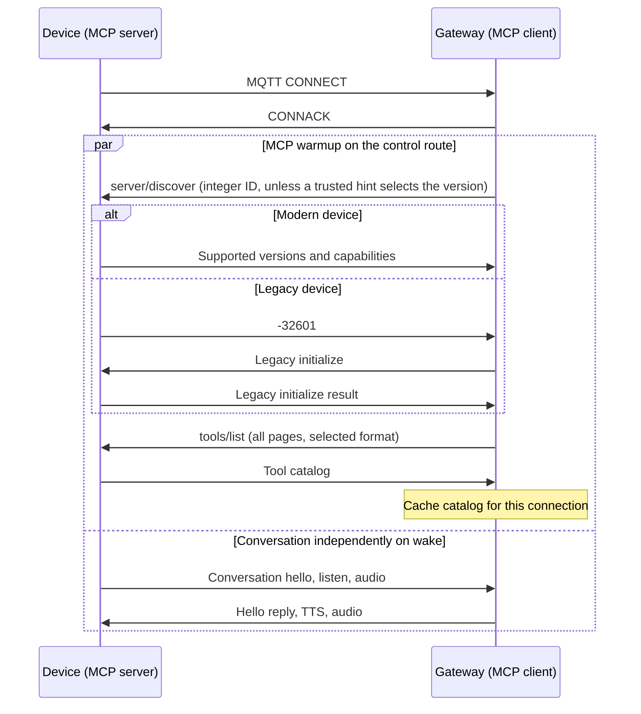

# WebSocket 与 MQTT 上的 MCP 协议

[English](mcp-protocol.md) | [工具注册](mcp-usage_zh.md)

设备是 **MCP 服务端**，调用工具的后端/网关是 **MCP 客户端**。
固件在两种传输上同时支持旧版 `2024-11-05` 和新版 `2026-07-28`。
网关发现、预取及可选凭据提示需要服务端配套。

## 1. 版本与兼容性

新版是[破坏性协议更新](https://modelcontextprotocol.io/specification/2026-07-28/basic/versioning)。
新版省去初始化，不取消 `tools/list`。固件保留两套请求格式以兼容，不代表支持中间所有版本。

| 后端/网关 | 设备 | 流程 |
|---|---|---|
| 旧版 | 旧版或双版本 | `initialize` → `tools/list` → `tools/call`。 |
| 双版本 | 旧版 | 发现返回 `-32601` → 旧版初始化、预热目录。 |
| 双版本 | 双版本 | 新版发现、预热目录；每次调用携带元数据。 |
| 仅新版 | 仅旧版 | 没有旧版回退则不兼容。 |

版本选择不依赖对话 hello。`features.mcp` 保持 true，`mcp_20260728` 表示支持新版。
OTA `protocol.features` 与两个 hello 共用能力来源，见 [OTA 协议能力上报](ota_zh.md#23-协议能力)。

## 2. 传输与连接预热

MCP 使用 WebSocket 文本或现有 MQTT 控制主题，不走 UDP 音频通道。
下方每个报文都是完整小智消息：`type: "mcp"` 包装 JSON-RPC `payload`。
外层 `session_id` 属于对话/路由；MQTT 连接预热时尚无对话 ID，后续调用按现有路由携带。
传输 hello 和音频格式见 [WebSocket](websocket_zh.md)、[MQTT/UDP](mqtt-udp_zh.md)。

MQTT 认证连接且控制路由就绪后，网关立即发现版本、读取**全部**工具分页并缓存，早于对话 hello。
首次探测使用整数 ID，避免旧固件忽略字符串 ID。直连 WebSocket 后端在原有传输 hello 后开始该流程。



每条连接只运行一个有界预热流程。重复唤醒/hello 复用已选版本及有效目录，重连才重新选择。
预热失败时工具暂不可用，语音继续。旧设备会在连接时多一次失败的发现往返，不是每次唤醒多一步。

### 2.1 可选网关版本提示

OTA 服务可以依据能力上报，通过与网关约定的凭据机制传递可信 `mcp_version` 提示。
编码和认证属于服务接入约定，固件原样使用返回的 MQTT 凭据。

| 可识别的可信提示 | 预热方式 |
|---|---|
| `2026-07-28` | 直接新版 `tools/list`，不初始化。 |
| `2024-11-05` | 旧版 `initialize`，再 `tools/list`。 |
| 缺失/不识别 | 按下文发现、回退。 |

提示描述当前运行固件。缓存凭据可能跨越升级/回滚；只读预热遇到版本不匹配时重新发现，不重放工具调用。

## 3. 新版请求与响应规则

每条新版请求，包括发现及每次分页，都携带 `payload.params._meta`：

| 键 | 取值 |
|---|---|
| `io.modelcontextprotocol/protocolVersion` | 必填字符串：`"2026-07-28"`。 |
| `io.modelcontextprotocol/clientCapabilities` | 必填对象；普通调用使用 `{}`。 |
| `io.modelcontextprotocol/clientInfo` | 可选身份信息，包含字符串 `name`、`version`，建议提供。 |

新版成功结果有 `resultType: "complete"`，固件同时返回
`result._meta["io.modelcontextprotocol/serverInfo"]`。错误使用 `error`，不使用 `result`。
参见[官方基础协议](https://modelcontextprotocol.io/specification/2026-07-28/basic/index)。

- ID 支持字符串或 ±(2^53−1) 范围内的整数，响应保留值及 JSON 类型。
  拒绝 null、小数、布尔、对象和数组 ID。通知没有 ID，不回复。
- 每条请求独立选择处理器。新版元数据或 `server/discover` 必须带合法新版字段；
  非法新版请求不会进入旧版。没有新版标记的列表、调用保留旧行为。
- 不支持的版本返回 `-32022`。选择 `2024-11-05` 要走旧版流程，不能放进新版元数据中使用。
  不相关的未知元数据忽略。
- 设备只声明工具和可用的视觉扩展，不实现资源、提示词等其他 MCP 可选能力。

## 4. 发现

网关在 MQTT 对话 hello 前发送：

```json
{
  "type": "mcp",
  "payload": {
    "jsonrpc": "2.0",
    "id": 10000,
    "method": "server/discover",
    "params": {
      "_meta": {
        "io.modelcontextprotocol/protocolVersion": "2026-07-28",
        "io.modelcontextprotocol/clientInfo": {
          "name": "xiaozhi-backend",
          "version": "example-backend"
        },
        "io.modelcontextprotocol/clientCapabilities": {}
      }
    }
  }
}
```

有摄像头工具的设备回复：

```json
{
  "type": "mcp",
  "payload": {
    "jsonrpc": "2.0",
    "id": 10000,
    "result": {
      "resultType": "complete",
      "supportedVersions": [
        "2026-07-28",
        "2024-11-05"
      ],
      "capabilities": {
        "tools": {},
        "extensions": {
          "me.xiaozhi/vision": {}
        }
      },
      "ttlMs": 60000,
      "cacheScope": "private",
      "_meta": {
        "io.modelcontextprotocol/serverInfo": {
          "name": "example-board",
          "version": "example-firmware"
        }
      }
    }
  }
}
```

无摄像头工具时省略 `me.xiaozhi/vision`。发现不替代 `tools/list`，也不安装视觉配置。

| 发现结果 | 网关处理 |
|---|---|
| 合法响应支持 `2026-07-28` | 预取、缓存新版工具分页。 |
| 首次探测返回 `-32601`，或明确只提供受支持的旧版 | 旧版初始化，再预取目录。 |
| 版本不支持 | 使用明确支持的共同版本，否则报告不兼容。 |
| 超时、断开、响应格式错误、ID 不匹配或其他错误 | 本次有界预热失败，不据此推断为旧版。 |

新版服务端必须实现发现，已知对端版本的调用方可以省略；参见[官方发现方法](https://modelcontextprotocol.io/specification/2026-07-28/server/discover)。

## 5. 工具列表、分页与缓存

版本确定后，网关立即请求：

```json
{
  "type": "mcp",
  "payload": {
    "jsonrpc": "2.0",
    "id": "list-1",
    "method": "tools/list",
    "params": {
      "withUserTools": false,
      "_meta": {
        "io.modelcontextprotocol/protocolVersion": "2026-07-28",
        "io.modelcontextprotocol/clientInfo": {
          "name": "xiaozhi-backend",
          "version": "example-backend"
        },
        "io.modelcontextprotocol/clientCapabilities": {}
      }
    }
  }
}
```

响应示例：

```json
{
  "type": "mcp",
  "payload": {
    "jsonrpc": "2.0",
    "id": "list-1",
    "result": {
      "resultType": "complete",
      "tools": [
        {
          "name": "self.audio_speaker.set_volume",
          "description": "Set the audio speaker volume.",
          "inputSchema": {
            "type": "object",
            "properties": {
              "volume": {
                "type": "integer",
                "minimum": 0,
                "maximum": 100
              }
            },
            "required": [
              "volume"
            ]
          }
        },
        {
          "name": "self.camera.take_photo",
          "description": "Take a photo and answer the question about it.",
          "inputSchema": {
            "type": "object",
            "properties": {
              "question": {
                "type": "string"
              }
            },
            "required": [
              "question"
            ]
          }
        }
      ],
      "ttlMs": 60000,
      "cacheScope": "private",
      "_meta": {
        "io.modelcontextprotocol/serverInfo": {
          "name": "example-board",
          "version": "example-firmware"
        }
      }
    }
  }
}
```

`withUserTools` 省略/false 时排除用户专用工具，true 时包含；它是可见性筛选，不是鉴权。
存在 `nextCursor` 时，将其原样放入下次 `params.cursor`，保持筛选条件并携带必需元数据。
读完所有分页才将目录标记为就绪。非法游标返回 `-32602`，可从第一页重新读取；空列表合法。
工具列表的 JSON-RPC 响应（含新版元数据）不超过 8000 字节，单个工具过大时返回错误。

发现、列表响应使用 `ttlMs: 60000`、`cacheScope: "private"`，遵循[官方缓存规则](https://modelcontextprotocol.io/specification/2026-07-28/server/utilities/caching)。
缓存归网关/后端所有，区分设备、固件/工具配置、协议版本、鉴权上下文、游标及筛选条件。
重连、相关配置变化或 TTL 到期时失效，按已选格式刷新。缓存回复保留剩余 TTL、private 范围，
并使用当前请求的 ID 和报文格式；不缓存工具执行结果或凭据。

## 6. 工具调用

后端已知有效工具 schema 时，可以不初始化而直接调用：

```json
{
  "session_id": "session-001",
  "type": "mcp",
  "payload": {
    "jsonrpc": "2.0",
    "id": "volume-1",
    "method": "tools/call",
    "params": {
      "name": "self.audio_speaker.set_volume",
      "arguments": {
        "volume": 50
      },
      "_meta": {
        "io.modelcontextprotocol/protocolVersion": "2026-07-28",
        "io.modelcontextprotocol/clientInfo": {
          "name": "xiaozhi-backend",
          "version": "example-backend"
        },
        "io.modelcontextprotocol/clientCapabilities": {}
      }
    }
  }
}
```

```json
{
  "session_id": "session-001",
  "type": "mcp",
  "payload": {
    "jsonrpc": "2.0",
    "id": "volume-1",
    "result": {
      "resultType": "complete",
      "content": [
        {
          "type": "text",
          "text": "true"
        }
      ],
      "isError": false,
      "_meta": {
        "io.modelcontextprotocol/serverInfo": {
          "name": "example-board",
          "version": "example-firmware"
        }
      }
    }
  }
}
```

执行失败仍使用相同结果结构，将 `isError` 设为 true，在 `content` 中放错误文本。
新版图片内容直接使用 `type`、`mimeType`、`data`，旧版图片 JSON 字符串包装保持不变。

## 7. 逐次 vision 配置

项目扩展只使用以下路径：

`payload.params._meta["io.modelcontextprotocol/clientCapabilities"].extensions["me.xiaozhi/vision"]`

| 字段 | 含义 |
|---|---|
| `url` | 必填、非空的 HTTP/HTTPS 图片解释地址。 |
| `token` | 可选字符串。缺失/空串时不发 Authorization，否则使用 `Bearer <token>`。 |

后端/网关在**每次**新版拍照调用中提供配置。模型只提供 `question` 等工具参数；
URL、token 不进入模型的输入 schema、发现、目录、结果或日志。

```json
{
  "session_id": "session-001",
  "type": "mcp",
  "payload": {
    "jsonrpc": "2.0",
    "id": "photo-1",
    "method": "tools/call",
    "params": {
      "name": "self.camera.take_photo",
      "arguments": {
        "question": "What is in front of me?"
      },
      "_meta": {
        "io.modelcontextprotocol/protocolVersion": "2026-07-28",
        "io.modelcontextprotocol/clientInfo": {
          "name": "xiaozhi-backend",
          "version": "example-backend"
        },
        "io.modelcontextprotocol/clientCapabilities": {
          "extensions": {
            "me.xiaozhi/vision": {
              "url": "https://vision.example.com/analyze",
              "token": "example-token-not-a-real-secret"
            }
          }
        }
      }
    }
  }
}
```

```json
{
  "session_id": "session-001",
  "type": "mcp",
  "payload": {
    "jsonrpc": "2.0",
    "id": "photo-1",
    "result": {
      "resultType": "complete",
      "content": [
        {
          "type": "text",
          "text": "There is a red cup on the table."
        }
      ],
      "isError": false,
      "_meta": {
        "io.modelcontextprotocol/serverInfo": {
          "name": "example-board",
          "version": "example-firmware"
        }
      }
    }
  }
}
```

固件在拍照、上传前校验扩展，并持有配置字符串直至 `Application::Schedule()` 延后执行结束。
新版调用不读取、覆盖旧版配置，缺失 token 不复用前值。
`Explain(question, url, token)` 复用现有上传逻辑，`Explain(question)` 使用保存的旧版配置转调。
普通工具注册方式不变，不新增 task、定时器或持久视觉缓存。

## 8. 错误与重试

| 情况 | 响应 |
|---|---|
| 非法 JSON / 非法 JSON-RPC 请求 | `-32700` / `-32600`。 |
| 新版元数据、视觉配置、参数缺失或非法 | 执行工具前返回 `-32602`。 |
| 不支持的版本 | `-32022`，带 `data.supported`、`data.requested`。 |
| 拍照缺少视觉能力 | `-32021`，带 `data.requiredCapabilities`。 |
| 未知方法 / 工具 | `-32601` / `-32602`。 |
| 工具执行失败 | 新版 `result.isError: true`；旧版错误 `-32603`。 |

版本不匹配示例：

```json
{
  "session_id": "session-001",
  "type": "mcp",
  "payload": {
    "jsonrpc": "2.0",
    "id": "version-1",
    "error": {
      "code": -32022,
      "message": "Unsupported protocol version",
      "data": {
        "supported": [
          "2026-07-28",
          "2024-11-05"
        ],
        "requested": "2099-01-01"
      }
    }
  }
}
```

缺少视觉能力示例：

```json
{
  "session_id": "session-001",
  "type": "mcp",
  "payload": {
    "jsonrpc": "2.0",
    "id": "photo-1",
    "error": {
      "code": -32021,
      "message": "Missing required client capability",
      "data": {
        "requiredCapabilities": {
          "extensions": {
            "me.xiaozhi/vision": {}
          }
        }
      }
    }
  }
}
```

只有首次发现探测的 `-32601` 用来选择旧版。非法请求、缺视觉配置、上传失败或超时不是降级信号。
只读发现、列表可在有界预热内重试；工具调用不能跨版本、重连自动重放，响应丢失不代表没有产生副作用。

## 9. 旧版流程

旧客户端继续初始化并保存视觉配置：

```json
{
  "type": "mcp",
  "payload": {
    "jsonrpc": "2.0",
    "id": 1,
    "method": "initialize",
    "params": {
      "protocolVersion": "2024-11-05",
      "capabilities": {
        "vision": {
          "url": "https://vision.example.com/analyze",
          "token": "example-token-not-a-real-secret"
        }
      },
      "clientInfo": {
        "name": "legacy-backend",
        "version": "example-backend"
      }
    }
  }
}
```

```json
{
  "type": "mcp",
  "payload": {
    "jsonrpc": "2.0",
    "id": 1,
    "result": {
      "protocolVersion": "2024-11-05",
      "capabilities": {
        "tools": {}
      },
      "serverInfo": {
        "name": "example-board",
        "version": "example-firmware"
      }
    }
  }
}
```

随后读取全部旧版目录分页，不带新版元数据；`notifications/initialized` 不回复。
后续拍照使用初始化时的配置：

```json
{
  "session_id": "session-001",
  "type": "mcp",
  "payload": {
    "jsonrpc": "2.0",
    "id": 3,
    "method": "tools/call",
    "params": {
      "name": "self.camera.take_photo",
      "arguments": {
        "question": "What is in front of me?"
      }
    }
  }
}
```

```json
{
  "session_id": "session-001",
  "type": "mcp",
  "payload": {
    "jsonrpc": "2.0",
    "id": 3,
    "result": {
      "content": [
        {
          "type": "text",
          "text": "There is a red cup on the table."
        }
      ],
      "isError": false
    }
  }
}
```

旧版响应不增加 `resultType`、新版缓存字段或逐次视觉配置要求，普通未标记的列表、调用不新增初始化门槛；旧版拍照仍需可用的旧版视觉配置。

## 10. 与 UDP probe 联测

固件同时支持两个 MCP 版本和 UDP probe。OTA 与传输 hello 共用一处能力生成逻辑，声明
`udp_probe: true`；MQTT 探测仍需双方协商成功。

```sh
git fetch origin main
git worktree add --detach ../xiaozhi-mcp-udp-test origin/main
cd ../xiaozhi-mcp-udp-test
# 加载 ESP-IDF 6.0.1+（优先 release/v6.1），并选择实际板型。
python3 -m unittest discover -s scripts/tests -v
python3 scripts/build.py kevin/c3 --name kevin-c3
# 或带摄像头的 S3 变体；每次构建会替换之前的输出。
python3 scripts/build.py bread-compact-wifi-s3cam --name bread-compact-wifi-s3cam
```

| 对端 | 验收内容 |
|---|---|
| 旧 MCP、无 probe | 原初始化、列表、调用及 UDP 行为。 |
| 新 MCP、无 probe | 新版调用不要求 UDP probe 健康检测。 |
| 旧 MCP、协商 probe | 旧版调用及认证 PING/PONG、RTT 日志。 |
| 新 MCP、协商 probe | 两者在唤醒、音频、工具调用、重连时正常。 |

验证 MQTT hello 前预取、旧设备回退、目录刷新、逐次视觉配置隔离、UDP 阻断、PONG 丢失/迟到、打断，
以及 C3 内部堆余量、任务栈高水位。新版发现需要测试对端配套。旧版 MCP 与 UDP probe 的唤醒、
语音及拍照链路已通过 S3 真机联调；丢包/防火墙故障注入、C3 堆余量及任务栈测量仍需单独验证。
