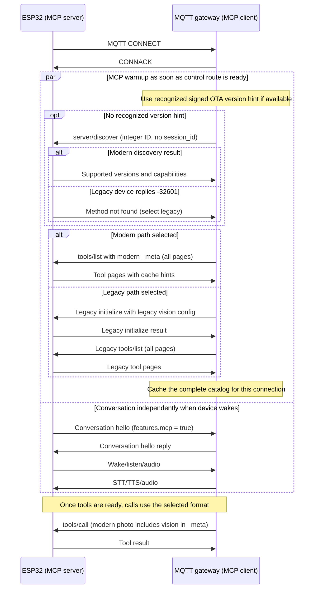

# WebSocket 与 MQTT 上的 MCP 协议

[English](mcp-protocol.md) | [工具注册用法](mcp-usage_zh.md)

**设备端状态：** 已实现旧版 `2024-11-05` 和新版 `2026-07-28` 工具请求。
网关发现、预取和可选提前版本提示仍需服务端配套；端到端真机验收与主机测试、固件构建分开记录。

本文说明两种报文格式，设备不增加额外任务。

## 1. 范围与兼容性

设备在小智的两种传输上支持新版 MCP 工具交互，同时保留现有 `2024-11-05` 行为。
ESP32 是 **MCP server**；发起请求的后端或网关是 **MCP client**，与谁主动建立网络连接无关。

`2026-07-28` 的线上协议是一次**破坏性更新**。仅支持新版的一端，不能自动与仅支持旧版的一端互通。
兼容需要实现两套流程：接受旧版初始化，也接受新版自包含请求。官方 SDK 的兼容能力不会自动升级
小智自行编写的分发器或网关。参见[官方兼容矩阵](https://modelcontextprotocol.io/specification/2026-07-28/basic/versioning)。

旧处理器继续在 `initialize` 回复 `2024-11-05`、保留初始化视觉配置。
新处理器校验请求元数据，实现发现、新版响应，并为每次调用持有自己的视觉配置。
两条路径都不需要等待新增的设备任务。

小智的交互行为为：

- 保留 `features.mcp: true`；MQTT 连接时、对话 hello 之前确定版本。
- 视觉配置随每次相关调用放入 `params._meta`。
- 保留现有 MCP 外层封装和传输鉴权。
- 保留 `tools/list`：它用于发现工具及参数，新版没有删除该方法。
- 实现必需的基础行为及 tools 能力。本方案不增加或声明 resources、prompts、sampling、
  elicitation、subscriptions、tasks 等能力。

官方变更清单以 `2025-11-25` 为对照，而当前固件旧处理器声明的是 `2024-11-05`。
本方案支持两个指定版本，不代表支持中间所有版本。必须完成的改动不只是去掉握手：

| 范围 | 小智需要做的改动 |
|---|---|
| 初始化、协议会话 | 保留旧处理器；新版请求自包含。小智外层对话 ID 继续保留。 |
| 版本、调用方能力 | 校验逐请求必需的 `_meta`，实现新版版本、能力错误。 |
| 端点发现 | 实现 `server/discover`；没有可识别签名版本提示时，MQTT 网关在连接时先发现，再预热工具缓存。 |
| 响应 | 新版输出 `resultType`；明确走旧版时，把没有该字段的旧响应按 complete 理解。 |
| 目录缓存 | 增加必需的 `ttlMs`、`cacheScope`，保留分页和过滤语义。 |
| Vision | 定义带命名空间的项目扩展，逐次传入配置，不依赖共享初始化状态。 |
| 网关、后端 | 同时升级整条路径的请求生成、转发、拦截响应及缓存。 |
| 仅 HTTP 及未使用的可选功能 | 按实际暴露的端点、能力处理，不塞进设备工具流程。 |

字符串请求 ID 是 JSON-RPC 原有要求。分发器现已支持字符串、安全整数，
经过调度及响应后保留原值、JSON 类型。

## 2. 传输 hello 与版本发现时机

保留现有布尔能力声明 `features.mcp: true`。版本选择不依赖 hello 的 feature：
设备会在共享能力表中声明 `mcp_20260728`，
但 MQTT 初始化、工具预取不能等待对话 hello。
OTA 和两个 hello 构造器共用能力来源；网关仍根据发现或可信提前提示选择请求版本。
不增加 `mcp_versions`。

可选的[OTA 协议能力上报](ota_zh.md#10-协议能力上报)
可以为网关提前选择版本提供信息。如何把选择传给网关属于第 2.1 节的部署接入约定，
不是 OTA 的 username 格式。识别为新版时直接预热新版目录，识别为旧版时直接初始化、预热；
没有可识别提示时，使用连接时发现、回退。该可选路径须配套实现，不是基线支持的前提。

以下为 WebSocket 的设备 hello 和后端 hello：

```json
{
  "type": "hello",
  "version": 1,
  "transport": "websocket",
  "features": {
    "mcp": true,
    "mcp_20260728": true,
    "udp_probe": false,
    "aec": false,
    "glyph_push": false
  },
  "audio_params": {
    "format": "opus",
    "sample_rate": 16000,
    "channels": 1,
    "frame_duration": 60
  }
}
```

```json
{
  "type": "hello",
  "transport": "websocket",
  "session_id": "session-001",
  "audio_params": {
    "format": "opus",
    "sample_rate": 24000,
    "channels": 1,
    "frame_duration": 60
  }
}
```

MQTT/UDP 继续使用传输版本 `3`，MCP 走 MQTT，不走 UDP。
下面这些消息用于开启对话；收到它们以前，网关可能已经完成 MCP 发现并缓存工具：

```json
{
  "type": "hello",
  "version": 3,
  "transport": "udp",
  "features": {
    "mcp": true,
    "mcp_20260728": true,
    "udp_probe": false,
    "aec": false,
    "glyph_push": false
  },
  "audio_params": {
    "format": "opus",
    "sample_rate": 16000,
    "channels": 1,
    "frame_duration": 60
  }
}
```

```json
{
  "type": "hello",
  "transport": "udp",
  "session_id": "session-001",
  "audio_params": {
    "format": "opus",
    "sample_rate": 24000,
    "channels": 1,
    "frame_duration": 60
  },
  "udp": {
    "server": "udp.example.com",
    "port": 8888,
    "encryption": "aes-128-ctr",
    "key": "00112233445566778899aabbccddeeff",
    "nonce": "01000000010203040000000000000000"
  }
}
```

其他能力（包括 AEC、字形推送、UDP probe）保持独立。
示例中的音频参数和 UDP 凭据仅用于说明报文。

选择及时间规则：

1. MQTT 鉴权连接就绪、可以收发设备控制消息后，网关先使用鉴权 username 中可识别的版本提示；
   没有提示时立即发送 `server/discover`，使用整数 ID，不带对话 `session_id`。
   不等待 hello，也不在 MQTT 连接时额外请求一次 OTA。
2. 合法发现响应确定双方支持的版本。选择 `2026-07-28` 后，按新版元数据预取
   `tools/list` 并缓存所有分页，保留连接时预热。
3. 此发现探测收到 `-32601`，表示当前旧固件不认识该方法：执行 `initialize`，
   然后预取、缓存旧版工具目录。其他结果见第 4 节。
4. 后续对话 hello 复用当前连接的发现结果及有效目录，不能每次唤醒、hello 都重新发现、
   初始化或完整加载工具列表。
5. 直连 WebSocket 后端在现有控制通道、传输 hello 就绪后，使用相同的发现、回退逻辑。
   只需原有 `mcp` 能力，不需要 hello 版本 flag；不能把 MQTT 预热也拖到这个较晚的时机。
6. 发现决定网关如何生成自己的请求，不会在设备上建立必需的 MCP 会话。
   固件仍按每次请求自身的元数据分发，也继续接受旧客户端请求。

即使 hello 意外带有版本 flag，也不能覆盖已经完成的发现结果。
新版请求仍须通过 `_meta` 声明实际 MCP 版本。基线路径不要求修改 OTA 或凭据；
可选可信提示属于第 2.1 节需要配套实现的网关接入优化。

### 2.1 可选网关版本提示

OTA 服务签发 MQTT 凭据时，可以利用设备上报的协议能力。
在签发方、网关明确约定的部署中，凭据可以承载受保护的 `mcp_version` 提示。
其编码、认证、提取属于网关接入约定；不是所有 MQTT username 都能解码，
OTA 接口也不定义 username 的内部字段。固件始终原样使用返回的凭据字符串。

| 配置网关解释出的可信提示 | 连接时预热 |
|---|---|
| `2026-07-28` | 直接预取、缓存新版工具列表，不发现、不初始化。 |
| `2024-11-05` | 旧版初始化、预取并缓存工具，不发现。 |
| 版本缺失或不认识 | `server/discover` 及明确的旧版回退。 |

签发方加入提示后，须按原有凭据认证规则处理。
不能假定任意 username 是 JSON、Base64，也不能信任未经验证的字段。
公开 OTA 说明只约定能力上报及不透明凭据下发；
本节提示是特定签发方、网关之间的接入约定。

提示描述当前运行固件，不是下一次准备下载的镜像。
缓存凭据可能跨越 OTA 失败、升级、回滚；能力变化时刷新提示，
只读预热出现明确不匹配时用发现确认，不能重放工具调用。
实际新版请求仍通过 `_meta` 声明版本。

## 3. 封装、元数据、ID 与分发

下文所有 MCP 示例都是完整的应用层 JSON 报文，外层为 `type: "mcp"`，内层 `payload` 为 JSON-RPC。
WebSocket 以文本发送，MQTT 使用现有控制主题。外层 `session_id` 属于小智的对话、路由层，
不是 MCP 协议会话；现有传输需要时继续携带。MQTT 连接时的发现、初始化和工具预取
使用已经建立的设备控制路由，不带对话 `session_id`；这些交互的示例特意省略了该字段。

每个新版请求都使用 `payload.params._meta`，发现请求和每一页查询也一样：

| `_meta` 内的字段 | 要求 |
|---|---|
| `io.modelcontextprotocol/protocolVersion` | 必需的字符串；本次新版实现使用 `"2026-07-28"`。 |
| `io.modelcontextprotocol/clientCapabilities` | 必需的对象；无需调用方能力时传 `{}`。 |
| `io.modelcontextprotocol/clientInfo` | 建议携带的调用方身份；示例全部携带。 |
| `io.modelcontextprotocol/logLevel` | 可选；没有明确请求时不产生 MCP 日志通知。 |

新版普通成功响应包含 `resultType: "complete"`；本方案同时要求每个新版成功响应携带
`result._meta["io.modelcontextprotocol/serverInfo"]`。错误响应使用 `error`，不使用 `result`，
也不需要 `resultType`。
这些字段来自[官方基础协议](https://modelcontextprotocol.io/specification/2026-07-28/basic/index#_meta)。

请求 ID 支持字符串和安全范围内的整数。经过调度、网关映射和响应后，必须保留 ID 的值及 JSON 类型，
不能把字符串转为 `int`。拒绝小数、null、布尔值、对象、数组类型的请求 ID。
无法恢复的非法 ID 不能替换为某个正在等待的有效请求 ID。合法通知没有 ID，不回复。

新旧分发按每次请求决定，并且必须在工具产生副作用前完成：

- 不带新版协议字段的 `initialize` 进入旧版处理。
- 携带新版版本键的请求按新版校验；必需的配套字段缺失、类型错误或视觉数据非法时直接报错，
  不能再交给旧版处理器尝试。
- `server/discover` 或其他新版专用元数据缺少必需的版本、能力字段时，属于非法新版请求。
- 没有新版协议元数据的普通 `tools/list`、`tools/call` 保留现有旧版行为。
  设备无法区分“完全没标记的新版请求”和旧请求；后端必须保证新版请求始终附带元数据。
- 不支持的版本回复 `-32022` 并列出支持版本。选择 `2024-11-05` 意味着走旧版 `initialize`，
  不能只把无状态请求中的版本字符串改为旧日期。
- 不相关的未知元数据忽略；未知方法回复 `-32601`。
  旧版 `notifications/initialized` 继续容忍且不回复。

## 4. 连接时发现与旧版回退

MCP 规范规定：调用方可以省略 `server/discover`，新版服务端必须实现。
没有可识别的签名 OTA 版本提示时，本方案将它作为每次 MQTT 鉴权连接后的第一条请求，
在对话 hello 之前选择预热路径。有可识别提示时可省略探测，见第 2 节。
这是小智自己的 MQTT 绑定策略，不表示 MCP 官方定义了 MQTT 传输。
参见[官方发现方法](https://modelcontextprotocol.io/specification/2026-07-28/server/discover)。

网关发送第一条报文，支持新版且带摄像头的设备回复第二条。
此时还没有对话 `session_id`。首次探测使用整数 ID `10000`，
因为当前旧分发器会拒绝字符串 ID；确定支持后，后续请求可以使用任一受支持的 ID 类型。

```json
{
  "type": "mcp",
  "payload": {
    "jsonrpc": "2.0",
    "id": 10000,
    "method": "server/discover",
    "params": {
      "_meta": {
        "io.modelcontextprotocol/protocolVersion": "2026-07-28",
        "io.modelcontextprotocol/clientInfo": {
          "name": "xiaozhi-backend",
          "version": "example-backend"
        },
        "io.modelcontextprotocol/clientCapabilities": {}
      }
    }
  }
}
```

```json
{
  "type": "mcp",
  "payload": {
    "jsonrpc": "2.0",
    "id": 10000,
    "result": {
      "resultType": "complete",
      "supportedVersions": [
        "2026-07-28",
        "2024-11-05"
      ],
      "capabilities": {
        "tools": {},
        "extensions": {
          "me.xiaozhi/vision": {}
        }
      },
      "ttlMs": 60000,
      "cacheScope": "private",
      "_meta": {
        "io.modelcontextprotocol/serverInfo": {
          "name": "example-board",
          "version": "example-firmware"
        }
      }
    }
  }
}
```

`supportedVersions` 同时列出新旧两代；选择 `2024-11-05` 仍须走旧版初始化。
无摄像头工具的设备不声明视觉扩展，未实现相应行为前不声明 `listChanged` 等能力。
发现响应没有视觉地址或 token，不能代替 `tools/list`，也不会安装可复用的逐调用配置。

现有旧设备收到完全相同的探测后，回复未知方法错误：

```json
{
  "type": "mcp",
  "payload": {
    "jsonrpc": "2.0",
    "id": 10000,
    "error": {
      "code": -32601,
      "message": "Method not implemented: server/discover"
    }
  }
}
```

随后网关执行第 9 节的旧版 `initialize` 交互，携带旧版 vision 配置，
再查询旧版分页 `tools/list`。与当前逻辑一样，在 MQTT 连接时缓存完整目录，不能等到后续 hello。

| 发现结果 | 预取目录前的网关动作 |
|---|---|
| 合法 complete 结果支持 `2026-07-28` | 选择新版请求，查询、缓存新版工具分页。 |
| 探测返回 `-32601` | 执行旧版 `initialize`，再查询、缓存旧版工具分页。 |
| complete 结果或 `-32022` 明确只提供我们支持的旧版本 | 选择旧版初始化，再加载目录。 |
| `-32022` 提供另一个双方已实现的新版版本 | 使用该版本重试发现；本方案只实现指定的新版日期。 |
| 没有双方已实现的版本 | 报告不兼容，不能把目录标为就绪。 |
| 超时、断连、响应格式非法、ID 不匹配或其他错误 | 本次预热失败，不据此推断为旧版，也不重试工具调用。 |

沿用现有有界 MCP 请求超时和网关初始化并发控制。
每条连接最多一个预热工作流，重复 hello 不能启动重复探测。
失败时清理等待请求，状态必须区别于合法空目录；报告工具暂不可用，语音仍可继续。
显式管理操作或新连接可以发起下一次有界尝试，本方案不增加轮询循环。

网关在当前连接中保留生成请求所用的代际。重连清除此选择，按当前凭据或发现重新确定。
可选 OTA 提示必须随运行能力变化刷新；缓存凭据可能跨越升级、回滚或 OTA 请求失败，
只读预热出现明确不匹配时用发现重新确认。
工具目录 TTL 刷新使用已经选定的格式，不在每次刷新时重新探测代际。
网关的逐连接选择不会改变设备逐请求、无状态的语义。

没有提示的基线路径中，新设备用一次发现往返替代原来的一次初始化往返；
旧设备在原初始化之前多一次失败探测。两者都发生在连接预热阶段，
不是每次唤醒或对话 hello 的固定新增步骤。

## 5. 工具发现、分页与缓存

发现确定新版模式后，MQTT 网关立即查询 `tools/list` 并缓存所有分页，无需初始化，
也无需对话 hello。因此这些预取示例省略 `session_id`。之后后端有有效目录时可以直接调用；
目录失效则使用已选择的格式刷新。这里用两个工具演示完整目录，实际集合由板型及注册结果决定。
[新版规范仍保留工具发现](https://modelcontextprotocol.io/specification/2026-07-28/server/tools)。

后端发给设备：

```json
{
  "type": "mcp",
  "payload": {
    "jsonrpc": "2.0",
    "id": "list-1",
    "method": "tools/list",
    "params": {
      "withUserTools": false,
      "_meta": {
        "io.modelcontextprotocol/protocolVersion": "2026-07-28",
        "io.modelcontextprotocol/clientInfo": {
          "name": "xiaozhi-backend",
          "version": "example-backend"
        },
        "io.modelcontextprotocol/clientCapabilities": {}
      }
    }
  }
}
```

```json
{
  "type": "mcp",
  "payload": {
    "jsonrpc": "2.0",
    "id": "list-1",
    "result": {
      "resultType": "complete",
      "tools": [
        {
          "name": "self.audio_speaker.set_volume",
          "description": "Set the audio speaker volume.",
          "inputSchema": {
            "type": "object",
            "properties": {
              "volume": {
                "type": "integer",
                "minimum": 0,
                "maximum": 100
              }
            },
            "required": [
              "volume"
            ]
          }
        },
        {
          "name": "self.camera.take_photo",
          "description": "Take a photo and answer the question about it.",
          "inputSchema": {
            "type": "object",
            "properties": {
              "question": {
                "type": "string"
              }
            },
            "required": [
              "question"
            ]
          }
        }
      ],
      "ttlMs": 60000,
      "cacheScope": "private",
      "_meta": {
        "io.modelcontextprotocol/serverInfo": {
          "name": "example-board",
          "version": "example-firmware"
        }
      }
    }
  }
}
```

某一页有 `nextCursor` 时，下一次 `tools/list` 在 `params.cursor` 中原样携带该不透明字符串，
保持 `withUserTools` 一致，并继续携带必需的请求元数据，直到 `nextCursor` 缺失或为空。
工具顺序保持稳定，不能把未拉完的目录当作完整目录。未知、非法 cursor 返回 `-32602`；
后端可以不带 cursor 重新发现。

保留小智的 `withUserTools` 扩展：省略或为 false 时只列普通工具；true 时包含普通工具和 user-only 工具。
该字段是可见性选择，不是身份认证或授权。不同选择及鉴权上下文的缓存必须分开。

新版发现、列表响应按[官方缓存规则](https://modelcontextprotocol.io/specification/2026-07-28/server/utilities/caching)
包含 `ttlMs` 和 `cacheScope`。本方案初始策略取 `60000` 毫秒及 `"private"`，不是新增协议常量。
缓存放在后端或网关，ESP32 不新增工具目录缓存。已有有效目录时可以直接调用。
TTL 在使用时检查，不增加轮询任务。

缓存身份必须区分设备、固件或工具配置、协议代际、鉴权上下文，以及影响结果的全部参数
（包括 cursor 和 `withUserTools`）。重连、身份或固件变化、相关配置变化、TTL 失效或发现目录变化时，
清除相应缓存。网关返回缓存页时不能重新开始计算保鲜期：应返回剩余 TTL，并保留 private 范围。
不缓存工具执行结果或凭据。本方案不增加工具目录 hash 或变更通知。

## 6. 普通工具调用

该调用不需要视觉能力；后端已知有效工具定义时，它可以是第一条 MCP 请求。后端发给设备：

```json
{
  "session_id": "session-001",
  "type": "mcp",
  "payload": {
    "jsonrpc": "2.0",
    "id": "volume-1",
    "method": "tools/call",
    "params": {
      "name": "self.audio_speaker.set_volume",
      "arguments": {
        "volume": 50
      },
      "_meta": {
        "io.modelcontextprotocol/protocolVersion": "2026-07-28",
        "io.modelcontextprotocol/clientInfo": {
          "name": "xiaozhi-backend",
          "version": "example-backend"
        },
        "io.modelcontextprotocol/clientCapabilities": {}
      }
    }
  }
}
```

设备回复后端：

```json
{
  "session_id": "session-001",
  "type": "mcp",
  "payload": {
    "jsonrpc": "2.0",
    "id": "volume-1",
    "result": {
      "resultType": "complete",
      "content": [
        {
          "type": "text",
          "text": "true"
        }
      ],
      "isError": false,
      "_meta": {
        "io.modelcontextprotocol/serverInfo": {
          "name": "example-board",
          "version": "example-firmware"
        }
      }
    }
  }
}
```

## 7. 随调用传递的 vision 配置

### 7.1 固定字段路径及所有权

在官方能力扩展映射下定义小智扩展标识 `me.xiaozhi/vision`。它是项目扩展，不是 MCP 内置视觉字段；
反向域名命名空间对应 `xiaozhi.me`。新版 vision 配置唯一规定的位置是：

`payload.params._meta["io.modelcontextprotocol/clientCapabilities"].extensions["me.xiaozhi/vision"]`

| 字段 | 要求 |
|---|---|
| `url` | 必需的非空 HTTP/HTTPS 图片解释接口地址，不能是 WebSocket 地址。 |
| `token` | 可选字符串；缺失或为空则不加 Authorization 头，否则使用 `Bearer <token>`。 |

发现选择新版设备路径后，每次拍照都由后端或网关在模型选定工具及参数后注入该对象。
连接时的发现及缓存工具列表，不会安装一份可复用的 vision 配置。不能把地址、token 放进面向模型的 `inputSchema`，
不能让模型生成凭据，也不能将它们回显到结果、发现响应、工具目录或日志。
无关工具只需 `clientCapabilities: {}`。每次拍照都携带自己的扩展对象，即使与上一次相同。

### 7.2 完整拍照调用与响应

后端发给设备；下面的 token 是虚构示例：

```json
{
  "session_id": "session-001",
  "type": "mcp",
  "payload": {
    "jsonrpc": "2.0",
    "id": "photo-1",
    "method": "tools/call",
    "params": {
      "name": "self.camera.take_photo",
      "arguments": {
        "question": "What is in front of me?"
      },
      "_meta": {
        "io.modelcontextprotocol/protocolVersion": "2026-07-28",
        "io.modelcontextprotocol/clientInfo": {
          "name": "xiaozhi-backend",
          "version": "example-backend"
        },
        "io.modelcontextprotocol/clientCapabilities": {
          "extensions": {
            "me.xiaozhi/vision": {
              "url": "https://vision.example.com/analyze",
              "token": "example-token-not-a-real-secret"
            }
          }
        }
      }
    }
  }
}
```

```json
{
  "session_id": "session-001",
  "type": "mcp",
  "payload": {
    "jsonrpc": "2.0",
    "id": "photo-1",
    "result": {
      "resultType": "complete",
      "content": [
        {
          "type": "text",
          "text": "There is a red cup on the table."
        }
      ],
      "isError": false,
      "_meta": {
        "io.modelcontextprotocol/serverInfo": {
          "name": "example-board",
          "version": "example-firmware"
        }
      }
    }
  }
}
```

### 7.3 执行与生命周期

在拍照或上传产生副作用之前校验：

- 拍照请求缺少视觉能力时，返回 `MissingRequiredClientCapability`（`-32021`）。
  已提供但格式非法、URL 非法或 token 不是字符串时，返回 `-32602`。
- 检查 URL scheme 及 token 的头部安全性，遵循现有传输大小限制和部署端点策略。
  不记录含 token 的原始请求日志。
- 调度工具前只复制执行所需的小型上下文；收到的消息释放后，不能继续引用其中借用的 `cJSON` 指针。
  上下文持有视觉字符串，直到执行完成、失败或取消。
- 把 vision 显式传入本次执行。新版调用不能读取、覆盖旧版 `SetExplainUrl()` 保存的共享配置，
  错误路径也一样；不能通过临时设置全局 URL/token、执行后再恢复来实现。
- token 缺失不能复用旧 token；vision 缺失不能回退到上次调用、旧初始化、其他用户或其他连接。
- 保留现有摄像头串行执行和帧所有权。延迟执行期间上下文必须有效，响应仍绑定原请求及原连接。

实现使用小型自有请求上下文及显式的 `Explain(question, url, token)` 重载。
原 `Explain(question)` 使用旧配置转调该入口。
`Esp32Camera`、`EspVideo`、`SscmaCamera` 复用原来的拍照、编码、上传主体，
普通工具仍使用原有注册回调接口。不增加任务、定时器、token 持久化或跨调用配置缓存。

设备长期设置仍可由 OTA、现有配置接口加载；MQTT/UDP 地址及音频 key 仍留在传输 hello，
不迁入 MCP 元数据。

## 8. 错误与重试边界

请求非法、不支持的版本或方法、未知工具、参数非法时，使用 JSON-RPC error。
请求合法但拍照、上传等执行失败时，新版使用 `resultType: "complete", isError: true` 工具结果。
旧版路径保留原有 `-32603` 执行失败错误，新版路径返回 `isError: true` 工具结果。

| 情况 | 新版响应 |
|---|---|
| JSON 非法 / JSON-RPC 结构非法 | `-32700` / `-32600`，工具不产生副作用。 |
| 可识别的新版请求缺少必需元数据、类型非法、视觉格式非法 | `-32602`。 |
| 请求版本不受支持 | `-32022`，带 `data.supported` 和 `data.requested`。 |
| 拍照调用缺少视觉能力 | `-32021`，`data.requiredCapabilities` 为对象。 |
| 未知方法 / 未知工具 | `-32601` / `-32602`。 |
| 合法工具调用执行失败 | `isError: true` 的新版工具结果。 |

请求声明 `2099-01-01` 时，版本错误响应如下：

```json
{
  "session_id": "session-001",
  "type": "mcp",
  "payload": {
    "jsonrpc": "2.0",
    "id": "version-1",
    "error": {
      "code": -32022,
      "message": "Unsupported protocol version",
      "data": {
        "supported": [
          "2026-07-28",
          "2024-11-05"
        ],
        "requested": "2099-01-01"
      }
    }
  }
}
```

缺少视觉能力：

```json
{
  "session_id": "session-001",
  "type": "mcp",
  "payload": {
    "jsonrpc": "2.0",
    "id": "photo-1",
    "error": {
      "code": -32021,
      "message": "Missing required client capability",
      "data": {
        "requiredCapabilities": {
          "extensions": {
            "me.xiaozhi/vision": {}
          }
        }
      }
    }
  }
}
```

已提供的视觉配置格式非法：

```json
{
  "session_id": "session-001",
  "type": "mcp",
  "payload": {
    "jsonrpc": "2.0",
    "id": "photo-1",
    "error": {
      "code": -32602,
      "message": "Invalid vision configuration"
    }
  }
}
```

合法拍照调用的上传执行失败：

```json
{
  "session_id": "session-001",
  "type": "mcp",
  "payload": {
    "jsonrpc": "2.0",
    "id": "photo-1",
    "result": {
      "resultType": "complete",
      "content": [
        {
          "type": "text",
          "text": "Failed to upload photo"
        }
      ],
      "isError": true,
      "_meta": {
        "io.modelcontextprotocol/serverInfo": {
          "name": "example-board",
          "version": "example-firmware"
        }
      }
    }
  }
}
```

错误结构依据[官方 schema](https://github.com/modelcontextprotocol/modelcontextprotocol/blob/main/schema/2026-07-28/schema.ts)。
不能给新版保留错误码分配自定义业务含义。

收到明确版本响应后，后端可以切换到兼容代际，重试只读的发现、列表查询。
不能因元数据非法、缺少视觉能力、上传失败或超时而静默降级。
明确的 `-32601` 回退仅适用于第 4 节首次发现探测，不适用于工具执行期间任意未知方法。
响应丢失时工具可能已经执行；更换 JSON-RPC ID 不会让重试变成幂等操作。
不能跨版本或重连自动重放有副作用的调用。本方案不增加 ACK 或逐工具重放缓存。

## 9. 继续保留旧版流程

旧后端继续使用 `features.mcp` 和保留的旧版路径。新 MQTT 网关的发现探测收到 `-32601`，
或签名提示明确选择旧版后，也在对话 hello 前执行下面的旧版交互。这些初始化报文省略 `session_id`，
其中的视觉配置只属于旧版上下文：

```json
{
  "type": "mcp",
  "payload": {
    "jsonrpc": "2.0",
    "id": 1,
    "method": "initialize",
    "params": {
      "protocolVersion": "2024-11-05",
      "capabilities": {
        "vision": {
          "url": "https://vision.example.com/analyze",
          "token": "example-token-not-a-real-secret"
        }
      },
      "clientInfo": {
        "name": "legacy-backend",
        "version": "example-backend"
      }
    }
  }
}
```

```json
{
  "type": "mcp",
  "payload": {
    "jsonrpc": "2.0",
    "id": 1,
    "result": {
      "protocolVersion": "2024-11-05",
      "capabilities": {
        "tools": {}
      },
      "serverInfo": {
        "name": "example-board",
        "version": "example-firmware"
      }
    }
  }
}
```

旧版可以随后发送 `notifications/initialized`，无需回复。旧版 `tools/list` 继续支持分页，
不要求新版元数据。旧版初始化后的拍照调用仍为：

```json
{
  "session_id": "session-001",
  "type": "mcp",
  "payload": {
    "jsonrpc": "2.0",
    "id": 3,
    "method": "tools/call",
    "params": {
      "name": "self.camera.take_photo",
      "arguments": {
        "question": "What is in front of me?"
      }
    }
  }
}
```

```json
{
  "session_id": "session-001",
  "type": "mcp",
  "payload": {
    "jsonrpc": "2.0",
    "id": 3,
    "result": {
      "content": [
        {
          "type": "text",
          "text": "There is a red cup on the table."
        }
      ],
      "isError": false
    }
  }
}
```

不能把 `resultType`、新版缓存字段或逐次视觉配置要求塞进旧版响应约定。
普通旧版列表、调用继续保留目前没有初始化门槛的行为；
旧版拍照仍须具备可用的旧版视觉配置。

| 面向设备的后端或网关 | 设备 | 结果 |
|---|---|---|
| 旧版 | 旧版 | 原有初始化、列表、调用。 |
| 旧版 | 新旧双支持 | 仍走旧版，设备保留旧处理器。 |
| 新旧双支持 | 旧版 | 识别到旧版提示或发现返回 `-32601`，旧版初始化、预取并缓存。 |
| 新旧双支持 | 新旧双支持 | 连接时选择版本、预取并缓存；新版调用各自携带元数据。 |
| 仅新版 | 仅旧版 | 不兼容，明确报错，不能声称自动升级。 |

回滚是让后续操作选择保留的旧版流程，不是删除旧处理器，也不能重放执行结果不确定的上一条工具调用。

## 10. 连接预热、对话时序与网关职责



保留 MQTT 连接时的工具预热及目录缓存。第一次对话通常直接复用已经准备好的目录。
如果 hello 在发现、预取尚未完成时到达，不能重新启动预热，也不能阻塞监听或 TTS；
只有依赖未完成目录的操作等待有界准备过程，或得到明确的暂不可用错误。
后续 hello 不清除代际选择或目录缓存；TTL 失效只可能需要刷新目录，不需要重新初始化。
重新选择代际（使用提示或发现）的边界是传输重连，不是开启一段新对话。

`xz-mqtt` 项目已经在 `handleConnected()` 中初始化设备工具，早于对话 hello，
并拦截部分上游 MCP 请求、从缓存回复。改造时保留这个时机：

1. 在原连接预热入口，有可识别签名 OTA 提示时直接选择；没有时使用 `server/discover`
   和第 4 节的回退。
   复用初始化并发限制及等待请求清理。hello 既不启动重复工作流，也不决定代际。
2. 网关主动发出的新版请求生成必需元数据。现有 `mcp_client.capabilities.vision` 配置
   可以提供参数，但每次新版拍照都要注入；旧版路径继续通过初始化安装旧版视觉配置。
3. 转发调用时保留元数据。若上游和网关都提供视觉配置，使用一个明确、可信的来源策略，
   不能把一方的 URL 与另一方 token 混用，也不能意外覆盖上游整组参数。
4. 缓存的 `server/discover`、`tools/list` 回复应匹配请求代际、ID 类型、过滤条件、
   鉴权上下文及剩余 TTL。缓存的旧初始化结果不等于新版发现结果。
   合法空目录须与预热失败、未完成区分。
5. 保留旧上游路径。对双支持设备服务旧版调用时，回复初始化成功之前，应确保旧初始化
   真正安装了对应 vision 配置；只有一份新版发现缓存，并不能提供旧版视觉状态。
6. 设备发现响应描述设备这一段，不自动代表网关上游端点。
   上游发现只能声明整条拦截、转发路径可处理的版本和方法。
   旧网关可以继续按旧版访问新设备，但不会自动获得新版行为。
7. 首阶段采用端到端新版路径或明确的旧版路径，不假定存在通用跨代际适配器。
   后续适配器须转换元数据、视觉所有权、结果及错误；删除拍照请求的 `_meta` 不是合法转换。
8. 隔离设备重连及上游 bridge 替换前后的在途请求；迟到结果不能投递给 ID 恰好复用的新连接。

## 11. 实现归属与资源约束

下表设备端条目已经实现；网关、后端条目说明端到端部署仍需配套的工作：

| 归属 | 必需改动 |
|---|---|
| `main/protocols/protocol.*` 及传输接入 | 保留 `features.mcp`；MQTT 在对话 hello 前可收发 MCP 控制消息，不用 hello 版本门槛，不改变音频版本。 |
| `main/mcp_server.*` | 逐请求代际和元数据校验、字符串及整数 ID、发现方法、新版响应及缓存字段和错误、经过现有调度时拥有自己的请求上下文。 |
| `main/boards/common/camera.h` 及适用摄像头实现 | 逐次显式传入 vision，同时保留旧接口及行为。 |
| `xz-mqtt/src/gateway.ts` | 连接时发现、回退及目录预热；注入、转发元数据，按代际处理拦截、缓存、请求身份及重连。 |
| 后端 MCP client | 根据发现选择版本、请求元数据、目录缓存使用、逐次 vision 注入、错误及兼容处理。 |

不增加专用 MCP task、逐请求任务堆栈、轮询定时器、无界队列或设备端工具目录副本。
复用现有应用调度、有界消息及工具执行路径；协议迁移不能给主任务、音频任务增加阻塞工作。
只有拍照调用需要拥有 URL/token 字符串。摄像头始终是可选能力，包含无 LVGL、无摄像头构建。

保留现有约 8000 字节的列表结果预算；追加每个工具前，重新计算包含新版字段的序列化大小，
同时遵守外层传输报文限制。不能只为补 `resultType` 再分配一个大型 JSON 缓冲区。
超大输入按现有传输限制拒绝，不能假设有 PSRAM 或足够 SRAM 放下完整 SDK。

HTTP MCP 要求（`Mcp-Method`、`Mcp-Name` 头，删除 `Mcp-Session-Id`，OAuth 变化）
在暴露独立 Streamable HTTP 端点时处理，不是往小智 MQTT/WebSocket 报文里添加这些字段。
同样，删除 MCP 的 `ping` RPC 不等于删除 UDP probe、MQTT keepalive 或 WebSocket 传输 ping。
参见[官方变更清单](https://modelcontextprotocol.io/specification/2026-07-28/changelog)。

不能仅为采用新版工具流程就声明 sampling、elicitation、tasks。
将来工具需要多轮输入时，应先实现相应交互再暴露能力。
现有小智主动状态消息也不会自动成为新版 MCP 订阅事件。

## 12. 推进步骤与验收计划

1. 评审中英文约定，验证已实现的设备行为。
2. 完成设备新旧分发、响应、发现和逐次 vision 的代表性检查，再开启网关新版路径。
3. 升级网关、后端，同时保留连接预热及完整目录缓存；根据发现选择代际，保留明确的旧版运行回滚路径。
4. 完成 WebSocket、MQTT/UDP 端到端验证，再开启网关发现、新版路径。
   基线路径不需要 hello 版本 feature、OTA 改动或 MCP 专用任务。
   后续实现可选 OTA 提示时，识别到版本即可跳过发现；否则旧设备多出的一次探测仍计入
   连接预热，不是每段对话的固定开销。

实现完成前必须验证：

- 所有示例 JSON 可解析，请求、响应 ID 的值及 JSON 类型匹配。
- 新旧设备、后端组合，包括中间存在旧网关的情况。
- 没有可识别凭据提示时，MQTT 连接后立即用整数 ID、不带 `session_id` 发现，
  即使始终没有对话 hello 也能完成。
  `-32601` 应进入初始化并缓存完整目录；新版结果应直接缓存新版目录，不发送初始化。
- 每条连接最多一份预热，重复 hello 不重启、不清缓存；重连、固件回滚后重新发现。
  超时或非法响应不能推断为旧版；预热期间到达 hello 不能阻塞语音或重复启动工作。
- 可选 OTA 扩展中，可识别的新旧提示应省略发现、选择正确预热路径，缺失、未知提示仍探测。
  覆盖缓存凭据、OTA 失败、能力变化、升级、回滚及只读不匹配恢复，不能重放工具调用。
- 新版发现、列表、调用分别作为第一条 MCP 请求；旧版初始化、通知、列表、调用以及无标记普通旧请求。
  携带新版元数据的请求不能静默按旧版处理。
- 字符串、安全整数 ID，非法 JSON，未知方法及工具，非法元数据、不支持版本及保留错误结构。
  非法请求不能产生工具副作用。
- 完整分页、非法 cursor、合法空目录、单个超大工具，以及包含新版字段的响应大小预算；
  检查缓存过滤、过期、剩余 TTL 和设备、鉴权、代际隔离。
- 拍照 A、B 使用不同 URL/token 时各自正确上传；交错新旧调用，下一次省略 token、省略 vision、
  执行失败及重连时，新版执行不能混入以前的配置；适用时覆盖两种摄像头实现。
- 输入 JSON 释放、延迟调度、断连及 bridge 替换后的上下文和响应生命周期。
  token 不能出现在常规请求、结果日志或模型 schema。
- 使用受支持 ESP-IDF 构建代表性 ESP32-C3、带摄像头、无摄像头目标；
  测量空闲堆、堆栈及消息分配大小，确认未增加任务堆栈。
- 真机验证目录加载与语音并行时的唤醒、录放音、TTS、打断、工具执行、重连及两种网络路径。

主机回归覆盖生产分发器、共享能力构造器。清单还包含必须在目标设备上完成的运行、硬件验收；
文档示例通过或固件构建成功，不表示已经完成这些检查。

## 13. 参考资料

- [OTA 配置与能力上报](ota_zh.md)
- [设备工具注册与用法](mcp-usage_zh.md)
- [MCP 2026-07-28 兼容性与版本规则](https://modelcontextprotocol.io/specification/2026-07-28/basic/versioning)
- [官方基础协议与元数据](https://modelcontextprotocol.io/specification/2026-07-28/basic/index)
- [官方发现方法](https://modelcontextprotocol.io/specification/2026-07-28/server/discover)
- [官方工具规范](https://modelcontextprotocol.io/specification/2026-07-28/server/tools)
- [官方缓存规范](https://modelcontextprotocol.io/specification/2026-07-28/server/utilities/caching)
- [相对 2025-11-25 的官方变更](https://modelcontextprotocol.io/specification/2026-07-28/changelog)
- [官方 schema](https://github.com/modelcontextprotocol/modelcontextprotocol/blob/main/schema/2026-07-28/schema.ts)


## 14. 与 UDP probe 联合测试

MCP 实现 PR 和 UDP probe PR 保持独立。
`codex/test-mcp-udp-probe` 联测分支合并两者，生成同一份测试固件，但不作为任一 PR 的基线。
合并时统一共享能力表，使 OTA、MQTT hello 都声明 `udp_probe: true`；
独立 MCP 分支在尚无探测实现时声明 `udp_probe: false`。

可以在独立检出目录查看、构建已准备的联测分支：

```sh
git fetch origin codex/test-mcp-udp-probe
git worktree add --detach ../xiaozhi-mcp-udp-test origin/codex/test-mcp-udp-probe
cd ../xiaozhi-mcp-udp-test
# 先加载受支持的 ESP-IDF 环境。
python3 -m unittest discover -s scripts/tests -v
python3 scripts/build.py kevin/c3 --name kevin-c3
# 或选择带摄像头的 S3 变体：
python3 scripts/build.py bread-compact-wifi-s3cam --name bread-compact-wifi-s3cam
```

每次构建只选择一块板，并替换上次输出；烧录文件必须匹配真实板型。
不能用合并联测分支直接替代两个独立 PR 的评审合入。

联合验收应覆盖：

| 对端行为 | 设备预期 |
|---|---|
| 旧 MCP、无 probe feature | 原初始化、列表、调用及普通 UDP 行为。 |
| 新 MCP、无 probe feature | 新请求可用，不要求 probe 超时检测。 |
| 旧 MCP、协商 probe | 旧工具调用及认证 PING/PONG、RTT 日志可用。 |
| 新 MCP、协商 probe | 两者在唤醒、音频、工具调用、重连并发时正常。 |

在具备对应能力的测试对端，MQTT 连接后、对话 hello 前立即发起发现，
验证网关列表预取、缓存及旧设备回退；随后在 UDP 探测运行时测试普通工具，
以及使用不同逐次视觉地址、token 的拍照调用。
覆盖 UDP 被阻断、PONG 丢失或迟到、重复 hello、重连、打断及 C3 最低空闲堆、堆栈。
发生重传的 PING 不能当作无歧义网络 RTT 样本。

未更新的旧网关只能验证兼容路径；真实 PONG、新 MCP 预热需要测试对端或网关配套。
本固件 PR 不部署、修改生产服务。真机结果与主机、构建结果分开记录，
包含联测提交、板型变体及对端版本。
