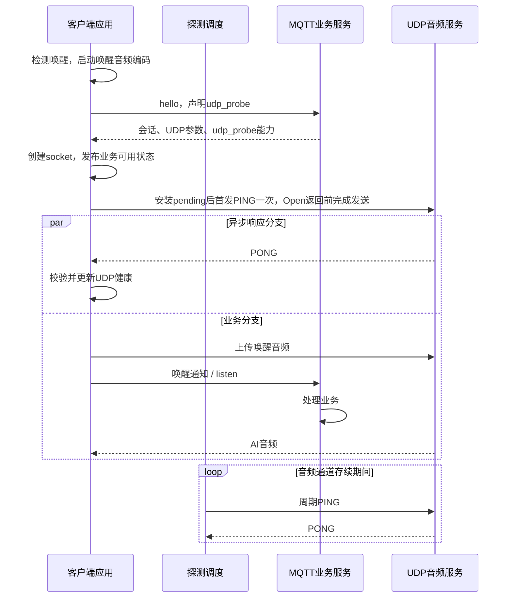

# MQTT/UDP PING/PONG 扩展设计方案

[English](mqtt-udp-probe.md) | [现有 MQTT/UDP 协议](mqtt-udp_zh.md)

**状态：客户端已实现，服务端待实现。** 客户端按本文规范实现，只有协商成功才启用探测。
服务端实现及端到端硬件验证留待下一阶段；下文验收清单不表示所有联调检查均已通过。

## 1. 目标与范围

现有 MQTT hello 成功以及本地 UDP socket 创建成功，不能证明 UDP 音频通道双向可达。
防火墙阻断 UDP 时，MQTT 控制消息仍可能正常，使设备进入对话后持续无声。

本方案增加由客户端主动发起的 UDP 探测：

- 固定 32 字节：复用现有 16 字节头布局，附加 16 字节 HMAC。
- 直接复用现有音频会话 key；HMAC 输入只有包头，没有额外前缀。
- 仅维护一个探测序号，不增加 ACK 字段、随机 challenge、独立密钥或密钥派生流程。
- 首次探测与唤醒业务并发；通道存续期间继续周期探测。
- 双向协商后启用，兼容未支持扩展的客户端和服务端。

`type=0x01` 的音频格式及 AES-CTR 流程保持现有定义。探测只验证 UDP 往返，不保证音频
解码、扬声器播放、所有包长或持续音频流的质量。

## 2. MQTT hello 能力协商

客户端在现有 hello 的 `features` 中增加布尔字段 `udp_probe`：

```json
{
  "type": "hello",
  "version": 3,
  "transport": "udp",
  "features": {
    "mcp": true,
    "udp_probe": true
  },
  "audio_params": {
    "format": "opus",
    "sample_rate": 16000,
    "channels": 1,
    "frame_duration": 60
  }
}
```

服务端支持该扩展且客户端已声明支持时，在 hello 响应中返回 `features.udp_probe: true`：

```json
{
  "type": "hello",
  "transport": "udp",
  "session_id": "example-session",
  "features": {
    "udp_probe": true
  },
  "audio_params": {
    "format": "opus",
    "sample_rate": 24000,
    "channels": 1,
    "frame_duration": 60
  },
  "udp": {
    "server": "udp.example.com",
    "port": 8888,
    "key": "000102030405060708090a0b0c0d0e0f",
    "nonce": "01000000112233440000000000000000"
  }
}
```

示例只展示相关字段，实际 hello 仍包含基础协议要求的其他字段。示例 key 和 nonce 仅用于
说明及测试，不得用于真实会话。

协商规则：

1. 只有客户端声明和服务端响应都为布尔 `true`，才启用探测。
2. 服务端能力缺失或为 `false`，进入 `LEGACY_UNVERIFIED`，不发送 PING/PONG。
3. `features` 存在时必须是对象；`udp_probe` 存在时必须是布尔值，类型错误视为协商错误。
4. 服务端不得要求未声明支持的旧客户端发送 PING。
5. 一旦当前会话协商成功，后续超时或认证失败不得触发静默降级。

hello 的协议版本仍为 `3`。扩展名为 `udp_probe`，没有 `_v1` 后缀；本版不增加
包内版本字段、探测参数对象或额外密钥字段。

## 3. 固定 32 字节包格式

```text
| type 1B | flags 1B | payload_len 2B | ssrc 4B | reserved 4B | probe_seq 4B |
| auth_tag 16B |
```

| 偏移 | 长度 | 字段 | 定义 |
|---:|---:|---|---|
| 0 | 1 | `type` | `0x02`：客户端 PING；`0x03`：服务端 PONG。 |
| 1 | 1 | `flags` | 固定为 `0`。 |
| 2 | 2 | `payload_len` | 固定为 `16`，认证值作为这 16 字节负载。 |
| 4 | 4 | `ssrc` | 当前会话标识，原样复制解码后 `udp.nonce[4:8]` 的四个字节。 |
| 8 | 4 | `reserved` | 固定为全零；复用音频头中 `timestamp` 的位置。 |
| 12 | 4 | `probe_seq` | 无符号 32 位独立探测序号，从 `1` 开始。 |
| 16 | 16 | `auth_tag` | HMAC-SHA256 结果的前 16 个原始字节。 |

所有多字节整数采用网络字节序。SSRC 原字节直接复制；若作为整数解释，也采用网络字节序。
序列化不得依赖语言结构体的内存填充或本机字节序。

数据报实际长度必须严格等于 32；`payload_len` 必须等于 16，`flags` 和 `reserved`
必须为零。没有 `ack_seq` 字段。

服务端必须保证同一 UDP 服务入口的活动 SSRC 可以唯一路由到会话；新建会话时避免冲突。
客户端代码可以确认 SSRC 来自 nonce 的上述位置，但服务端现有索引方式需要联调确认。

## 4. HMAC 与会话密钥

```text
key      = hex_decode(hello.udp.key)       // 当前协议为16字节
header   = datagram[0:16]                 // 已编码为网络字节序的完整头
auth_tag = HMAC-SHA256(key, header)[0:16]
datagram = header || auth_tag
```

HMAC 使用原始密钥字节，不使用 32 个字符的十六进制文本。消息输入严格为完整 16 字节头，
不包含认证值，也不添加用途前缀、session_id、nonce 或其他上下文。

探测包不进入 AES-CTR 加解密流程。头部保持明文，HMAC 覆盖类型、长度、SSRC、保留位和
探测序号。服务端把 PING 类型改成 PONG 后，必须重新计算认证值，不能复制原认证值。

嵌入式可使用 PSA 的 HMAC-SHA256 和 16 字节截断 MAC 接口。当前音频密钥对象限定用于
AES-CTR，因此需要把同一份 16 字节密钥另行导入为 HMAC 密钥对象；这不是额外的协议密钥。
使用标准库验证 MAC，避免普通字符串比较造成认证值比较的时序差异。

每次重置 `probe_seq`，都必须使用此前未使用过的 `(key, SSRC)` 组合。服务端应为新
会话生成新的既有 `udp.key` 和 `udp.nonce`；仅更换 `session_id` 不足以隔离旧探测包。
序号不得回绕；下一轮递增将超出 `UINT32_MAX` 时，先关闭并重新协商会话。

## 5. 请求、应答与重复包

### 5.1 客户端

每个通道只保留一轮 pending 探测。开始一轮时，先保存当前会话代次、原始 PING 头、完整
32 字节数据报和截止时间，再尝试发送，避免快速 PONG 先到而找不到 pending 请求。

UDP 回调入口必须先分流 PONG，不能先等待 `channel_mutex_`（包括音频的会话代次检查）。
`ReceivePong()` 在首次等锁前设置接收标记并记录单调时间，拿锁后先核对回调捕获的探测通道
仍是当前对象，再校验轮次和 HMAC。关闭或重开会更换该对象身份，因此旧回调不能复活通道或
完成新一轮探测；音频分支仍保留原有的会话代次检查。

接收 PONG 时依次执行：

1. 检查长度、类型、固定字段及当前会话 SSRC。
2. 使用当前会话 key 验证 HMAC。
3. 确认头部除 `type=0x03` 外，与 pending PING 的头完全一致。
4. 确认会话代次仍有效，且响应在本轮截止时间之前收到。

全部通过后完成本轮、取消剩余重试、标记 `HEALTHY` 并更新独立 UDP 健康时间。
已完成轮次的重复 PONG、旧会话响应、无 pending 时的响应和过期响应均不得刷新健康时间。
其他无效包只丢弃，不因单个无效包立即终止对话。

每轮认证及匹配成功的 PONG 在 INFO 级别输出一次串口时延日志：

```text
UDP RTT: 42.137 ms
UDP RTT: unknown after retransmission (attempts=2, elapsed=1100.123 ms)
```

未重传轮次以毫秒输出 RTT，保留三位小数，从首次发送尝试开始计时，到接收回调记录的单调
时间结束，包含本地调度/HMAC、服务器响应处理，以及适用时的 4G AT 开销。发生重传时无法
确定 PONG 对应哪次发送，因此只输出发送次数和自首个 PING 起的耗时，不把它作为有效 RTT。
重复、非法、过期及旧会话的 PONG 不输出样本。日志在释放通道锁后打印，复用已有计时状态，
不修改包格式。

### 5.2 服务端

服务端先检查固定格式，再通过 SSRC 找到已协商扩展的会话并验证 HMAC。认证通过后复制
PING 的完整头，仅将 `type` 改成 `0x03`，重新计算 HMAC 并回复。

PING 和音频使用客户端同一个 UDP socket。PONG 必须从 hello 指定的同一个服务端
IP、端口，返回实际收到 PING 的来源地址。服务器立即应答，不等待 ASR、LLM 或 TTS。
探测不得用于改变现有音频目的地址绑定。

相同轮次的有效重复 PING 必须仍能获得 PONG；服务端可以只缓存最近一轮的响应。比最近
轮次更旧的 PING 可以丢弃。不能用音频的序号过滤器拒绝当前轮重传。

探测不触发唤醒、listen、对话创建或音频重传，也不修改音频序号或音频解密状态。

### 5.3 单个序号的含义

首次探测使用 `probe_seq=1`。只有该轮成功，客户端才允许在下一轮使用 `2`，依此类推。
重传不增加序号；一轮最终失败就关闭通道，不跳过失败轮次继续递增。

因此，遵循本协议的客户端发来下一轮新序号，可以间接说明上一轮 PONG 曾被收到，无需
ACK 字段。服务端发送了 PONG 本身不代表它已送达；重复 PING 或客户端停止发送，也不能
单独证明下行阻断。该推断只用于运行诊断，不作为开始 AI 业务的门槛。

## 6. 唤醒业务与探测并发

本方案区分 socket 可供业务使用和 UDP 已验证。保留 `OpenAudioChannel()`、
`IsAudioChannelOpened()`、`OnAudioChannelOpened` 的业务可用语义，不把它们重新定义成
“已收到 PONG”。UDP 健康状态单独维护。



当前同步唤醒路径在 Open 返回后才上传唤醒音频，因此不能在 Open 中增加等待 PONG 的阻塞。
socket 就绪后，探测和原有“唤醒音频上传、MQTT 通知、收听、AI 处理”流程并行推进。正常
业务不额外串行等待一个探测 RTT；4G 共享发送链路时仍可能有调度耗时，需要实测。

所有传输统一使用一次性 `esp_timer`，不创建专用探测任务或任务栈。处理入口只有两个：
`OpenAudioChannel()` 在 socket 就绪后首发一次，以及后续主任务处理可合并的定时事件。
`SendAudio()`、`SendText()` 不调用 `ProcessPending()`，也不操作探测定时器。发送已统一在
主任务，不再增加发送锁或发送繁忙重试。定时器只负责重试、整轮截止和周期探测，不承担业务
空闲计时或主动回收。低内存 C3 不再承担此前 4KB 专用任务栈及任务控制块，但定时器和
会话状态本身仍占用内存。

任何发送路径都不等待 PONG 才继续业务。单次发送仍沿用现有同步 UDP 接口，4G 可能像音频
发送一样等待 AT 响应，这个等待不会发生在定时器回调。主任务调度和发送耗时可能推迟超时
提示，响应是否有效仍按整轮绝对单调截止时间判断。

复用已打开通道时，不要求每次唤醒重新等待 PONG。未开启 `CONFIG_SEND_WAKE_WORD_DATA`
时，探测仍异步运行，只是没有唤醒音频上传这段时间可以重叠。探测重试绝不重复提交唤醒通知。

| 健康状态 | 允许业务收发 | 含义 |
|---|---|---|
| `CLOSED / NEGOTIATING` | 否 | 尚无可用 socket 或会话参数。 |
| `VERIFYING` | 是 | 首次探测进行中。 |
| `HEALTHY` | 是 | 最近一轮已成功，或正在进行尚未超时的周期探测。 |
| `SUSPECT` | 是 | 一次等待超时，正在重试。 |
| `FAILED` | 否 | 本轮总期限耗尽。 |
| `LEGACY_UNVERIFIED` | 是 | 未协商探测能力，沿用旧流程。 |

表中的允许收发仍以原有通道检查（包括接收超时）通过为前提。

首次验证前允许业务开始，因此 UDP 被阻断时仍可能短暂进入对话；该窗口由首轮截止时间
限制，之后明确退出并提示错误，避免持续无声。

## 7. 丢包重试与周期

首次和周期探测共用同一套规则。默认起始配置如下：

| 相对本轮首次发送尝试的时间 | 动作 |
|---:|---|
| `0s` | 首次发送 PING。 |
| `1s` | 尚无有效 PONG，第一次重传。 |
| `3s` | 尚无有效 PONG，第二次重传。 |
| `5s` | 仍无有效 PONG，本轮失败。 |

使用单调时钟；5 秒是整轮总预算，不是每次发送后的独立超时。重试发送完全相同的原包，
不修改序号、头部或认证值。本轮任何一次发送对应的有效 PONG 均可完成探测。

已经成功、取消或超过截止时间的重试任务必须丢弃。发送仍在进行时，不积累多份待发送
重试；重试排队和本地发送耗时不重置总截止时间。发送失败不视为远端确认，可在剩余预算
内按同一重试规则处理。接收回调记录单调时间，PONG 成功与最终超时必须同步仲裁；截止前
收到且通过验证的有效 PONG 必须阻止超时关闭，不能只由主任务处理事件的先后顺序决定结果。

成功后等待 15 秒，再增加 `0–10%` 的正向随机抖动，即默认 15–16.5 秒后开始下一轮。
客户端可以配置 30 秒周期，此时为 30–33 秒；不增加线上的协商字段。

周期探测在静音和持续下行播放期间都运行，通道关闭后停止。若新一轮已开始，不再创建第二
个 pending。不计抖动和调度延迟，15 秒周期加 5 秒预算的故障发现最坏约 20 秒，30 秒周期
约 35 秒；这些是起始参数，Wi-Fi 和 4G 的预算需要实测调整。

单个 PING 或 PONG 丢失只触发重试，不暂停正常业务。持续所有响应都丢失时仍会判定探测
失败；普通音频不能替代双向探测。该错误不等同于确认所有 UDP 报文都被防火墙阻断。

## 8. 超时、空闲与会话关闭

只有有效 PONG 可以完成 UDP 探测，MQTT 消息和音频不能替代它。原有
`Protocol::IsTimeout()` 行为保持不变：入站 MQTT/控制消息或音频更新 `last_incoming_time_`，
出站流量和 PONG 均不更新。`IsAudioChannelOpened()` 对 legacy 和探测通道都继续使用该
120 秒接收超时判断，并额外检查探测失败。实际回收仍由原有生命周期和调用方处理；本扩展
不新增业务活动时钟、空闲回收定时器或主动空闲关闭策略。真正关闭通道时停止探测定时器。

本轮最终失败后报告一次 `udp_probe_timeout`，由当前主任务处理函数直接报错并关闭通道，
不再额外调用一次 `Application::Schedule()`。原有应用回调继续通过状态机进入 Idle 并保留
错误提示。本地 HMAC 计算失败同样直接报告 `udp_probe_auth_error` 并关闭，不降级，也不
误报网络超时。按现有规则发送一次客户端发起的 goodbye；服务端发起的关闭不回发 goodbye。
探测超时只表示验证未成功，不直接证明是防火墙导致或所有 UDP 包都被阻断。

本版失败动作是关闭并提示，不把运行期自动切换 WebSocket 作为已提供的能力。

关闭、取消、重连或网络切换时：

1. 先使当前会话代次失效。
2. 取消定时器和 pending，丢弃已排队的旧重试及发送结果。
3. 安全释放 socket 和密钥对象；旧回调不得修改新会话。
4. 新会话重新 hello，取得满足隔离要求的 key/nonce，再从序号 1 开始。

本地会话代次防止旧任务回调；线上旧包的隔离仍依赖新 `(key, SSRC)`，两者不能互相替代。

## 9. 旧服务端兼容与发布

| 组合或条件 | 行为 |
|---|---|
| 新客户端与新服务端都声明 `udp_probe: true` | 启用认证探测。 |
| 新客户端遇到缺失或为 `false` 的服务端能力 | `LEGACY_UNVERIFIED`，不发送新包，保留旧流程。 |
| 旧客户端连接新服务端 | 保留旧流程，不要求或主动发送探测包。 |
| 能力字段类型非法，或既有 UDP 参数非法 | 协商错误，结束本次打开流程。 |
| 已协商探测，后续持续超时或始终无有效认证响应 | 通道失败，禁止自动退回 legacy。 |

兼容模式不提供 UDP 可达性保证。部署时先让服务端支持可选扩展，再发布客户端。服务端
不得把支持扩展的声明作为省略基础音频会话处理的理由；探测与原有业务并行。

## 10. 实现落点

| 位置 | 所需修改 |
|---|---|
| `main/protocols/mqtt_protocol.h/.cc` | 能力协商、HMAC 对象、控制包分流、单个 pending、健康状态、周期与重试。 |
| `main/application.h/.cc` | 可合并协议事件调用 `ProcessPending()`，复用现有发送上下文；处理失败、关闭和设备状态。 |
| `main/protocols/protocol.h` | `ProcessPending()` 默认空实现，WebSocket 等其他传输不改变既有行为。 |
| 服务端 UDP 入口 | SSRC 会话路由、固定格式与 HMAC 校验、快速 PONG、当前轮重复请求处理。 |
| 基础协议文档中英文版 | 实现完成后更新已支持行为；当前只链接本设计方案。 |

在音频解密和音频序号检查之前按 `type` 分流。控制帧使用固定 32 字节缓冲区和单个 pending，
不依赖 PSRAM，不需要无界请求表。音频 CTR 状态及 `local_sequence_ / remote_sequence_`
不得被探测修改。

定时器和 UDP/AT 接收回调只记录结果、投递事件，不在回调内等待发送、关闭或销毁 socket。
定时器回调不保留协议对象指针，关闭后的陈旧事件只会触发当前协议重新检查状态。Wi-Fi
和 4G 均复用既有应用发送上下文，让 PING 穿插在音频发送之间，不新增发送任务。发送前
取得会话快照，释放通道锁后再调用可能阻塞的 `Send()`。

收包、定时、发送前和发送完成后都检查会话代次。现有对象级存活标记不能替代会话隔离。
服务端 hello 只在等待本次打开响应期间处理，重复响应不得重置正在使用的探测状态。
该接收窗口不是线上请求关联，无法识别恰好落入新窗口的上一轮迟到 hello。基础 hello 流程
仍须保证同一设备的请求与响应不交错，避免旧响应重新安装已用过的 `(key, SSRC)`；本地
会话代次不能解决这个问题。本扩展不新增 hello 请求关联字段。

## 11. 验收与联调

下面是完整扩展的验收要求。客户端主机测试覆盖重试、截止时间、包匹配和认证 PONG 处理；
服务端及实机联调项目仍待执行：

- 用第 12 节向量验证双方编码、网络字节序、16 字节截断及 key 的原始字节解释。
- 修改 type、flags、长度、SSRC、reserved、序号或认证值，确保无效包不刷新健康。
- 验证首个 PING 丢失、首个 PONG 丢失、重复、乱序、迟到及过期响应。
- 用实际注册的 UDP 回调验证跨截止时间的通道锁竞争，并强制定时超时先于接收方获得锁：
  截止前到达者仍有效，真正迟到者拒绝，关闭或重开后的旧阻塞回调不得影响当前会话。
- 验证关闭后旧 PONG、旧发送结果和旧定时任务不影响新会话。
- 分别阻断 UDP 上行、下行和双向流量，同时保持 MQTT 正常，确认及时报错。
- 验证 socket 就绪时首发一次 PING，不等待 PONG 才上传；音频和控制发送函数不处理探测，一次唤醒只创建一次对话。
- 验证未开启唤醒音频上传、长时间静音和持续播放仍有周期探测；PONG 不延长或绕过原有接收超时，不新增主动空闲关闭。
- 覆盖新旧客户端和服务端组合、非法协商，以及已协商后不降级。
- 在 Wi-Fi、4G 实机检查首音延迟、发送拥塞、功耗、网络切换和失败预算。
- 验证没有新增探测任务、一次性截止时间、快速 PONG 重新定时，以及关闭后陈旧事件无害；
  在 C3 实测最小剩余堆及现有任务的栈高水位。
- 实现时运行主机测试并构建代表性 Wi-Fi/4G 路径；共享接口有改动时回归 WebSocket。

成功构建不能代替真实音频和网络硬件验证。

## 12. 联调向量与参考

以下为已用 Python 标准库计算的原始十六进制字节。PING 与 PONG 均为序号 1、
SSRC `11223344`、reserved 全零；完整数据报为 header 后直接拼接 tag。

```text
key:
000102030405060708090a0b0c0d0e0f

PING header:
02000010112233440000000000000001
PING tag:
daef4dd63a34feb152d16095500e9506

PONG header:
03000010112233440000000000000001
PONG tag:
7cd8501761355f1009447bad2c4f8a56
```

参考编码及 PONG 匹配，参数均为解码后的原始字节或整数。`pending_ping` 必须是本地为当前轮
生成的有效 32 字节请求；调用方还须检查会话代次、pending 是否存在及单调时钟截止时间：

```python
import hashlib
import hmac
import struct


def encode_probe(kind, key, ssrc, probe_seq):
    if kind not in (0x02, 0x03):
        raise ValueError("invalid probe type")
    if len(key) != 16 or len(ssrc) != 4:
        raise ValueError("invalid key or SSRC length")
    if not 1 <= probe_seq <= 0xFFFFFFFF:
        raise ValueError("invalid probe sequence")
    header = struct.pack("!BBH4sII", kind, 0, 16, ssrc, 0, probe_seq)
    return header + hmac.new(key, header, hashlib.sha256).digest()[:16]


def matches_pending_pong(data, pending_ping, key):
    if len(data) != 32 or len(pending_ping) != 32 or len(key) != 16:
        return False
    if data[0] != 0x03 or data[1:16] != pending_ping[1:16]:
        return False
    expected = hmac.new(key, data[:16], hashlib.sha256).digest()[:16]
    return hmac.compare_digest(data[16:], expected)
```

- [PSA MAC 接口](https://arm-software.github.io/psa-api/crypto/1.2/api/ops/macs.html)
  提供 HMAC 计算、截断和验证能力。
- [RFC 8489 §6.2.1](https://www.rfc-editor.org/rfc/rfc8489.html#section-6.2.1)
  可供参考 UDP 请求重传与退避；本文的三次发送、5 秒预算是产品起始配置，并非 STUN 默认值。
- [RFC 8085 §3.5](https://www.rfc-editor.org/rfc/rfc8085.html#section-3.5)
  讨论 UDP 保活频率和随机抖动；周期探测不保证适配所有 NAT 超时策略。
