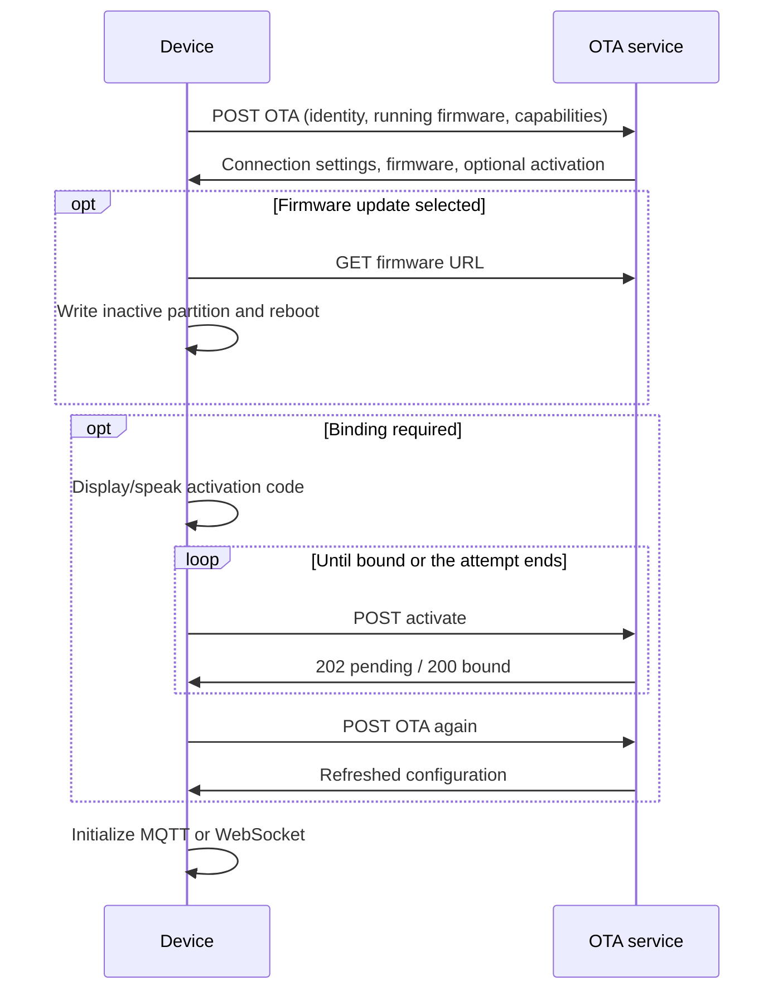

# OTA Configuration, Activation, and Firmware Updates

[简体中文](ota_zh.md)

The OTA endpoint supplies connection settings, activation information and an optional firmware URL.
Firmware binaries are downloaded separately. This guide describes the device-facing HTTP interface.

## 1. Endpoints and startup

| Endpoint example | Use |
|---|---|
| `POST /xiaozhi/ota/` | Query configuration and firmware. |
| `POST /xiaozhi/ota/activate` | Check/complete activation. |
| `GET /xiaozhi/ota/`, if offered | Service health; its response is not the POST configuration. |

The prefix is deployment-specific. Firmware uses a valid saved `wifi.ota_url`, otherwise
`CONFIG_OTA_URL`; activation appends `activate`, inserting a slash when needed.



The application applies assets through their separate path before OTA checks. Connection settings
are saved in NVS and reused on reconnect. Bound devices normally receive no `activation` object;
a returned code/challenge keeps the application in its activation loop.

## 2. Query request

### 2.1 Headers and identity

| Header | Value |
|---|---|
| `Device-Id` | Hardware MAC: six colon-separated hexadecimal pairs. |
| `Client-Id` | **Required** for query and activation: persisted UUID v4 of the firmware client instance. |
| `User-Agent` | `BOARD_NAME/firmware-version`, also a fallback for board/version identification. |
| `Accept-Language` | Locale, for example `zh-CN`. |
| `Content-Type` | `application/json`. |
| `Activation-Version` | `1` without a usable textual serial number, otherwise `2`. |
| `Serial-Number` | Present when the configured eFuse field supplies a usable serial number. |

Generate and persist `Client-Id` once. Normal reboot, reconnect and OTA preserving NVS keep it;
clearing those settings creates a new identity. It is not derived from the firmware version.
A body `uuid` must match this header and cannot replace it.

```http
POST /xiaozhi/ota/ HTTP/1.1
Device-Id: 02:00:00:00:00:01
Client-Id: 11111111-2222-4333-8444-555555555555
User-Agent: example-wifi-board/2.5.4
Accept-Language: zh-CN
Activation-Version: 1
Content-Type: application/json
```

### 2.2 Complete request body

This is a common ESP32 request example. Board, chip and partition values vary by firmware:

```json
{
  "version": 2,
  "language": "zh-CN",
  "flash_size": 16777216,
  "minimum_free_heap_size": "65536",
  "mac_address": "02:00:00:00:00:01",
  "uuid": "11111111-2222-4333-8444-555555555555",
  "chip_model_name": "esp32s3",
  "chip_info": {
    "model": 9,
    "cores": 2,
    "revision": 2,
    "features": 18
  },
  "application": {
    "name": "xiaozhi",
    "version": "2.5.4",
    "compile_time": "Nov 12 2026T02:00:00Z",
    "idf_version": "v6.1-beta1",
    "elf_sha256": "0123456789abcdef0123456789abcdef0123456789abcdef0123456789abcdef"
  },
  "partition_table": [
    {"label": "nvs", "type": 1, "subtype": 2, "address": 36864, "size": 16384},
    {"label": "otadata", "type": 1, "subtype": 0, "address": 53248, "size": 8192},
    {"label": "phy_init", "type": 1, "subtype": 1, "address": 61440, "size": 4096},
    {"label": "ota_0", "type": 0, "subtype": 16, "address": 131072, "size": 4128768},
    {"label": "ota_1", "type": 0, "subtype": 17, "address": 4259840, "size": 4128768},
    {"label": "assets", "type": 1, "subtype": 130, "address": 8388608, "size": 8388608}
  ],
  "ota": {
    "label": "ota_0"
  },
  "display": {
    "monochrome": true,
    "width": 128,
    "height": 64
  },
  "board": {
    "type": "example-wifi-board",
    "name": "example-wifi-board",
    "manufacturer": "example",
    "ssid": "ExampleWiFi",
    "rssi": -55,
    "channel": 6,
    "ip": "192.168.1.100",
    "mac": "02:00:00:00:00:01"
  },
  "protocol": {
    "features": {
      "mcp": true,
      "mcp_20260728": true,
      "udp_probe": true,
      "aec": false,
      "glyph_push": true
    }
  }
}
```

| Field | Meaning |
|---|---|
| `version` | Request layout `2`, not firmware, transport, activation or MCP version. |
| `application.version` | Running firmware version. |
| `application.elf_sha256` | Running build identity; not a downloaded binary checksum. |
| `flash_size` | Bytes, numeric. |
| `minimum_free_heap_size` | Currently serialized as a **string**; services may also accept historical numeric telemetry. |
| `chip_info.features` | Hardware bitmask, separate from protocol capabilities. |
| `partition_table` | Byte offsets/sizes and numeric ESP-IDF type/subtype values. |
| `ota.label` | Running partition. |
| `display` | Optional display information. |
| `board` | Stable board identity plus available network information. Cellular boards need not supply Wi-Fi fields. |

`compile_time` follows the existing firmware format, not guaranteed ISO-8601. The common builder
does not emit `psram_size`. A third-party client still needs the identity headers and resolvable
board/running-version information; automatic firmware matching also needs the relevant chip,
flash and partition constraints.

### 2.3 Protocol capabilities

`protocol.features` reports the **running firmware's** complete protocol capability map, from the
same source as hello `features`. It is distinct from hardware bits and OTA-service capabilities:

| Feature | Meaning |
|---|---|
| `mcp` | Device MCP tools. |
| `mcp_20260728` | Modern MCP revision support. |
| `udp_probe` | Authenticated UDP probes; false without that implementation. |
| `aec` | Server AEC build option. |
| `glyph_push` | Available glyph-push resources. |

Values come from build options and active resources, not these sample values or the image offered
for download. Font details remain in hello `text_font`, outside the boolean map.
Services must tolerate absent/unknown capability fields from older/newer clients. This additive
report keeps request `version: 2`.

A service may use the report to coordinate early MQTT version selection; its credential/gateway
agreement is outside this OTA interface. See [MCP connection warmup](mcp-protocol.md#21-optional-gateway-version-hint).

## 3. Configuration response

A complete response awaiting activation, with no firmware update:

```json
{
  "mqtt": {
    "endpoint": "mqtt.example.com:8883",
    "client_id": "mqtt-client-example",
    "username": "<mqtt-username>",
    "password": "<mqtt-password>",
    "publish_topic": "device-server"
  },
  "websocket": {
    "url": "wss://ws.example.com/xiaozhi/v1/",
    "token": "<websocket-token>"
  },
  "server_time": {
    "timestamp": 1794448800000,
    "timezone_offset": 480
  },
  "firmware": {
    "version": "2.5.4",
    "url": ""
  },
  "activation": {
    "code": "123456",
    "message": "xiaozhi.me\n123456",
    "challenge": "22222222-3333-4444-8555-666666666666"
  }
}
```

| Field | Device behavior |
|---|---|
| `mqtt` | Uses `endpoint`, `client_id`, `username`, `password`, `publish_topic`, optional numeric `keepalive` (default 240 seconds). Separate `host`/`port` and `subscribe_topic` are not read. |
| `websocket` | Uses `url`, `token`, optional numeric audio-framing `version` (not MCP version). A nonempty token without spaces gets a `Bearer ` prefix. |
| `server_time` | UTC Unix milliseconds plus `timezone_offset` in minutes east of UTC; `480` means UTC+8. Firmware adds the offset once. |
| `firmware` | Current version and empty URL mean no selected update. |
| `activation` | Optional binding state, described below; omit for a bound device. |

Presence of `mqtt` selects MQTT even if that object is empty. To select WebSocket, omit `mqtt`.
If neither object is present, firmware tries saved MQTT settings. String/numeric settings are
persisted in the matching NVS namespace; omitted properties keep their old values. To clear a
string, send an explicit empty string. Nested objects and booleans are not persisted by this loop.

`mqtt.client_id`, `username` and `password` are **opaque service-issued strings**, saved and passed
to the MQTT client unchanged. This interface defines no decoded username fields, encoding or
signing algorithm. Broker `mqtt.client_id` need not equal the HTTP `Client-Id` UUID.

## 4. Activation

The device displays/speaks `activation.code`; the user binds the device in the service console.
`challenge` is separate from that code and is required to enter the current HTTP activation path,
including v1. Parsed `activation.timeout_ms` does not control the current polling loop.

POST the base URL plus `activate`, with the same identity headers:

### v1: no serial-number proof

Use `Activation-Version: 1` and this body:

```json
{}
```

The service checks binding state; v1 sends no HMAC proof.

### v2: provisioned serial number

Use `Activation-Version: 2`, `Serial-Number` and this body:

```json
{
  "algorithm": "hmac-sha256",
  "serial_number": "EXAMPLE-SERIAL-0001",
  "challenge": "22222222-3333-4444-8555-666666666666",
  "hmac": "1111111111111111111111111111111111111111111111111111111111111111"
}
```

The HMAC shown is a placeholder. Firmware computes HMAC-SHA256 over the challenge string with
the provisioned hardware key (key-0 path where supported), then sends 32 bytes as 64 lowercase
hex characters. Supplying a serial-number header does not provision the key; the service verifies
the serial, challenge and proof according to its provisioning policy.

### Responses

HTTP `202`: still waiting for binding, for example after the service's current wait expires:

```json
{
  "message": "Device activation timeout"
}
```

HTTP `200`: binding complete:

```json
{
  "message": "Device activated",
  "device_id": 12345
}
```

Here `device_id` is the service record ID, not the MAC. Firmware uses the HTTP status: `202` is
pending, `200` completes activation, other statuses fail. It then queries OTA again for updated
configuration. A `202` from the configuration endpoint is not activation success.

## 5. Firmware download

When selecting an update, replace the response's `firmware` object with:

```json
{
  "firmware": {
    "version": "2.5.5",
    "url": "https://firmware.example.com/example-wifi-board/2.5.5.bin"
  }
}
```

- Match the actual board, chip, flash and inactive OTA-partition size. Board identity is part of
  OTA compatibility; assets use a separate path/artifact.
- Versions are dot-separated integers; suffixes such as `-beta` are unsupported. Extra components
  count as newer (`2.5.4.0` versus `2.5.4`), so keep a consistent format.
- Numeric `firmware.force: 1`, with string version/URL, overrides comparison, including equal or older versions.
- Binary GET must return `200` and a known nonzero Content-Length. Firmware writes the inactive
  partition, validates the image with ESP-IDF, selects it for boot and reboots on success.
- The next successful version check marks a pending image valid. This response defines no separate
  downloaded-image checksum/signature field consumed by current firmware.

## 6. Errors, retries and testing

| Outcome | Behavior |
|---|---|
| Query `200` with valid JSON | Parse connection, activation and firmware settings. |
| Query non-`200`, transport failure or invalid JSON | Failed version-check attempt. |
| Activation `202` / `200` | Pending / complete. |
| Other activation status | Failure; use the service response for diagnostics. |
| Download status, length, write or image-validation failure | Upgrade fails. |

Startup version checks allow ten consecutive failures; delay starts at ten seconds and doubles.
Each outer query loop allows ten activation attempts, waiting three seconds after `202`, ten after
other failures, then querying OTA again. Exhausted version checks may fall back to saved MQTT settings.
Services should use HTTP error statuses; firmware does not require a particular error-body layout.

Save the request body above as `ota-request.json` for a smoke test:

```sh
curl --request POST 'https://ota.example.com/xiaozhi/ota/' \
  --header 'Content-Type: application/json' \
  --header 'Device-Id: 02:00:00:00:00:01' \
  --header 'Client-Id: 11111111-2222-4333-8444-555555555555' \
  --header 'User-Agent: example-wifi-board/2.5.4' \
  --header 'Accept-Language: zh-CN' \
  --header 'Activation-Version: 1' \
  --data-binary @ota-request.json
```

Test query, no-update/update, MQTT/WebSocket selection, v1/v2 activation and pending statuses,
retries, cached credentials and rollback against a test service and actual hardware.
Source owners: [HTTP/activation/download](../main/ota.cc), [startup](../main/application.cc),
[request information](../main/boards/common/board.cc).
