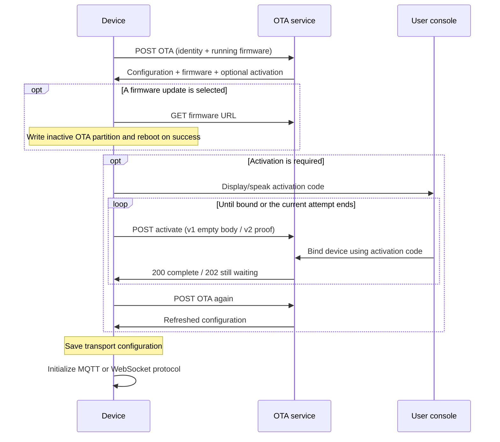

# OTA Configuration, Activation, and Firmware Updates

[简体中文](ota_zh.md)

This document describes the device-facing OTA HTTP interface used by this repository's firmware,
reviewed on 2026-11-13. Sections 1–9 describe the interface and firmware behavior;
section 10 describes implemented device capability reporting and its service integration boundary.

All identities, URLs, firmware data, and credentials below are illustrative.
Credential placeholders are not usable login credentials.

## 1. What the OTA endpoint does

The OTA request is also a bootstrap/configuration request. It can return MQTT/WebSocket connection
parameters, activation instructions, local-time information, and a firmware update in one response.

| Operation | Device-facing path example |
|---|---|
| Query device configuration and firmware | `POST /xiaozhi/ota/` |
| Check activation/binding completion | `POST /xiaozhi/ota/activate` |
| Health check, if provided by the service | `GET /xiaozhi/ota/` |

The path prefix is deployment configuration, not a fixed firmware path.
Point the firmware at the externally reachable OTA URL.

Firmware reads the saved `wifi.ota_url` when valid, otherwise `CONFIG_OTA_URL` (configured through
ESP-IDF menuconfig). Invalid saved values are ignored in favor of the default. Activation appends
`activate` to that base, inserting a slash when necessary. Devices with no custom URL UI can still
use the build-time default; a custom-URL interface is board-specific.

Use POST for device configuration. A service may expose a separate GET health response;
it must not be interpreted as the POST configuration response. The common ESP32 implementation
posts its system information.

## 2. Boot and configuration flow



The application checks/applies assets, performs the OTA query/activation loop, and then initializes
the transport. Assets are a separate download/configuration path, not a field consumed from this
OTA response. Connection parameters are persisted in NVS; a later MQTT reconnect reuses them.

When both `mqtt` and `websocket` are present, current firmware chooses MQTT. If only `websocket`
is present it chooses WebSocket. If neither is present, it falls back to the MQTT implementation
using saved settings; that succeeds only if usable settings exist.

An already bound device normally receives no `activation` object. Returning an activation code or
challenge keeps the application in its activation loop. Do not return a code for a device that
should enter normal operation.

## 3. Device request

### 3.1 HTTP headers

| Header | Firmware value and server usage |
|---|---|
| `Device-Id` | MAC-form device identity; the server requires six colon-separated hexadecimal pairs. |
| `Client-Id` | **Required** on both the OTA query and activation endpoints. A persisted UUID v4 identifying the firmware client instance. |
| `User-Agent` | `BOARD_NAME/firmware-version`. Also used as a server fallback for board/version identification. |
| `Accept-Language` | Firmware locale, for example `zh-CN`. |
| `Content-Type` | `application/json`. |
| `Activation-Version` | `1` without a usable textual serial number; `2` when the current firmware detects one in the configured eFuse field. |
| `Serial-Number` | Sent when a usable serial number is available. |

`Client-Id` is the firmware client's unique identity; `Device-Id` identifies the hardware device.
Generate and persist the client UUID once, and keep it unchanged across normal reboots, reconnects,
and OTA upgrades that preserve persistent settings. Clearing those settings creates a new client
identity. Do not generate an ID per request or derive it from the firmware version.
When the request body includes `uuid`, it must match the `Client-Id` header; the body field does
not replace the required header.

A device request example (Host and Content-Length are managed by the HTTP client):

```http
POST /xiaozhi/ota/ HTTP/1.1
Device-Id: 02:00:00:00:00:01
Client-Id: 11111111-2222-4333-8444-555555555555
User-Agent: example-wifi-board/2.5.4
Accept-Language: zh-CN
Activation-Version: 1
Content-Type: application/json
```

### 3.2 Complete current ESP32 request body

This example follows the current common system-information builder. A different board/target has
different partition and board data. It includes the protocol-capability map from the same source as transport hello.

```json
{
  "version": 2,
  "language": "zh-CN",
  "flash_size": 16777216,
  "minimum_free_heap_size": "65536",
  "mac_address": "02:00:00:00:00:01",
  "uuid": "11111111-2222-4333-8444-555555555555",
  "chip_model_name": "esp32s3",
  "chip_info": {
    "model": 9,
    "cores": 2,
    "revision": 2,
    "features": 18
  },
  "application": {
    "name": "xiaozhi",
    "version": "2.5.4",
    "compile_time": "Nov 12 2026T02:00:00Z",
    "idf_version": "v6.1-beta1",
    "elf_sha256": "0123456789abcdef0123456789abcdef0123456789abcdef0123456789abcdef"
  },
  "partition_table": [
    {
      "label": "nvs",
      "type": 1,
      "subtype": 2,
      "address": 36864,
      "size": 16384
    },
    {
      "label": "otadata",
      "type": 1,
      "subtype": 0,
      "address": 53248,
      "size": 8192
    },
    {
      "label": "phy_init",
      "type": 1,
      "subtype": 1,
      "address": 61440,
      "size": 4096
    },
    {
      "label": "ota_0",
      "type": 0,
      "subtype": 16,
      "address": 131072,
      "size": 4128768
    },
    {
      "label": "ota_1",
      "type": 0,
      "subtype": 17,
      "address": 4259840,
      "size": 4128768
    },
    {
      "label": "assets",
      "type": 1,
      "subtype": 130,
      "address": 8388608,
      "size": 8388608
    }
  ],
  "ota": {
    "label": "ota_0"
  },
  "display": {
    "monochrome": true,
    "width": 128,
    "height": 64
  },
  "board": {
    "type": "example-wifi-board",
    "name": "example-wifi-board",
    "manufacturer": "example",
    "ssid": "ExampleWiFi",
    "rssi": -55,
    "channel": 6,
    "ip": "192.168.1.100",
    "mac": "02:00:00:00:00:01"
  },
  "protocol": {
    "features": {
      "mcp": true,
      "mcp_20260728": true,
      "udp_probe": false,
      "aec": false,
      "glyph_push": true
    }
  }
}
```

Important field meanings:

| Field | Current behavior |
|---|---|
| `version` | Request layout marker, currently `2`; not the firmware, MQTT, activation, or MCP version. |
| `application.version` | Running firmware version, used to decide whether an update is newer. |
| `application.elf_sha256` | Build identity from the running image's app description. Not a downloaded `.bin` checksum supplied by this endpoint. |
| `flash_size` | Bytes, numeric. The ordinary board-firmware matching path uses this value. |
| `minimum_free_heap_size` | The current common firmware serializes this as a **string**. Historical examples used a number; servers should accept either for telemetry. |
| `chip_info.features` | Chip hardware bitmask, unrelated to protocol `features`. |
| `partition_table` | Partition offsets/sizes in bytes, with numeric ESP-IDF type/subtype values. |
| `ota.label` | Running partition label, not a declaration of OTA capabilities. |
| `display` | Optional board capability. Do not assume a screen exists. |
| `board` | Board identity plus available connection information; Wi-Fi fields are not required on cellular devices. |

The common builder does not currently emit `psram_size`, although historical documents listed it.
`compile_time` is the existing firmware-formatted build stamp, not a guaranteed ISO-8601 timestamp.
Cellular boards may supply modem and cell data (for example `board.cereg`) instead of SSID/RSSI.

### 3.3 Minimal third-party client example

Use the same identity headers: both `Device-Id` and `Client-Id` are required for configuration
queries and activation. Configuration access also needs a resolvable board identity/running version.
This minimal body is for configuration access, not a promise of an automatic firmware match without
chip/flash/partition information:

```json
{
  "application": {
    "version": "2.5.4"
  },
  "board": {
    "type": "example-wifi-board",
    "name": "example-wifi-board"
  }
}
```

## 4. Successful configuration response

### 4.1 MQTT/WebSocket configuration and no update

A response can contain both transport objects; firmware chooses MQTT first.
A service may return only the desired transport. The empty firmware URL below means that no
update was selected.

```json
{
  "mqtt": {
    "endpoint": "mqtt.example.com:8883",
    "client_id": "mqtt-client-example",
    "username": "<mqtt-username>",
    "password": "<mqtt-password>",
    "publish_topic": "device-server"
  },
  "websocket": {
    "url": "wss://ws.example.com/xiaozhi/v1/",
    "token": "<websocket-token>"
  },
  "server_time": {
    "timestamp": 1794448800000,
    "timezone_offset": 480
  },
  "firmware": {
    "version": "2.5.4",
    "url": ""
  }
}
```

MQTT fields are `endpoint`, `client_id`, `username`, `password`, `publish_topic` and optionally
`keepalive` (firmware default `240` seconds). Use `endpoint`, not separate `host`/`port` fields from
older examples. Current firmware does not read a `subscribe_topic` OTA setting.

The firmware stores string and numeric properties under the respective `mqtt` / `websocket` NVS
namespace. It does not clear omitted properties, and does not persist nested objects/booleans through
this generic loop. Use explicit empty strings when intentionally clearing a string value.

`mqtt.client_id`, `mqtt.username` and `mqtt.password` are opaque strings supplied by the service.
The firmware saves them and passes them to the MQTT client unchanged. The OTA interface does not
define a username payload, require it to be decodable, or specify a credential encoding or signing
algorithm. Do not parse, reconstruct or re-sign these values on the device.

The required HTTP `Client-Id` remains the firmware client's persisted UUID.
`mqtt.client_id` is the broker-facing login identifier; it need not equal that HTTP header or
follow a particular concatenation format.

### 4.2 WebSocket-only deployment

To select WebSocket on current firmware, omit the `mqtt` object rather than merely returning an
empty MQTT object. A valid response example is:

```json
{
  "websocket": {
    "url": "wss://ws.example.com/xiaozhi/v1/",
    "token": "<websocket-token>",
    "version": 1
  },
  "server_time": {
    "timestamp": 1794448800000,
    "timezone_offset": 480
  },
  "firmware": {
    "version": "2.5.4",
    "url": ""
  }
}
```

`websocket.version` is the audio transport framing version, not the MCP version. The server's
base response need not include it; firmware uses its existing default/saved setting.
A nonempty WebSocket token without spaces receives a `Bearer ` prefix from the client.

### 4.3 Server time

POST `server_time.timestamp` is Unix UTC milliseconds, with no time-zone offset already added.
`timezone_offset` is minutes east of UTC (west is negative): `480` means UTC+8, `330` means UTC+5:30.
Current firmware adds `timezone_offset * 60 * 1000` when setting its local clock. Adding the offset
on the server as well would apply it twice.

The service supplies the applicable offset; the firmware consumes the numeric offset rather
than a `timezone` name. A later OTA query can refresh a daylight-saving offset;
the response does not itself schedule future DST transitions.

## 5. Activation and binding

### 5.1 OTA response requesting activation

The service returns this additional object when binding is required. Other normal response fields
remain present; this example is a complete MQTT response awaiting activation:

```json
{
  "mqtt": {
    "endpoint": "mqtt.example.com:8883",
    "client_id": "mqtt-client-example",
    "username": "<mqtt-username>",
    "password": "<mqtt-password>",
    "publish_topic": "device-server"
  },
  "server_time": {
    "timestamp": 1794448800000,
    "timezone_offset": 480
  },
  "firmware": {
    "version": "2.5.4",
    "url": ""
  },
  "activation": {
    "code": "123456",
    "message": "xiaozhi.me\n123456",
    "challenge": "22222222-3333-4444-8555-666666666666"
  }
}
```

The device displays/speaks the code; the user adds the device in the console. The challenge is
distinct from the displayed code. Current firmware will call `activate` only when a challenge was
received, including the serial-less v1 path. A code-only historical response is not enough to
exercise that HTTP polling path. `activation.timeout_ms` is parsed by firmware but does not
currently control the request/poll loop.

### 5.2 Activation v1 (no serial-number proof)

POST to the base OTA URL plus `activate` using the same Device-Id/Client-Id and normal headers.
The JSON body is:

```json
{}
```

The server checks the device's binding state; there is no HMAC proof in this v1 body.

### 5.3 Activation v2 (provisioned serial number and HMAC)

Send `Activation-Version: 2` and `Serial-Number` on the OTA request when the firmware has a usable
serial number. The activation request body produced by the firmware is shaped as follows:

```json
{
  "algorithm": "hmac-sha256",
  "serial_number": "EXAMPLE-SERIAL-0001",
  "challenge": "22222222-3333-4444-8555-666666666666",
  "hmac": "1111111111111111111111111111111111111111111111111111111111111111"
}
```

The shown HMAC is a placeholder. Firmware computes HMAC-SHA256 over the challenge string using
the provisioned hardware key and serializes 32 output bytes as 64 lowercase hex characters.
The checked implementation uses the platform hardware HMAC/key-0 path where supported; setting a
header or inventing a serial number does not provision that capability. Unsupported or unprovisioned
targets must not be assumed to produce a valid v2 proof.

The activation service verifies the submitted serial number, challenge and HMAC according to
its provisioning policy. Activation proof and MQTT login credentials serve different purposes.

### 5.4 Activation responses

While the user has not completed binding, the service can hold the request and return HTTP `202`
when its current wait ends, for example:

```json
{
  "message": "Device activation timeout"
}
```

HTTP `200` means binding completed:

```json
{
  "message": "Device activated",
  "device_id": 12345
}
```

Here `device_id` is the service's numeric device-record ID, not the MAC header.
Firmware primarily uses the HTTP status: `202` means another activation attempt may be made;
`200` completes the attempt; other statuses are failures. It then re-queries OTA to obtain the
next configuration/activation state. Do not treat a `202` on the configuration query endpoint as
activation success.

## 6. Firmware selection and download

For no update, a service can return the current firmware version with an empty URL.
When an update is selected, that object becomes:

```json
{
  "firmware": {
    "version": "2.5.5",
    "url": "https://firmware.example.com/example-wifi-board/2.5.5.bin"
  }
}
```

The device compares dot-separated integer version components. Use ordinary numeric dotted
versions: suffixes such as `-beta` are not supported by this firmware comparator. Its current
comparison also treats extra components as newer (`2.5.4.0` versus `2.5.4`); use one consistent
version format across service and firmware.

The firmware can additionally honor numeric `firmware.force: 1` when version and URL are strings;
that can override normal version comparison, including for an equal or older version.
Services should send it only when that override is intended.

The service should select an artifact appropriate for board identity, chip, flash and partition
constraints. A returned URL is not permission to reuse another board's firmware: board identity
is OTA compatibility API. Update policy is service-specific; a no-update response can still provide
the normal connection settings.

Firmware downloads with GET, expects HTTP `200` and a nonzero known body length, and writes the next
inactive OTA partition. The present downloader relies on the HTTP client's body length, so provide
a valid Content-Length rather than an indeterminate stream. After SDK image validation and boot
partition selection succeed, the application reboots. A firmware image must fit the target's
inactive OTA partition; the assets partition is a separate artifact.

On the next successful version-check path, the firmware marks an image pending verification as
valid. This is not a claim that capture/playback and all hardware have been tested. The OTA response
does not currently define a separate downloaded-image hash/signature field consumed by this code.

## 7. Errors and retries

Services indicate failure with an HTTP error status. This is an example HTTP `400` body;
the firmware does not require this exact error-body layout:

```json
{
  "success": false,
  "error": "Device ID is required",
  "message": "Device ID is required"
}
```

| Endpoint/outcome | Device-visible behavior |
|---|---|
| OTA query `200` with valid JSON | Parse configuration, activation and firmware fields. |
| OTA query non-`200`, transport failure or invalid JSON | Version-check attempt fails; the firmware retries. |
| Activation `202` | Pending, not a fatal binding error. |
| Activation `400` / `404` | Activation failed; consult the service response for the reason. |
| Server `500` | Service failure; never a successful activation/configuration response. |
| Firmware download non-`200`, unknown/zero length or write/validation failure | Upgrade fails; it is not a completed update. |

Current startup version checks stop after ten consecutive failed attempts, with delay starting at ten seconds
and doubling between attempts. Activation is attempted up to ten times per outer query loop, waiting
three seconds after `202` and ten seconds after other failures, before checking OTA state again.
The parsed `activation.timeout_ms` does not replace this logic.

After version-check retries are exhausted, initialization can continue using saved MQTT settings.
Therefore a successful MQTT connection does not prove that this boot obtained fresh OTA credentials.
Do not assume upgrade or activation completed merely because a device remains reachable.

## 8. Implementing or integrating an OTA service

- Require `Client-Id` on both query and activation requests and use it as the firmware client's
  unique identity. Validate that a supplied body `uuid` matches the header.
- Preserve stable board identity and match the running device, not merely the firmware it might
  download next. Use byte counts and correct JSON types for chip/flash/partition matching.
- Return the complete connection settings for the intended transport. Current defaults can
  contain both objects; remember that MQTT takes precedence on this firmware.
- Keep pending binding responses distinct from bound-device responses. Support the activation
  endpoint and statuses if an activation challenge is returned.
- Keep POST timestamps in UTC milliseconds and apply the time-zone offset only once.
- Keep version-query JSON separate from firmware binary downloads. Test both the query and the
  actual binary response length/image compatibility.
- Treat optional, unknown request properties as forward-compatible metadata.
  Acceptance alone does not implement their semantics.

No service deployment, binary upgrade, or eFuse provisioning is performed by the examples.
For local smoke testing, save the body in `ota-request.json` and send it to your own test service:

```sh
curl --request POST 'https://ota.example.com/xiaozhi/ota/' \
  --header 'Content-Type: application/json' \
  --header 'Device-Id: 02:00:00:00:00:01' \
  --header 'Client-Id: 11111111-2222-4333-8444-555555555555' \
  --header 'User-Agent: example-wifi-board/2.5.4' \
  --header 'Accept-Language: zh-CN' \
  --header 'Activation-Version: 1' \
  --data-binary @ota-request.json
```

## 9. Differences from the historical documents

| Historical description/example | Current implementation |
|---|---|
| MQTT `host` / `port` | Firmware reads `endpoint`, plus client ID, credentials and publish topic. |
| Numeric `minimum_free_heap_size` | Current common firmware emits a string. |
| Optional `psram_size` listed | Not emitted by the current common builder. |
| Both transport objects imply a runtime choice | Current application chooses MQTT first when both are present. |
| `timezone` and UTC+8 as `-480` | Firmware consumes the numeric offset; UTC+8 is `480` and is added by the device. |
| `elf_sha256` described as firmware download verification | It identifies the running build; binary download validation is a different path. |
| v1 activation need not accept a challenge | Current firmware requires a challenge to enter HTTP activation polling, but v1 posts `{}`. |
| Code/message-only activation description | Current flow includes challenge and separate `activate` statuses/proof. |
| Historical forced-update exception | Service update policy and the firmware's `force` support are separate. |

Firmware behavior and the device-visible interface take precedence over historical examples.

## 10. Protocol capability reporting

**Device implementation available:** firmware includes `protocol.features` in OTA POST.
Service-side interpretation and gateway integration still require coordinated implementation.
See the [MCP protocol guide](mcp-protocol.md).

### 10.1 Complete protocol feature map in the OTA request

This object is included in the request in section 3; the fragment below is not a replacement
for device identity/application/board information:

```json
{
  "protocol": {
    "features": {
      "mcp": true,
      "mcp_20260728": true,
      "udp_probe": false,
      "aec": false,
      "glyph_push": true
    }
  }
}
```

`protocol.features` is the device's protocol-capability map, using the same definitions/source
as hello `features`. Generate the complete applicable map, not a separate MCP-only subset. Populate
it from the running firmware's build options and active resources; do not copy these sample values.
Hello may serialize the applicable transport subset from that same source, but MQTT prewarm does
not wait for hello. A supplemental hello capability declaration does not select/override the era.

This is distinct from chip hardware bits, the running OTA partition, and any future OTA-service
features. Do not name it `hello_features` or mix vision URLs/tokens into the boolean map.
Keep request layout `version: 2` for this additive optional extension; upgraded servers must
tolerate its absence, and old strict services need compatibility testing.

### 10.2 Service and gateway integration boundary

A service can use the reported capabilities to coordinate with its MQTT gateway and choose a
compatible MCP version before connection-time catalog warmup. How the service conveys that choice
to the gateway is their integration agreement, not part of the OTA credential-string contract.

This document does not define fields inside `username`, require a particular encoding/signature,
or ask firmware to interpret credentials. A gateway that has no trusted early version information
uses the discovery/fallback flow in the [MCP protocol guide](mcp-protocol.md#21-optional-gateway-version-hint).
The optional early-version path is specified there, separately from this OTA interface.

Capability reports describe the currently running firmware, not the update image in `firmware`.
Preserve the ordinary OTA response fields and the opaque-credential behavior when implementing this
extension. Per-call vision configuration remains part of MCP requests, not OTA credentials.

## 11. Sources and validation boundaries

Current firmware owners:

- [OTA HTTP, activation and download](../main/ota.cc)
- [Boot/activation/protocol lifecycle](../main/application.cc)
- [Common request information](../main/boards/common/board.cc)
- [Wi-Fi board information](../main/boards/common/wifi_board.cc)
- [MQTT settings and hello](mqtt-udp.md)
- [WebSocket settings and framing](websocket.md)

Documentation checks cover JSON parsing, bilingual example consistency, links and source review.
They do not exercise a deployed OTA service, activation license, eFuse proof, downloaded image or
physical device. Before shipping a service/firmware change, test query, no-update/update, both
transports, v1/v2 activation and pending statuses, retries, cached credentials and upgrade/rollback.
