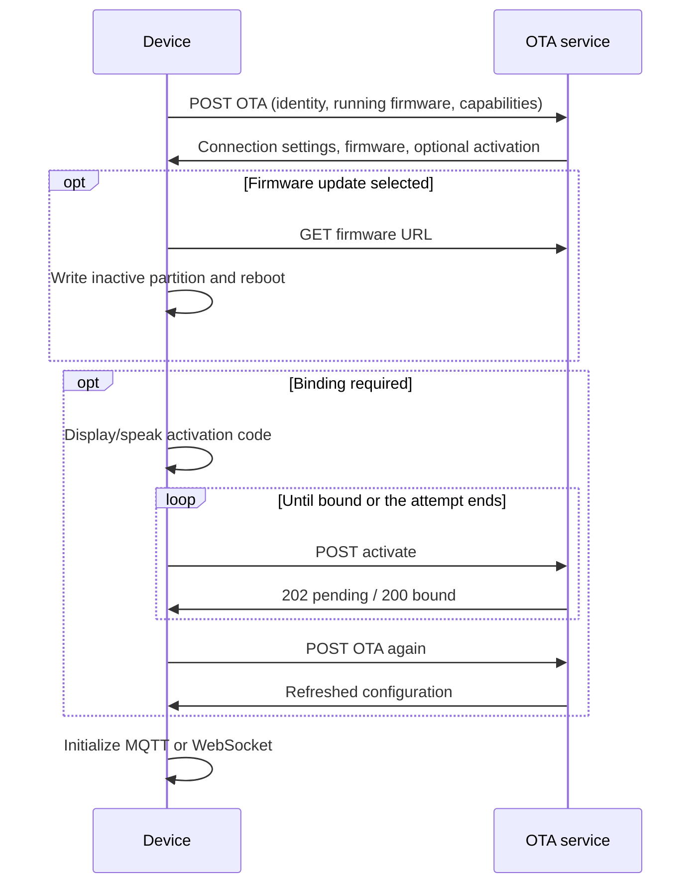

# OTA 配置、激活与固件升级接口

[English](ota.md)

OTA 接口提供连接配置、激活信息及可选固件 URL，固件二进制另行下载。本文定义设备侧 HTTP 接口。

## 1. 地址与启动流程

| 地址示例 | 用途 |
|---|---|
| `POST /xiaozhi/ota/` | 查询配置、固件。 |
| `POST /xiaozhi/ota/activate` | 查询、完成激活。 |
| 可选的 `GET /xiaozhi/ota/` | 服务健康检查，响应不是 POST 配置。 |

路径前缀由部署决定。固件优先使用合法的 `wifi.ota_url`，否则使用 `CONFIG_OTA_URL`；
激活地址在其后追加 `activate`，必要时补斜杠。



应用在 OTA 查询前通过独立路径应用 assets。连接配置持久化到 NVS，重连时复用。
已绑定设备通常不返回 `activation`；返回激活码/challenge 会让应用继续激活循环。

## 2. 查询请求

### 2.1 请求头与身份

| 请求头 | 取值 |
|---|---|
| `Device-Id` | 硬件 MAC，冒号分隔的六组十六进制数字。 |
| `Client-Id` | 查询、激活均**必填**，使用持久化 UUID v4 标识固件客户端实例。 |
| `User-Agent` | `BOARD_NAME/固件版本`，也是服务端识别板型、版本的后备来源。 |
| `Accept-Language` | 语言，如 `zh-CN`。 |
| `Content-Type` | `application/json`。 |
| `Activation-Version` | 无可用文本序列号时为 `1`，否则为 `2`。 |
| `Serial-Number` | 配置的 eFuse 字段存在可用序列号时发送。 |

`Client-Id` 只生成、持久化一次，普通重启、重连和保留 NVS 的 OTA 均保持不变；清除设置后才产生新身份。
它不能由固件版本派生。正文 `uuid` 必须与请求头一致，也不能替代必填请求头。

```http
POST /xiaozhi/ota/ HTTP/1.1
Device-Id: 02:00:00:00:00:01
Client-Id: 11111111-2222-4333-8444-555555555555
User-Agent: example-wifi-board/2.5.4
Accept-Language: zh-CN
Activation-Version: 1
Content-Type: application/json
```

### 2.2 完整请求正文

通用 ESP32 请求示例，板型、芯片、分区取值随固件变化：

```json
{
  "version": 2,
  "language": "zh-CN",
  "flash_size": 16777216,
  "minimum_free_heap_size": "65536",
  "mac_address": "02:00:00:00:00:01",
  "uuid": "11111111-2222-4333-8444-555555555555",
  "chip_model_name": "esp32s3",
  "chip_info": {
    "model": 9,
    "cores": 2,
    "revision": 2,
    "features": 18
  },
  "application": {
    "name": "xiaozhi",
    "version": "2.5.4",
    "compile_time": "Nov 12 2026T02:00:00Z",
    "idf_version": "v6.1-beta1",
    "elf_sha256": "0123456789abcdef0123456789abcdef0123456789abcdef0123456789abcdef"
  },
  "partition_table": [
    {"label": "nvs", "type": 1, "subtype": 2, "address": 36864, "size": 16384},
    {"label": "otadata", "type": 1, "subtype": 0, "address": 53248, "size": 8192},
    {"label": "phy_init", "type": 1, "subtype": 1, "address": 61440, "size": 4096},
    {"label": "ota_0", "type": 0, "subtype": 16, "address": 131072, "size": 4128768},
    {"label": "ota_1", "type": 0, "subtype": 17, "address": 4259840, "size": 4128768},
    {"label": "assets", "type": 1, "subtype": 130, "address": 8388608, "size": 8388608}
  ],
  "ota": {
    "label": "ota_0"
  },
  "display": {
    "monochrome": true,
    "width": 128,
    "height": 64
  },
  "board": {
    "type": "example-wifi-board",
    "name": "example-wifi-board",
    "manufacturer": "example",
    "ssid": "ExampleWiFi",
    "rssi": -55,
    "channel": 6,
    "ip": "192.168.1.100",
    "mac": "02:00:00:00:00:01"
  },
  "protocol": {
    "features": {
      "mcp": true,
      "mcp_20260728": true,
      "udp_probe": true,
      "aec": false,
      "glyph_push": true
    }
  }
}
```

| 字段 | 含义 |
|---|---|
| `version` | 请求布局版本 `2`，不是固件、传输、激活或 MCP 版本。 |
| `application.version` | 当前运行固件版本。 |
| `application.elf_sha256` | 当前构建身份，不是下载二进制的校验值。 |
| `flash_size` | 字节数，数值。 |
| `minimum_free_heap_size` | 当前固件序列化为**字符串**；服务也可接受历史数值遥测。 |
| `chip_info.features` | 硬件位图，与协议能力分开。 |
| `partition_table` | 字节偏移、大小及数值 ESP-IDF type/subtype。 |
| `ota.label` | 当前运行分区。 |
| `display` | 可选显示信息。 |
| `board` | 稳定板型身份及可用网络信息；蜂窝设备不必提供 Wi-Fi 字段。 |

`compile_time` 沿用现有固件格式，不保证 ISO-8601；通用构造器不输出 `psram_size`。
第三方客户端仍需身份请求头和可识别的板型、运行版本；自动匹配固件还需要相应芯片、flash、分区约束。

### 2.3 协议能力

`protocol.features` 上报**当前运行固件**的完整协议能力，与 hello `features` 共用来源，区别于硬件位图和 OTA 服务能力：

| Feature | 含义 |
|---|---|
| `mcp` | 设备 MCP 工具。 |
| `mcp_20260728` | 支持新版 MCP。 |
| `udp_probe` | 认证 UDP 探测，没有对应实现时为 false。 |
| `aec` | 服务端 AEC 编译选项。 |
| `glyph_push` | 可用字形推送资源。 |

取值来自编译选项、已启用资源，不照抄示例，也不描述待下载固件。字体详情仍在 hello `text_font` 中，不放入布尔能力表。
服务应兼容新旧客户端缺失或未知的能力字段；这一增量上报保持请求 `version: 2`。

服务可依据能力上报协调 MQTT 提前选版，但凭据与网关的接入约定不属于 OTA 接口，见 [MCP 连接预热](mcp-protocol_zh.md#21-可选网关版本提示)。

## 3. 配置响应

等待激活、没有固件更新时的完整响应：

```json
{
  "mqtt": {
    "endpoint": "mqtt.example.com:8883",
    "client_id": "mqtt-client-example",
    "username": "<mqtt-username>",
    "password": "<mqtt-password>",
    "publish_topic": "device-server"
  },
  "websocket": {
    "url": "wss://ws.example.com/xiaozhi/v1/",
    "token": "<websocket-token>"
  },
  "server_time": {
    "timestamp": 1794448800000,
    "timezone_offset": 480
  },
  "firmware": {
    "version": "2.5.4",
    "url": ""
  },
  "activation": {
    "code": "123456",
    "message": "xiaozhi.me\n123456",
    "challenge": "22222222-3333-4444-8555-666666666666"
  }
}
```

| 字段 | 设备行为 |
|---|---|
| `mqtt` | 读取 `endpoint`、`client_id`、`username`、`password`、`publish_topic`，以及可选数值 `keepalive`（默认 240 秒）；不读取独立 `host`/`port`、`subscribe_topic`。 |
| `websocket` | 读取 `url`、`token`、可选数值音频封装 `version`（不是 MCP 版本）；非空且不含空格的 token 添加 `Bearer ` 前缀。 |
| `server_time` | UTC Unix 毫秒及向东为正的分钟偏移 `timezone_offset`，`480` 为 UTC+8；固件只叠加一次偏移。 |
| `firmware` | 当前版本、空 URL 表示未选择更新。 |
| `activation` | 可选绑定状态，见下文；已绑定时省略。 |

存在 `mqtt` 对象就优先选择 MQTT，即使对象为空；要选择 WebSocket，需省略 `mqtt`。
两者都没有时尝试已有 MQTT 设置。字符串、数值保存到对应 NVS 命名空间，缺失项保留旧值；
清空字符串要显式传空串。嵌套对象、布尔值不会经此通用循环持久化。

`mqtt.client_id`、`username`、`password` 是**服务下发的不透明字符串**，固件保存并原样传给 MQTT 客户端。
OTA 接口不定义 username 解码字段、编码或签名算法。面向 broker 的 `mqtt.client_id` 不必等于 HTTP `Client-Id` UUID。

## 4. 激活

设备显示、播放 `activation.code`，用户在服务控制台绑定。`challenge` 与激活码不同，
当前 HTTP 激活流程（包括 v1）必须收到 challenge 才会进入。已解析的 `activation.timeout_ms` 不控制当前轮询。

使用相同身份请求头，POST 基础地址加 `activate`：

### v1：不带序列号证明

使用 `Activation-Version: 1`，正文：

```json
{}
```

服务查询绑定状态，v1 不发送 HMAC 证明。

### v2：已预置序列号

使用 `Activation-Version: 2`、`Serial-Number`，正文：

```json
{
  "algorithm": "hmac-sha256",
  "serial_number": "EXAMPLE-SERIAL-0001",
  "challenge": "22222222-3333-4444-8555-666666666666",
  "hmac": "1111111111111111111111111111111111111111111111111111111111111111"
}
```

示例 HMAC 为占位值。固件使用预置硬件密钥（平台支持时走 key-0）对 challenge 字符串计算 HMAC-SHA256，
将 32 字节输出序列化为 64 个小写十六进制字符。填写序列号请求头不会配置硬件密钥；服务按预置策略校验序列号、challenge 和证明。

### 响应

HTTP `202`：仍等待绑定，例如服务本轮等待超时：

```json
{
  "message": "Device activation timeout"
}
```

HTTP `200`：绑定完成：

```json
{
  "message": "Device activated",
  "device_id": 12345
}
```

这里的 `device_id` 是服务记录 ID，不是 MAC。固件依据 HTTP 状态判断：`202` 继续等待，`200` 完成，其他状态失败，
随后重新查询 OTA 获取配置。配置查询接口返回 `202` 不代表激活成功。

## 5. 固件下载

选择更新时，将响应的 `firmware` 对象替换为：

```json
{
  "firmware": {
    "version": "2.5.5",
    "url": "https://firmware.example.com/example-wifi-board/2.5.5.bin"
  }
}
```

- 匹配实际板型、芯片、flash 和空闲 OTA 分区大小。板型身份属于 OTA 兼容接口；assets 使用独立路径、产物。
- 版本使用点分整数，不支持 `-beta` 等后缀；额外分段会视为更新（`2.5.4.0` 比 `2.5.4` 新），需统一格式。
- 数值 `firmware.force: 1` 配合字符串 version/URL 可覆盖版本比较，包括同版或旧版。
- 二进制 GET 需要 HTTP `200` 和已知、非零 Content-Length。固件写入空闲分区，经 ESP-IDF 校验、设置启动分区后重启。
- 下次成功查询版本时，将待验证镜像标记有效。当前响应没有被固件读取的独立下载镜像校验和/签名字段。

## 6. 错误、重试与测试

| 结果 | 行为 |
|---|---|
| 查询 `200`、合法 JSON | 解析连接、激活、固件配置。 |
| 查询非 `200`、传输失败、非法 JSON | 本次版本查询失败。 |
| 激活 `202` / `200` | 等待 / 完成。 |
| 其他激活状态 | 失败，查看服务响应排查。 |
| 下载状态、长度、写入或镜像校验失败 | 升级失败。 |

启动版本查询最多连续失败十次，等待从十秒开始逐次翻倍。
每轮外层查询最多尝试十次激活：`202` 后等三秒，其他失败等十秒，再查询 OTA。
版本查询重试耗尽后可使用已有 MQTT 设置。服务用 HTTP 错误状态表示失败，固件不要求固定错误正文格式。

将上方请求正文保存为 `ota-request.json` 后，可做基本请求测试：

```sh
curl --request POST 'https://ota.example.com/xiaozhi/ota/' \
  --header 'Content-Type: application/json' \
  --header 'Device-Id: 02:00:00:00:00:01' \
  --header 'Client-Id: 11111111-2222-4333-8444-555555555555' \
  --header 'User-Agent: example-wifi-board/2.5.4' \
  --header 'Accept-Language: zh-CN' \
  --header 'Activation-Version: 1' \
  --data-binary @ota-request.json
```

配合测试服务、真机验证配置查询、无更新/更新、MQTT/WebSocket 选择、v1/v2 激活及等待状态、重试、缓存凭据和回滚。
代码入口：[HTTP/激活/下载](../main/ota.cc)、[启动流程](../main/application.cc)、[请求信息](../main/boards/common/board.cc)。
