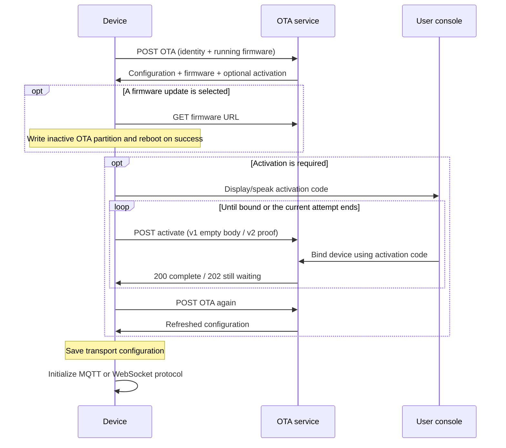

# OTA 配置、激活与固件升级接口

[English](ota.md)

本文面向设备接入开发者，说明本仓库固件使用的设备侧 OTA HTTP 接口，于 2026-11-13 核对。
第 1～9 节说明接口及固件行为；第 10 节说明已实现的设备能力上报及服务端接入边界。

下文设备身份、URL、固件信息、凭据均为示例，凭据占位符不能用于实际登录。

## 1. OTA 接口的职责

OTA 请求同时承担设备引导、配置下发，可在一份响应中提供 MQTT/WebSocket 连接参数、
激活信息、当地时间信息及固件更新。

| 操作 | 设备侧路径示例 |
|---|---|
| 查询设备配置及固件 | `POST /xiaozhi/ota/` |
| 查询激活、绑定是否完成 | `POST /xiaozhi/ota/activate` |
| 健康检查，若服务提供 | `GET /xiaozhi/ota/` |

路径前缀由部署决定，不是固件写死的路径；固件应配置设备实际可访问的 OTA 地址。

固件优先读取合法的 `wifi.ota_url`，否则使用通过 ESP-IDF menuconfig 配置的 `CONFIG_OTA_URL`。
已保存的非法值会被忽略、回退到默认地址。激活地址在该基础上追加 `activate`，必要时补斜杠。
自定义 URL 界面属于板级能力，没有该界面的设备仍可使用编译默认值。

设备配置查询使用 POST。服务可以另行提供 GET 健康检查，
其响应不能当作 POST 配置响应使用。通用 ESP32 实现会 POST 系统信息。

## 2. 启动与配置流程



应用先检查、应用 assets，再执行 OTA 查询、激活循环，最后初始化传输。
assets 有独立的下载、配置路径，不是当前 OTA 响应解析的字段。
连接参数持久化到 NVS，后续 MQTT 重连复用已保存参数。

同时存在 `mqtt`、`websocket` 时，当前固件优先 MQTT；只有 `websocket` 时选择 WebSocket。
两者都没有时，回退为 MQTT 实现、尝试已有设置；只有设置可用时才能连接成功。

已经绑定的设备通常不返回 `activation`。返回激活码或 challenge 会让应用继续激活循环，
需要正常运行的设备不能继续下发激活码。

## 3. 设备请求

### 3.1 HTTP 请求头

| 请求头 | 固件取值及服务端用途 |
|---|---|
| `Device-Id` | MAC 形式的设备身份；服务端要求冒号分隔的六组十六进制数字。 |
| `Client-Id` | OTA 查询、激活接口均**必填**，使用持久化的 UUID v4 标识固件客户端实例。 |
| `User-Agent` | `BOARD_NAME/固件版本`，也是服务端推断板型、版本的后备来源。 |
| `Accept-Language` | 固件语言，如 `zh-CN`。 |
| `Content-Type` | `application/json`。 |
| `Activation-Version` | 没有可用文本序列号时为 `1`；当前固件在对应 eFuse 字段读到可用序列号时为 `2`。 |
| `Serial-Number` | 存在可用序列号时发送。 |

`Client-Id` 是固件客户端的唯一标识，`Device-Id` 标识硬件设备。
客户端 UUID 只生成、持久化一次；普通重启、重连和保留持久化设置的 OTA 升级均保持不变。
清除这些设置后会生成新的客户端身份，不能每次请求重新生成，也不能由固件版本号派生。
请求正文携带 `uuid` 时，必须与 `Client-Id` 请求头一致；正文字段不能替代必填请求头。

请求头示例，Host、Content-Length 由 HTTP 客户端处理：

```http
POST /xiaozhi/ota/ HTTP/1.1
Device-Id: 02:00:00:00:00:01
Client-Id: 11111111-2222-4333-8444-555555555555
User-Agent: example-wifi-board/2.5.4
Accept-Language: zh-CN
Activation-Version: 1
Content-Type: application/json
```

### 3.2 当前 ESP32 完整请求正文

该示例按当前通用系统信息构造器生成；不同板型、芯片的分区及 board 内容不同。
其中协议能力表与传输 hello 使用同一个生成来源。

```json
{
  "version": 2,
  "language": "zh-CN",
  "flash_size": 16777216,
  "minimum_free_heap_size": "65536",
  "mac_address": "02:00:00:00:00:01",
  "uuid": "11111111-2222-4333-8444-555555555555",
  "chip_model_name": "esp32s3",
  "chip_info": {
    "model": 9,
    "cores": 2,
    "revision": 2,
    "features": 18
  },
  "application": {
    "name": "xiaozhi",
    "version": "2.5.4",
    "compile_time": "Nov 12 2026T02:00:00Z",
    "idf_version": "v6.1-beta1",
    "elf_sha256": "0123456789abcdef0123456789abcdef0123456789abcdef0123456789abcdef"
  },
  "partition_table": [
    {
      "label": "nvs",
      "type": 1,
      "subtype": 2,
      "address": 36864,
      "size": 16384
    },
    {
      "label": "otadata",
      "type": 1,
      "subtype": 0,
      "address": 53248,
      "size": 8192
    },
    {
      "label": "phy_init",
      "type": 1,
      "subtype": 1,
      "address": 61440,
      "size": 4096
    },
    {
      "label": "ota_0",
      "type": 0,
      "subtype": 16,
      "address": 131072,
      "size": 4128768
    },
    {
      "label": "ota_1",
      "type": 0,
      "subtype": 17,
      "address": 4259840,
      "size": 4128768
    },
    {
      "label": "assets",
      "type": 1,
      "subtype": 130,
      "address": 8388608,
      "size": 8388608
    }
  ],
  "ota": {
    "label": "ota_0"
  },
  "display": {
    "monochrome": true,
    "width": 128,
    "height": 64
  },
  "board": {
    "type": "example-wifi-board",
    "name": "example-wifi-board",
    "manufacturer": "example",
    "ssid": "ExampleWiFi",
    "rssi": -55,
    "channel": 6,
    "ip": "192.168.1.100",
    "mac": "02:00:00:00:00:01"
  },
  "protocol": {
    "features": {
      "mcp": true,
      "mcp_20260728": true,
      "udp_probe": false,
      "aec": false,
      "glyph_push": true
    }
  }
}
```

主要字段含义：

| 字段 | 当前行为 |
|---|---|
| `version` | 请求结构标记，目前为 `2`，不是固件、MQTT、激活或 MCP 版本。 |
| `application.version` | 当前运行的固件版本，用于比较是否升级。 |
| `application.elf_sha256` | 从运行镜像应用描述取得的构建身份，不是此接口提供的待下载 `.bin` 校验和。 |
| `flash_size` | 字节数，数值类型；普通开发板固件匹配会使用。 |
| `minimum_free_heap_size` | 当前通用固件序列化为**字符串**。历史示例为数值，服务端处理遥测时应兼容两种。 |
| `chip_info.features` | 芯片硬件位掩码，与协议 `features` 无关。 |
| `partition_table` | 地址、大小单位均为字节，type/subtype 使用 ESP-IDF 数值。 |
| `ota.label` | 当前运行分区，不表示 OTA 能力。 |
| `display` | 板级可选能力，不能假定存在屏幕。 |
| `board` | 板型及可用网络信息；蜂窝设备不要求 Wi-Fi 字段。 |

通用构造器目前不输出历史文档列出的 `psram_size`。
`compile_time` 保留固件已有构建时间格式，不保证是 ISO-8601 时间戳。
蜂窝板可以上报模组、基站信息（例如 `board.cereg`），不使用 SSID/RSSI。

### 3.3 第三方客户端最小示例

使用相同的身份请求头：配置查询、激活均必填 `Device-Id` 和 `Client-Id`。
配置接入还需要可解析的板型及运行版本。以下最小正文可用于获取配置，
不表示缺少芯片、闪存、分区信息也一定能匹配自动升级固件：

```json
{
  "application": {
    "version": "2.5.4"
  },
  "board": {
    "type": "example-wifi-board",
    "name": "example-wifi-board"
  }
}
```

## 4. 配置查询成功响应

### 4.1 MQTT/WebSocket 配置及无更新

响应可以同时包含两种传输配置，固件优先选择 MQTT；服务也可只返回希望使用的一种。
下例固件 URL 为空，表示本次没有选中更新。

```json
{
  "mqtt": {
    "endpoint": "mqtt.example.com:8883",
    "client_id": "mqtt-client-example",
    "username": "<mqtt-username>",
    "password": "<mqtt-password>",
    "publish_topic": "device-server"
  },
  "websocket": {
    "url": "wss://ws.example.com/xiaozhi/v1/",
    "token": "<websocket-token>"
  },
  "server_time": {
    "timestamp": 1794448800000,
    "timezone_offset": 480
  },
  "firmware": {
    "version": "2.5.4",
    "url": ""
  }
}
```

MQTT 字段包括 `endpoint`、`client_id`、`username`、`password`、`publish_topic`，
以及可选 `keepalive`（固件默认 `240` 秒）。使用 `endpoint`，不能照搬旧示例的独立 `host`、`port`。
当前固件不读取 OTA 中的 `subscribe_topic` 设置。

固件把字符串、数值属性存入对应的 `mqtt`、`websocket` NVS 命名空间。
省略属性不会清除旧值，这个通用循环也不会保存嵌套对象、布尔值。
需要清空字符串配置时，应明确返回空字符串。

`mqtt.client_id`、`mqtt.username`、`mqtt.password` 都是服务端下发的不透明字符串。
固件保存后原样传给 MQTT 客户端。OTA 接口不定义 username 内部结构，不要求它可解码，
也不约定凭据的编码、签名算法。设备不解析、重组或重新签名这些值。

必填 HTTP `Client-Id` 仍是固件客户端持久化的 UUID。
`mqtt.client_id` 是面向 broker 的登录标识，不要求与该请求头相等，也不要求特定拼接格式。

### 4.2 仅 WebSocket 的部署

当前固件要选择 WebSocket，应省略整个 `mqtt` 对象，不能只返回一个空 MQTT 对象。
完整有效响应示例如下：

```json
{
  "websocket": {
    "url": "wss://ws.example.com/xiaozhi/v1/",
    "token": "<websocket-token>",
    "version": 1
  },
  "server_time": {
    "timestamp": 1794448800000,
    "timezone_offset": 480
  },
  "firmware": {
    "version": "2.5.4",
    "url": ""
  }
}
```

`websocket.version` 是音频传输封装版本，不是 MCP 版本。服务端基础响应不一定携带它，
固件沿用默认或已保存的设置。非空 WebSocket token 没有空格时，客户端自动补 `Bearer ` 前缀。

### 4.3 服务端时间

POST 的 `server_time.timestamp` 是 UTC Unix 毫秒时间戳，尚未叠加时区。
`timezone_offset` 单位是分钟，UTC 以东为正、以西为负：`480` 表示 UTC+8，`330` 表示 UTC+5:30。
当前固件设置本地时间时会再加 `timezone_offset * 60 * 1000`，
服务端不能提前加一次，否则会重复偏移。

服务端提供适用的偏移，固件消费数值偏移而不是 `timezone` 名称。
后续 OTA 请求可以刷新夏令时偏移，响应本身不会安排将来的夏令时切换。

## 5. 激活与绑定

### 5.1 OTA 响应要求激活

需要绑定时，服务端额外返回该对象，其他正常响应字段仍在。
以下为一份等待激活的完整 MQTT 响应：

```json
{
  "mqtt": {
    "endpoint": "mqtt.example.com:8883",
    "client_id": "mqtt-client-example",
    "username": "<mqtt-username>",
    "password": "<mqtt-password>",
    "publish_topic": "device-server"
  },
  "server_time": {
    "timestamp": 1794448800000,
    "timezone_offset": 480
  },
  "firmware": {
    "version": "2.5.4",
    "url": ""
  },
  "activation": {
    "code": "123456",
    "message": "xiaozhi.me\n123456",
    "challenge": "22222222-3333-4444-8555-666666666666"
  }
}
```

设备显示、播报验证码，用户在控制台添加设备。challenge 与显示的验证码不是同一字段。
当前固件只有收到 challenge 才会调用 `activate`，没有序列号的 v1 路径也一样；
历史上仅有 code 的响应不足以触发这条 HTTP 轮询路径。
固件会解析 `activation.timeout_ms`，但目前它并不控制请求、轮询循环。

### 5.2 激活 v1：不带序列号证明

使用相同 Device-Id、Client-Id 及常规请求头，POST 到 OTA 基础地址追加 `activate` 的路径。
JSON 正文为：

```json
{}
```

服务端查询设备绑定状态，v1 正文不带 HMAC 证明。

### 5.3 激活 v2：预置序列号与 HMAC

固件有可用序列号时，在 OTA 请求中发送 `Activation-Version: 2` 和 `Serial-Number`。
固件生成的激活请求正文结构如下：

```json
{
  "algorithm": "hmac-sha256",
  "serial_number": "EXAMPLE-SERIAL-0001",
  "challenge": "22222222-3333-4444-8555-666666666666",
  "hmac": "1111111111111111111111111111111111111111111111111111111111111111"
}
```

上面的 HMAC 是占位值。固件使用预置硬件密钥，对 challenge 字符串计算 HMAC-SHA256，
将 32 字节结果编码为 64 个小写十六进制字符。当前实现在支持的平台使用硬件 HMAC/key-0 路径；
设置请求头或随意填写序列号不会自动配置该能力，不能假定所有目标都能产生有效的 v2 证明。

激活服务按其预置策略验证提交的序列号、challenge 和 HMAC。
激活证明与 MQTT 登录凭据是不同用途。

### 5.4 激活响应

用户尚未完成绑定时，服务可以保持请求等待，并在本次等待结束后返回 HTTP `202`，例如：

```json
{
  "message": "Device activation timeout"
}
```

HTTP `200` 表示绑定已经完成：

```json
{
  "message": "Device activated",
  "device_id": 12345
}
```

这里的 `device_id` 是服务端数值设备记录 ID，不是请求头中的 MAC。
固件主要根据 HTTP 状态处理：`202` 表示可以继续激活尝试，`200` 表示本次完成，
其他状态为失败。随后重新查询 OTA，获取下一份配置、激活状态。
不能把配置查询接口的 `202` 当作激活成功。

## 6. 固件选择与下载

没有更新时，服务可返回当前固件版本及空 URL；选中更新时替换为：

```json
{
  "firmware": {
    "version": "2.5.5",
    "url": "https://firmware.example.com/example-wifi-board/2.5.5.bin"
  }
}
```

设备按点分整数比较版本。应使用普通数字点分版本，当前比较器不支持 `-beta` 等后缀；
它还会把额外段视为更新（如 `2.5.4.0` 相对 `2.5.4`），因此服务端、固件应统一版本格式。

当 version、URL 都是字符串时，固件另外支持数值 `firmware.force: 1`，
可覆盖正常版本比较，包含同版本或旧版本。服务端只有在确实需要覆盖比较规则时才发送它。

服务端应根据板型身份、芯片、闪存及分区约束选择文件。
返回 URL 不代表可以复用其他板型的固件；板型身份属于 OTA 兼容性接口。
更新策略由服务决定，没有更新的响应仍可提供正常连接配置。

固件通过 GET 下载，要求 HTTP `200`、可取得的非零正文长度，再写入下一个非运行 OTA 分区。
当前下载器依赖 HTTP 客户端提供长度，因此下载服务应提供有效 Content-Length，
不能只提供长度未知的流。SDK 镜像校验、启动分区切换成功后，应用重启。
固件必须装得下目标非运行 OTA 分区，assets 分区是独立产物。

下一次成功版本查询路径中，固件会将待验证镜像标为有效，
不表示录放音及所有硬件已经通过测试。当前代码也没有消费 OTA 响应中独立的下载镜像 hash、签名字段。

## 7. 错误与重试

服务端使用 HTTP 错误状态表示失败。以下是 HTTP `400` 正文示例，
固件不要求错误正文必须使用这个具体结构：

```json
{
  "success": false,
  "error": "Device ID is required",
  "message": "Device ID is required"
}
```

| 接口、结果 | 设备处理 |
|---|---|
| OTA 查询 `200` 且 JSON 合法 | 解析连接配置、激活及固件字段。 |
| OTA 查询非 `200`、传输失败或 JSON 非法 | 本次版本查询失败，按固件逻辑重试。 |
| 激活 `202` | 仍在等待，不是致命绑定错误。 |
| 激活 `400`、`404` | 激活失败，具体原因查看服务端响应。 |
| 服务端 `500` | 服务失败，不是激活、配置成功。 |
| 下载非 `200`、长度未知或为零、写入或镜像校验失败 | 升级失败，不能视为更新完成。 |

当前启动版本检查连续失败十次后结束，失败间隔从十秒开始翻倍。
每轮外层查询内最多激活十次，`202` 后等待三秒，其他失败等待十秒，再重新检查 OTA 状态。
解析的 `activation.timeout_ms` 不会替换这些逻辑。

版本检查重试耗尽后，初始化仍可能使用已保存的 MQTT 设置。
因此 MQTT 连接成功不能证明本次启动获得了新 OTA 凭据，
也不能仅凭设备仍在线判断升级、激活已完成。

## 8. 实现、接入 OTA 服务

- 查询、激活均要求 `Client-Id`，用作固件客户端唯一标识；正文有 `uuid` 时校验它与请求头一致。
- 保持板型身份稳定，匹配当前运行设备，不能只看下一次准备下载的固件；
  芯片、闪存、分区匹配使用正确 JSON 类型及字节数。
- 为目标传输返回完整连接参数。当前默认响应可以同时有两个对象，固件会优先 MQTT。
- 区分等待绑定、已经绑定的响应；下发 challenge 时，应实现激活接口及对应状态。
- POST 时间戳使用 UTC 毫秒，时区只叠加一次。
- 区分版本查询 JSON 与固件二进制下载；查询、实际文件长度及镜像兼容性都需要验证。
- 未知可选请求字段作为向前兼容元数据处理；接受字段不等于已经实现它的语义。

示例不会部署服务、执行固件升级或烧录 eFuse。
本地冒烟测试可将正文保存为 `ota-request.json`，向自己的测试服务发送：

```sh
curl --request POST 'https://ota.example.com/xiaozhi/ota/' \
  --header 'Content-Type: application/json' \
  --header 'Device-Id: 02:00:00:00:00:01' \
  --header 'Client-Id: 11111111-2222-4333-8444-555555555555' \
  --header 'User-Agent: example-wifi-board/2.5.4' \
  --header 'Accept-Language: zh-CN' \
  --header 'Activation-Version: 1' \
  --data-binary @ota-request.json
```

## 9. 与历史文档的差异

| 历史描述、示例 | 当前实现 |
|---|---|
| MQTT 使用 `host`、`port` | 固件读取 `endpoint`，以及客户端 ID、凭据、发布主题。 |
| `minimum_free_heap_size` 是数值 | 当前通用固件输出字符串。 |
| 列出可选 `psram_size` | 当前通用构造器没有输出。 |
| 同时返回两种传输后再自行选择 | 当前应用两者都有时优先 MQTT。 |
| 返回 `timezone`，UTC+8 示例为 `-480` | 固件消费数值偏移，UTC+8 为 `480`，由设备叠加。 |
| `elf_sha256` 被描述为下载固件校验 | 它标识运行构建；二进制下载校验走另一条路径。 |
| v1 不需要接受 challenge | 当前固件进入 HTTP 激活轮询仍要求 challenge，但 v1 正文是 `{}`。 |
| 激活只有 code、message | 当前流程还有 challenge、独立 activate 状态及证明。 |
| 历史特殊强制更新例外 | 服务端更新策略与固件支持 `force` 是两回事。 |

固件行为及设备可见的接口约定优先于历史示例。

## 10. 协议能力上报

**设备端已实现：** 固件在 OTA POST 中包含 `protocol.features`。
服务端解释及网关接入仍需配套实现。参见[MCP 改造方案](mcp-protocol_zh.md)。

### 10.1 OTA 请求中的完整协议 feature 映射

第 3 节请求已经包含以下对象。这里只展示该片段，不能替代设备身份、application、board：

```json
{
  "protocol": {
    "features": {
      "mcp": true,
      "mcp_20260728": true,
      "udp_probe": false,
      "aec": false,
      "glyph_push": true
    }
  }
}
```

`protocol.features` 是设备协议能力映射，与 hello `features` 共用定义、来源；
生成完整的适用能力表，不另外维护一份只含 MCP 的子集。
取值来自当前运行固件的编译选项及有效资源，不能照抄示例。
hello 可从同一来源序列化适用传输的子集，但 MQTT 预热不等待 hello，
hello 中的补充能力声明也不选择、覆盖已经确定的代际。

它与芯片硬件位、运行 OTA 分区、未来 OTA 服务自身能力不同。
不命名为 `hello_features`，也不能把视觉 URL/token 混进布尔表。
该可选增量扩展保留请求结构 `version: 2`；升级服务端须兼容缺失字段，
旧严格服务仍需兼容性测试。

### 10.2 服务端与网关的接入边界

服务端可利用上报能力，与 MQTT 网关协作，在连接预热工具目录前选择兼容的 MCP 版本。
服务端如何把这个选择传给网关，属于双方接入约定，不属于 OTA 凭据字符串的格式约定。

本文不定义 `username` 内部字段，不要求特定编码、签名，也不要求固件解释凭据。
网关没有可信的提前版本信息时，使用[MCP 改造方案](mcp-protocol_zh.md#21-可选网关版本提示)
中的发现、回退流程。可选提前版本路径在该方案中单独说明，与 OTA 接口区分。

能力上报描述当前运行固件，不是 `firmware` 中准备升级的镜像。
实现本扩展时，保留普通 OTA 响应字段及凭据原样传递行为。
逐调用 vision 配置仍属于 MCP 请求，不放进 OTA 凭据。

## 11. 来源与验证边界

当前固件的相关实现：

- [OTA HTTP、激活及下载](../main/ota.cc)
- [启动、激活、协议生命周期](../main/application.cc)
- [通用请求信息](../main/boards/common/board.cc)
- [Wi-Fi 板型信息](../main/boards/common/wifi_board.cc)
- [MQTT 配置及 hello](mqtt-udp_zh.md)
- [WebSocket 配置及封装](websocket_zh.md)

文档检查覆盖 JSON 解析、双语示例一致性、链接及源码核对，
不代表已验证部署中的 OTA 服务、激活 license、eFuse 证明、固件下载或真机。
发布服务、固件改动前，应验证查询、无更新及有更新、两种传输、v1/v2 激活及等待状态、
重试、缓存凭据、升级和回滚。
